# BeautyShot 82 - Illustrated user manual

Edition 2 / Edição 2 · 30 October 2026

## 1 · Start here

BeautyShot is a Windows application for presenting 3D assets: materials, lighting, cameras, animation and image or video output. This manual describes the Beta 82 interface. Controls depend on the selected object, material family and renderer; a control that is not relevant may be hidden.

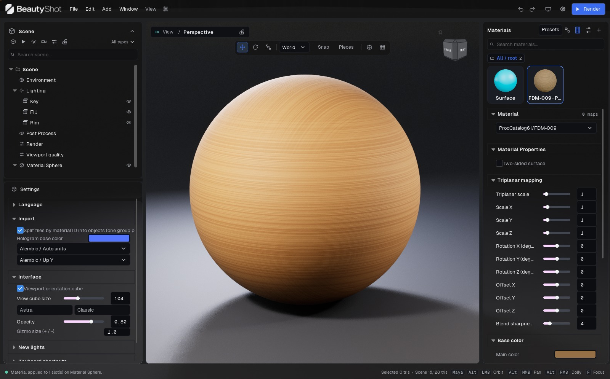

Figure 01. Beta 82 with a library material applied to the demonstration sphere. The viewport and material thumbnail show the wood-colored procedural surface.

### Install and launch

Extract the entire download to a writable folder. Keep the Engine and SculptStudio directories alongside the launcher; copying the executable alone is not an installation. Launch BeautyShot from the extracted folder. Do not run it inside the ZIP. Keep projects and exported images in a separate working folder so that replacing an application version does not replace your work.

The supplied build targets Windows 64-bit and DirectX 12. Progressive and offline path tracing require a supported hardware ray-tracing GPU and driver. DLSS options require compatible NVIDIA hardware. Availability in one renderer does not establish support in another. The reference machine for this release is an RTX 4060 with 8 GB VRAM and 32 GB RAM; this is a tested configuration, not a universal minimum or performance guarantee.

### Your first image

1. Choose File > Import mesh and select a model. Wait for geometry and texture loading to finish.

2. Select a part in Scene, then choose its material slot. Assign the base color, normal and roughness maps in Materials.

3. In Environment, choose an HDRI or a procedural sky. Adjust the lights under Lighting.

4. Navigate to a useful view. Use View > Frame all or frame the selection if the model is outside the view.

5. Create a camera from the current view, set its output size and lock it once the composition is ready.

6. Save the project. In Render choose an image task, camera, output format and destination. Use PNG for a finished display image; choose EXR for linear compositing.

For a texture that already contains painted lighting, use Viewport quality > NPR > Unlit / Hand-painted. Start with white material tint and vertex color disabled. The dedicated workflow is explained in the NPR chapter.

### Read the interface names

The screenshots show the English interface in the Windows Beta 82 build. The Portuguese edition explains the same controls and retains the English label where it helps you find the field. “Scene > Render” means click Render in the left hierarchy; it does not mean press the blue Render button. A section may be farther down the inspector: scroll inside that panel, not over the viewport.

### Guided exercise: a studio image from an imported object

1. Extract the download. Open BeautyShot.exe. Create a working folder for your model, textures, project and exports.

2. Import your mesh and wait until the status bar no longer reports loading. Expand the imported group and select a mesh, then its material slot. You should see the corresponding material selected on the right.

3. Start with Surface and Opaque. For an untextured nonmetal object set Metalness to 0 and Roughness near 0.4. These are practice values, not a preset for every asset. Leave vertex color off unless the model intentionally uses polypaint.

4. Frame the selection with F while the viewport has focus. Orbit until you can read the silhouette. Do not use object rotation just to look around it.

5. Select the Key light in Scene. Move it to one side and adjust its intensity until the main shape reads clearly. Use Fill to recover shadow detail and Rim for separation. Keep the brightest highlight below a featureless white patch.

6. Create a camera from the current view. Choose a crop suited to the delivery and lock the camera after framing. Save the project with Ctrl+S.

7. Click Scene > Render. Select Render images / animation, Image, the intended camera, and PNG. Set a small first output such as 1280 × 720. Select the desired export engine before adjusting its quality.

8. Render to the exports folder. Open the saved file, check framing, materials and background, then raise output resolution for the final image.

### What to keep together

| Item | Purpose | Keep when updating |
| --- | --- | --- |
| Application folder | Launcher, engine and runtime content | Replace as a complete version; never mix arbitrary binaries |
| .sculptstudio project | Scene arrangement and authored settings | Keep your saved project and backups |
| Models and textures | External source resources used by the project | Keep stable paths or create a project package |
| Exported PNG, EXR or video | Finished delivery | Store separately from the application |

If the executable reports a missing VCRUNTIME or MSVCP library, install the Microsoft Visual C++ x64 runtime linked in the download's quick-start instructions. Copying random DLLs into the application folder is not an installation workflow.

## 2 · Workspace and navigation

The menu bar spans the top. Scene and the contextual Object inspector occupy the left; Materials occupies the right. The viewport is in the center, with its camera selector, transform toolbar and navigation cube. The bottom status bar reports imports, texture loading and triangle counts. Timeline opens below the viewport.

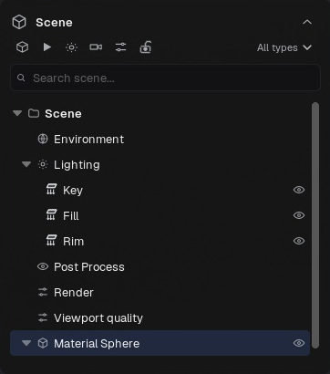

Figure 02. Scene tree: select objects, expand groups, filter entries and toggle visibility.

Click an object to select it. Use the Outliner when overlapping surfaces make picking difficult. Frame the selected object before orbiting around a small detail. The transform toolbar switches move, rotate and scale, coordinate space, snapping, and piece selection. Changing the transform space changes the axes used by the gizmo; it does not rotate the model by itself.

Navigation is configurable. Open Preferences > Navigation to choose a profile, orbit center and focus behavior. The footer shows hints for the active profile. Orbit center can use the view pivot, selection or point under the cursor. Focus can frame a selection or keep the camera position. Dolly drag direction and axis are configurable. Copy bindings or start from a preset before making a custom profile.

Shift + right drag rotates the HDRI. Ctrl + Shift + right drag rotates the lighting rig; the first movement locks the rotation axis until release. The navigation cube selects standard views and its Home control returns to the initial view. Hide it from its menu or change its size in Preferences.

Drag panel separators to resize the workspace. Window can detach Scene/properties or Materials into floating windows, move the application to the next monitor and restore the layout. Named panel layouts store useful arrangements. Restoring a layout changes interface placement, not the scene's object transforms.

Number controls accept typed values; Shift gives finer dragging. A modified-value indicator returns a control to its default. Right-click supported control labels to add or remove Favorites. Use the eyedropper in the color picker to sample a visible color; Esc cancels the pick.

### Navigation without changing the asset

| Action | Where to operate | What changes |
| --- | --- | --- |
| Select a mesh or material slot | Scene hierarchy | Editing target; not camera framing |
| Orbit, pan, dolly | Empty viewport space with the active profile's gesture | View position and orientation |
| Move, rotate, scale | Gizmo or Object numbers | Selected object or group transform |
| World / local | Transform toolbar | Axis basis for the gizmo |
| F / frame selection | Viewport with a selected object | Camera framing around that selection |
| Shift + right drag | Viewport | HDRI orientation |
| Ctrl + Shift + right drag | Viewport | Lighting-rig rotation |

The reference captures use the Maya navigation profile: Alt + left drag orbits, Alt + middle drag pans and Alt + right drag dollies. Other profiles use different gestures. Check the footer after changing profile; do not assume Blender or Toolbag bindings remain active.

### Arrange the workspace for a task

1. Open Window > Panel layouts to save your current arrangement before reorganizing it.

2. For material work, widen Materials by dragging its inside edge. Scroll within Materials to reach channels below Base color.

3. Resize the split between Scene and Object so the hierarchy or the inspector gets the space you need.

4. Use Window > Float / dock Materials if a second monitor is available. The main viewport remains in the main window.

5. Use Window > Reset layout if a panel is difficult to locate. Show/hide commands and reset layout do not delete scene items.

### Edit a number accurately

Click the numeric field and type an exact value when a slider is too coarse. Use Shift while dragging for fine adjustment. A slider's visible travel is a convenience range; some fields accept a wider typed range. Units belong to the particular field: pixels for output and screen effects, centimeters for focus distance, degrees for angles, and dimensionless values for many material multipliers. Check the label before copying a number from another control.

If a control is greyed out, first inspect the selected object, material family and renderer. A disabled path-tracing option can indicate unavailable hardware support; a missing opacity section can simply mean that the material is opaque. Opening a panel does not automatically select a suitable object.

## 3 · Menu reference

### File

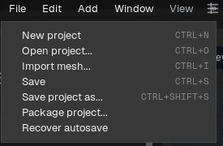

Figure 03. The File menu in the English interface.

New starts a project. Open loads a saved project. Import mesh adds geometry to the current scene. Save updates the current project; Save as creates another project file. Package project collects supported external resources for transfer. Recover autosave opens a recovery copy: inspect it and save under a new name before replacing your main project.

### Edit

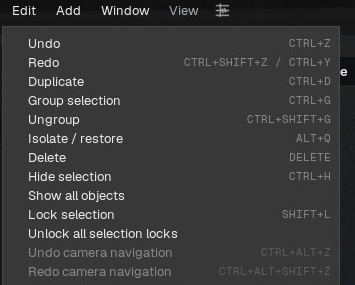

Figure 04. The Edit menu in the English interface.

Undo and Redo traverse edit history. Duplicate creates copies of selected items. Group collects pieces; Ungroup removes the grouping without intentionally deleting its members. Delete removes the selected item; deleting a group also deletes its objects. Isolate and Restore isolate the selection temporarily. Hide, Show all, Lock and Unlock all control visibility and editing. Camera undo/redo is separate from general edit history.

### Add

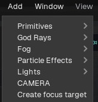

Figure 05. The Add menu in the English interface.

Primitives include sphere, plane, cube and cylinder. Lights include rectangle, point, spot and sun. Camera creates a camera from the current view; a focus target supplies a movable target for depth of field. Effect submenus are populated from the installed library and include local atmosphere/fog assets, particles, god rays and Draw FX. Global volumetric fog is controlled in Environment. Draw FX starts a drawing mode; Stop drawing or Esc ends it. Fire scatter operates on the selected surface where available.

### Window

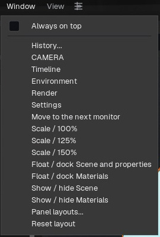

Figure 06. The Window menu in the English interface.

History opens camera/history tools. Camera, Timeline, Environment, Render and Preferences open their panels. Move to next monitor changes the application window's display. Scale offers 100%, 125% and 150%. Detach/reattach Scene and properties and Detach/reattach Materials make those panels float or dock. Show/hide Scene and Show/hide Materials control visibility. Panel layouts manages saved arrangements. Restore layout returns the default docking arrangement.

### View

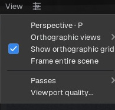

Figure 07. The View menu in the English interface.

Perspective returns to perspective projection. Orthographic views offers Front, Back, Left, Right, Top and Bottom. Show orthographic grid toggles the grid. Frame all fits the visible scene. Passes opens diagnostic viewport channels. Viewport quality opens renderer and performance controls.

### Viewport camera menu

View through chooses Free view, a named scene camera or New camera from current view. Viewport renderer selects Real-time, Progressive path tracing, Hybrid or NPR. Viewport layout selects Single view, Camera preview, Two views or Four views. View options opens preview size, update frequency and lighting controls. The adjacent small padlock locks or unlocks the active render camera.

### Header buttons

Undo, Redo, Show/hide panels, Preferences and Render provide direct access. Render executes the currently configured output task; it is not necessarily a still image. The timeline icon toggles the timeline. Minimize, maximize and close may be supplied by the Windows title bar, depending on window mode.

### File and edit commands: consequences and defaults

| Command | Default shortcut | Result / caution |
| --- | --- | --- |
| New | Ctrl + N | Starts a new project; save current work first |
| Open | Ctrl + O | Loads a project file rather than importing it as geometry |
| Import mesh | Ctrl + I | Adds supported geometry/resources to the current project |
| Save | Ctrl + S | Updates the current project file |
| Save as | Ctrl + Shift + S | Writes a separate project version |
| Package project | Menu command | Collects project resources for transfer; inspect the resulting package |
| Recover autosave | Menu command | Opens recovery data; save a reviewed copy separately |
| Undo | Ctrl + Z | Reverses supported scene edits |
| Redo | Ctrl + Shift + Z / Ctrl + Y | Reapplies an undone edit where available |
| Duplicate | Ctrl + D | Copies the selected scene items |
| Group / Ungroup | Ctrl + G / Ctrl + Shift + G | Changes the selected scene hierarchy |
| Isolate | Alt + Q | Temporarily concentrates on the selected objects |
| Hide | Ctrl + H | Hides selected objects; Show all restores visibility |
| Lock | Shift + L | Protects selection/manipulation; Unlock all removes locks |
| Delete | Delete | Removes the selection; a group includes its contents |
| Camera undo / redo | Ctrl + Alt + Z / Ctrl + Alt + Shift + Z | Traverses camera-view history separately |

Shortcuts are context-sensitive and can be customized. A graph editor, text field or native file dialog can own keyboard focus instead of the viewport. Check Preferences > Keyboard shortcuts for the current installation.

### Layout and view decisions

Use Window > Always on top only when BeautyShot should remain above other windows. Move to next monitor moves the application; detached panels may need their own repositioning. Save a named layout after arranging Scene, Materials, Graph and Timeline. If a detached panel becomes inaccessible after disconnecting a monitor, use Restore/Reset layout.

View > Passes is a diagnostic display selector. It is not the same as selecting EXR output passes in Render. Viewport quality controls interactive rendering. Camera/output controls define the saved shot and export. The main Render button follows the current task, so check that task after switching between stills, animation and capture.

## 4 · Projects, imports and portability

Save early, especially before importing a large asset. A scene project stores composition, assignments and settings; it is not a substitute for your source models and textures. Keep those resources in a stable folder. Use Package project when transferring work to another machine, then open the packaged copy to check that resource paths resolve.

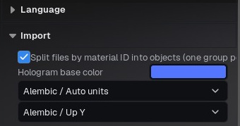

Figure 08. Import preferences: split by material ID, loading hologram color and Alembic interpretation.

Import through File > Import mesh or the supported drop workflow. Use the format filter in the file dialog as the authority for this build. Mesh import and Alembic groom import are different operations; arbitrary animation or grooming data is not interchangeable with a static mesh. Import preferences control splitting by parts/material IDs. A character can therefore appear as a group containing separately editable pieces and slots.

The hologram is a loading preview. Geometry availability does not mean that all textures are ready. Check the bottom progress indicator and wait before evaluating a material or beginning the final render. Very large sources may need substantial RAM, VRAM and loading time even when the final visible asset appears simple.

Reimport selected updates an object from its source while retaining its placement and assigned materials. Reimport only this piece targets a component of a multipart source. The source-part selector and material mapping determine which incoming piece and materials replace the previous ones. Check these mappings before committing a reimport after renaming parts in the authoring application.

For missing files, restore the resource at its saved path or replace the channel/source with the new location. Save a corrected copy and package it again. An autosave is recovery assistance, not a version-control system. Keep dated project backups before destructive changes and before opening older work in a newer beta.

### Import a multipart character

1. Open Preferences > Import. Leave Split files by material ID into objects enabled if you want each material region to become independently selectable.

2. Use File > Import mesh. Choose the source file; the project already open remains the destination scene.

3. Wait for the hologram and texture progress to finish. Expand the new group in Scene and verify that expected pieces and slots are present.

4. Select the group to move the complete character. Select an individual part only when its placement or material must differ.

5. Save a .sculptstudio project beside your source folder. Do not rename or move the original maps until you have packaged or relinked the project.

### Save, Save as and Package are different

| Command | Use it for | Check afterward |
| --- | --- | --- |
| Save | Continue the same working project | Correct name and destination |
| Save project as | A version or alternate scene | New project opens with the same resources |
| Package project | Transfer to another computer or archive | Collected resources travel with the packaged scene |
| Recover autosave | Recover unsaved scene work after interruption | Inspect the recovered scene, then Save as |

When packaging, transfer the resulting scene and its companion resource folder together. A package is a project handoff, not a replacement for the installed BeautyShot application. Test the packaged copy from its new location before deleting any source folders.

### Reimport without losing a deliberate material assignment

Save a version first. Select the affected piece and choose Reimport only this piece when the change belongs to one component. Use Reimport objects from this file for the related imported set. If the authoring file changed its part names or material IDs, review the offered source-part/material correspondence; the old index alone may no longer describe the intended region. After reimport, compare silhouette, position, material slots and texture appearance before saving over the previous scene.

For a missing source, the locate-file dialog is asking for the original model or its replacement, not another BeautyShot scene. For a missing map, use the relevant material channel. Similar filenames in several folders can be ambiguous: select the intended asset explicitly.

## 5 · Scene, groups and transforms

The Scene Outliner contains environment, lighting, post process, render settings, viewport quality, cameras, groups and model parts. Search narrows the displayed list. Type filters change the list, not scene visibility. Expand groups and objects to reach their pieces and material slots.

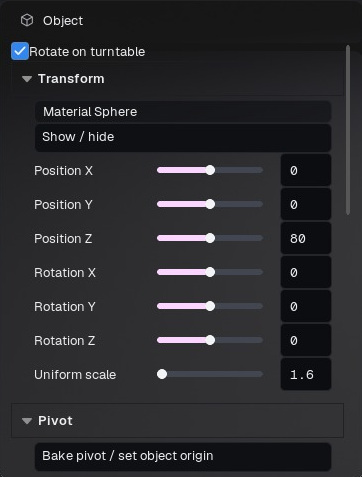

Figure 09. Object inspector: turntable participation, transforms and pivot controls. Select the intended object or group before editing.

Click the eye to show or hide an item. Drag across eyes to change several items in one gesture; one Undo restores that gesture. Lock prevents editing of the relevant item. A camera's small padlock controls its transform. Select a material slot to edit its assignment rather than guessing which overlapping surface received a click.

Group pieces that should move or animate together. Select the group itself for whole-character transform animation. Deleting a group deletes its contained objects; Ungroup is the operation for keeping those objects. Use isolation when a dense scene makes selection difficult, and restore visibility before final output.

The Object inspector exposes position, rotation and scale. Move/rotate/scale gizmos operate in the chosen coordinate space. Snapping helps repeat regular offsets. Negative or strongly nonuniform scale can affect normals, thickness and procedural patterns; verify those materials after scaling. Explode view separates pieces for presentation without requiring you to manually arrange every part.

Pivot editing changes the center used for transformations. Choose among the 27 bounding-box positions, enter coordinates, copy a pivot, find the nearest vertex or pick a vertex in the viewport. Exit pivot editing before moving the object itself. Bake pivot / set object origin applies the pivot as the object's origin while keeping the mesh in place. Check the pivot before a turntable: an off-center pivot causes an orbit rather than an in-place rotation.

Mesh / Subdivision contains the available geometry refinement controls. More geometry is not automatically more useful: inspect the silhouette and shading, and retain the original source for reimport. Render visibility and editor selection are different concerns; confirm which objects remain visible in the output.

### Organize a character for animation

1. In Scene, select the pieces that belong to the character using Ctrl to add items. Exclude independent background props and studio lights unless they should move with it.

2. Choose Edit > Group selection. Rename the group so its role is clear.

3. Select the group row and inspect its transform and pivot. A group is a transform target, not just a display folder.

4. Move it slightly and verify that all intended pieces follow. Undo the trial movement.

5. Open Timeline with the group selected and create Object keys for the group. You do not need a separate transform track for every UV/material piece.

### Selection, visibility and deletion

| Control | Result | Common mistake |
| --- | --- | --- |
| Type filter or search | Narrows the Outliner list | Assuming filtered objects are excluded from render |
| Eye / Show-hide | Changes scene visibility | Leaving an isolated or hidden part absent from the final image |
| Lock selection | Prevents unintended selection/editing | Trying to move a locked target |
| Isolate / restore | Temporarily focuses on selected items | Forgetting to restore the scene |
| Ungroup | Keeps members and removes the grouping | Using Delete when you only wanted to reorganize |
| Delete group | Deletes the group and its contained objects | Treating a group as an empty folder |

### Set a useful pivot

For a turntable, choose a central bounding-box pivot or type the intended axis position. For a hinged object, use a picked vertex near the hinge. Preview a small rotation before committing an animation. Reset the rotation if the test was only diagnostic. Pivot editing and object movement are separate operations: leave pivot-edit mode before repositioning the object.

Separate material ID, Separate loose parts and Separate by polypaint colour are available from supported scene context menus. They create a different editing structure; save a scene version first. Explode view is useful for presentations of assemblies: use its amount control and Reset explode to return the parts. Check that your selected group or pieces are the intended assembly before applying it.

## 6 · Material library and presets

The library lists scene materials and available preset categories. Search, categories and Favorites help find a preset. Change thumbnail size for browsing. A thumbnail is an illustration of a preset under its preview conditions, not a guarantee of its appearance on a different model, light rig or renderer.

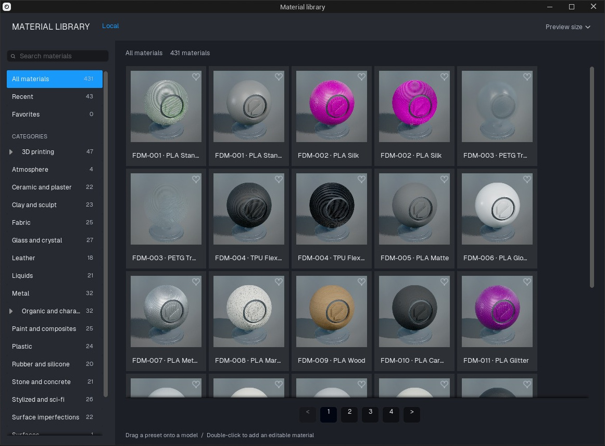

Figure 10. Material library with loaded previews, search, categories, favorites and page navigation. The footer explains drag-to-assign and double-click-to-add.

Drag a preset onto a surface or Outliner material slot to assign it. Alt-drag opens scope choices. Double-click adds an editable material to the scene library. Confirm the intended slot before editing: several objects may share the same scene material, so changing it can affect all of them. Duplicate a material when one object needs independent settings.

Use material categories and Move to to organize selected entries. Favorite marks frequently used materials. Save/export a preset to reuse a look, and import a compatible preset to add it to the local library. Keep its dependent textures together when sharing it. A material preset does not contain the entire lighting and camera composition.

Open Material Graph or Open construction inspects a material's editable graph. Basic artist controls expose common adjustments; Advanced lists actual parameters of the prepared parent. These views edit related material data, not separate copies. Some presets contain specialized texture types or compiled switches that require a prepared variant rather than a file replacement.

Prismatic Crystal is a material look for assigning to chosen surfaces. It is not a global NPR style. Apply it only where a crystal appearance is wanted; use the NPR selector for a viewport-wide artistic mode.

### Apply a preset to the intended surface

1. Select the object and expand its material slots in Scene. Note which slot needs the new material.

2. Click Presets at the top of Materials. Choose a category, then narrow the results with Search materials. All materials removes the category restriction; Favorites shows starred entries and Recent helps return to a previous choice.

3. Allow thumbnails to finish loading. Drag a card onto the intended visible surface. For a hidden or overlapping region, target its material slot instead.

4. Hold Alt during the drag if you need the scope chooser. Read the scope before applying: replacing a shared material can affect several parts.

5. Close the browser and inspect the material name, family and channels. Compare the model under your own lighting; the browser uses its own preview scene.

Double-clicking a card adds an editable scene material. It does not by itself prove that the intended mesh slot uses that material. Check the slot assignment before changing parameters.

### Shared materials and independent variations

Use one shared material for pieces that must remain identical. Duplicate the material before making a variation for only one piece, then assign the duplicate to that slot. Renaming a material makes it easier to identify but does not create a separate copy. An object duplicate may still share its material.

| Location | What it contains | Typical action |
| --- | --- | --- |
| Preset browser | Reusable starting materials | Search, filter, favorite, add or apply |
| Scene material list | Materials available in this project | Select, rename, duplicate, organize or assign |
| Material inspector | Parameters of the selected scene material | Change maps, values and family-specific controls |
| Graph / construction | Editable construction supported by that material | Connect nodes or inspect published parameters |

Export a reusable preset only after checking its dependent textures. A custom image file on your drive does not become available on another computer just because the material has a name. Import the exported preset in a separate scene and check it before sharing. The scene's cameras, lights and render settings are not part of an ordinary material preset.

## 7 · Texture channels and color interpretation

Choose the material, then assign maps to their matching channels. Base color describes surface color; normal describes direction detail; roughness controls highlight spread; metallic identifies metal; AO controls ambient occlusion; emissive adds emitted color. A packed map needs the correct source channel for each destination. Do not treat every grayscale texture as opacity.

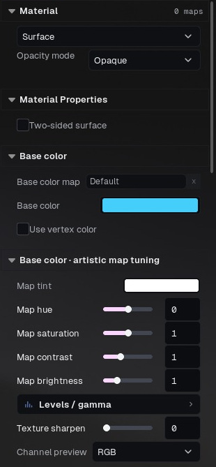

Figure 11. Material family, opacity mode, Base color map, tint and vertex-color toggle. Artistic map adjustments follow below.

Each map can be enabled or disabled without discarding its source, tiles or adjustments. Open source folder locates the original file. Reset map restores inherited/default settings where available. A preset texture may be inherited until replaced. Source channels choose R, G, B or A. Color-space overrides create a compatible converted texture rather than changing an incompatible shader sampler in place.

Base color usually represents color data; roughness, metalness, AO and normal maps represent linear data. Follow the exporting application's convention instead of changing exposure to compensate for an incorrectly interpreted map. Normal convention can be DirectX or OpenGL; use the normal interpretation control when bumps appear inverted. Strength changes the detail intensity.

Roughness or Glossiness selects the intended map interpretation. Glossiness is inverted into roughness as linear data. Levels/gamma and inversion are channel adjustments, independent of scene exposure. Metalness threshold can turn a mask into binary metal/dielectric regions; leave it disabled for intended continuous values. AO has its own levels. Channel preview isolates data for diagnosis.

UV scale, detail tiling, detail normal, height/parallax and texture sharpening affect sampling or apparent relief. Native UV/UDIM color sampling must remain consistent with the source. Before blaming a seam on the shader, inspect UV padding, normal convention, map channel and the source texture. Surface paint and vertex color can multiply the base color; disable Use vertex color when comparing the texture alone. Loading a base map uses the texture-oriented workflow, but existing project/preset settings should still be checked.

Map tint and base-color levels are deliberate artistic adjustments. For a faithful source comparison start with white tint, neutral levels, correct color space and no vertex modulation. Display transforms and post processing can still change the image shown on screen.

### Connect a conventional PBR texture set

1. Select the material slot, choose Surface and begin with an opaque material.

2. Load the albedo image in Base color map. Set the color multiplier to white and disable Use vertex color for an initial comparison with the texture.

3. Load Roughness into the roughness channel. If the file is Glossiness, choose that interpretation instead of compensating with a different light.

4. Load Metallic into Metalness, or keep a constant 0 for a dielectric material. A metal uses its color differently from plastic; do not increase Metalness just to make plastic shinier.

5. Load the normal map. If dents become bumps or lighting flips across details, check Flip green / OpenGL normal. Start with strength 1.

6. Add AO only to its intended channel. Add Emission separately if the asset contains luminous regions.

7. Check the result from several angles. Save the scene only after confirming that all maps target the intended material, especially when several slots have similar names.

| Input | Encoded information | Interpretation to check |
| --- | --- | --- |
| Base color / albedo | Painted surface color | Color/sRGB source; neutral tint |
| Roughness | Broad or sharp reflections | Linear data; white usually rougher |
| Glossiness | Inverse roughness convention | Choose Glossiness interpretation |
| Metalness | Metal versus dielectric regions | Linear mask; avoid accidental alpha routing |
| Normal | Tangent-space direction detail | Linear normal data and green-channel convention |
| AO | Occlusion information | Linear scalar data; not opacity |
| ORM | Three scalar maps in one image | R = AO, G = Roughness, B = Metal |
| Opacity | Surface coverage | Authored alpha or mask; independent of RGB black |
| Emission | Emitted color and pattern | Color plus intensity; bloom is a separate image effect |

### Inspect a channel instead of guessing

Use the source-channel selector when a packed image stores the needed mask in only R, G, B or A. Disable the map temporarily to compare its contribution without losing the path. Channel preview helps inspect the source; return it to RGB after diagnosis. Levels/gamma changes the channel itself, while scene exposure changes the rendered image as a whole.

For normal/roughness seams, inspect at the intended output size with sharpening near neutral. Check UV padding and whether the texture exporter used the expected normal convention. Detail normal and its tiling are additional layers; turn them off during a source-map comparison. Height/parallax creates apparent depth in supported families; it is not equivalent to adding a silhouette-changing mesh subdivision.

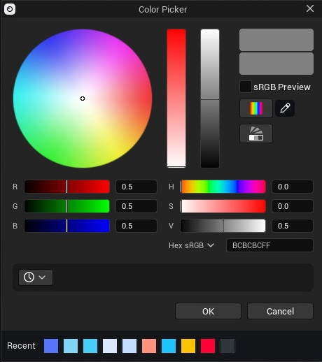

Figure 12. Color picker with numeric color values and saved/recent color swatches. Check the display/color interpretation when matching texture colors.

## 8 · Opacity, black pixels and glass

Black color and transparency are independent. An opaque black pixel should remain a visible black surface. A coverage mask controls whether that surface exists. Base-color alpha may supply coverage when the material is configured to use it; the RGB brightness is not a substitute for that alpha.

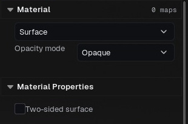

Figure 13. Opacity mode is an explicit material choice. An opaque material does not derive coverage from black RGB values.

### Choose a coverage mode

Opaque keeps the surface solid. A retained opacity map is ignored by an opaque material, including in NPR. Cutout / Masked removes pixels according to coverage and suits leaves, lace or hair-card cutouts. Translucent allows partial coverage but has different sorting and rendering behavior. Choose Glass for see-through glass or clear plastic rather than trying to imitate it only by lowering the opacity of a scattering surface.

### Diagnose black regions disappearing

1. Select the affected material slot and inspect Opacity mode.

2. For a solid object choose Opaque. Inspect the Opacity channel and the Base color alpha source indicator.

3. View the original texture's alpha separately from RGB. A PNG may contain unintended zero alpha even when its RGB image looks correct.

4. If cutouts are intended, keep Masked and supply the authored coverage map. Do not remove genuine alpha to hide a problem elsewhere.

5. Export a small RGBA PNG and inspect it over a checkerboard. A black background in an image viewer can conceal the difference between black pixels and transparent pixels.

Subsurface and thickness are not coverage. A white SSS mask enables scattering; black suppresses it. Thickness changes the distance light travels through material. For a bottle start with coverage 1 and adjust absorption distance, transmission tint, IOR and roughness. Glass needs suitable geometry, thickness and a useful environment to reflect. Raster and path-traced glass may differ; a thin plane is not a physically closed volume.

For transparent output select an alpha-capable format and enable the output's alpha option. JPEG and ordinary MP4 do not preserve transparent backgrounds. The material's coverage and the image's background alpha are separate settings.

### Three different meanings of “transparent”

| Setting | Controls | Does not mean |
| --- | --- | --- |
| Opacity mode / mask | Whether a material covers a pixel | That all dark colors should disappear |
| Glass transmission and absorption | Light passing through a material volume | A transparent image background |
| Render > Transparent background / RGBA | Alpha in the exported composition | That all scene materials become glass |

To keep black paint solid, use an opaque surface. To cut holes in a leaf, use a coverage mask. To make a colored bottle, use Glass with transmission/absorption and suitable thickness. To remove the studio background from a delivery image, enable RGBA output. These operations can coexist, but changing one is not a substitute for the others.

### Inspect the exported alpha

Render a small PNG with Transparent background / RGBA enabled. Open it over both a light checkerboard and a dark solid background in an image editor. Inspect a black area inside the model: it should cover the background if the material is opaque. Inspect a deliberately cut-out hole: it should reveal the background. Inspect the outer silhouette for a fringe. This comparison distinguishes material coverage from an image viewer that simply displays transparency as black.

For glass, first check the model's scale, normals and whether it represents a solid shell. Increase roughness to soften transmission and reflections; adjust the transmission tint and absorption distance to control colored thickness. Compare both a thin edge and the thick center. Use a bright reflection source and a background with contrast so the glass has something to reveal. A completely uniform environment can make correctly transparent glass difficult to read.

## 9 · Material families and advanced controls

Choose a family suited to the surface: general PBR, skin/subsurface, metal, clear coat, cloth/fuzz, glass, hair cards or eyes. Parameters are family-dependent. Start with the basic controls, then use Artist and Advanced to expose the prepared parent's additional capabilities. Search parameters and read the parameter's type before changing it.

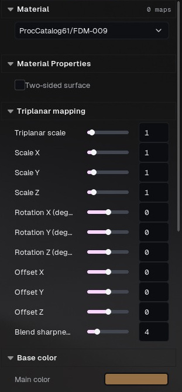

Figure 14. A procedural preset exposes its own triplanar mapping and main-color controls. Its construction differs from a simple texture-map material.

Skin scattering profiles, transmission strength, thickness and scattering tint control subsurface response. Clear coat adds another reflective layer with its own roughness. Cloth/fuzz controls soft fiber response. Hair-card opacity cuts out the card; it does not create individual groom strands. Eye controls include iris mask and depth. Glass recipes provide starting points, not a replacement for correct geometry.

Lighting groups separate direct illumination and specular response. One-sided/two-sided surface settings change back-face behavior. Emission color, map and strength control self-lit content. To glow only selected materials, mark Selective bloom on those materials and set its radius/strength in Post Process. Scene bloom can be combined with it; a bright emissive material is not automatically a useful area light in every rendering mode.

Procedural/clay materials may expose automatic scale, tiling and relief. Automatic scale fits detail to the model; adjust it if the source units produce inappropriate detail size. Advanced scalar, vector, color and texture entries edit actual prepared material parameters. Static switches marked compiled cannot be toggled into a shader permutation that was not shipped. Cube, volume and virtual textures may require a prepared variant.

The capability inspector describes the real prepared rendering family. It should not be interpreted as a promise that arbitrary Unreal material graphs can be compiled in the packaged application. Keep a duplicate material before changing family, and compare its channels after the switch.

### Choose the family before refining the look

| Family / workflow | Intended use | First controls to check |
| --- | --- | --- |
| Surface | General opaque PBR objects | Base color, roughness, metalness, normal |
| Clear coat | A coated substrate such as varnished paint | Underlying material, coat amount and coat roughness |
| Cloth | Fabric with a soft grazing response | Color, roughness, fuzz and scattering |
| Skin | Skin with controlled scattering | Scale, scattering profile, masks, specular and normal |
| Subsurface | Wax, resin and other scattering solids | Scattering distance, color, thickness and transmission |
| Glass | Transparent glass or clear plastic | Geometry thickness, tint, roughness, IOR and absorption |
| Hair cards | Textured ribbon geometry | Opacity mask, normal and strand direction controls |
| Groom | Imported curve-based hair | Groom geometry, strand width and hair appearance |
| Eye | Eye-specific surfaces | Iris controls, reflections and the intended eye geometry |
| Prepared native preset | A material with its own authored construction | Published artist controls, then Advanced parameters |

### Build a coated painted object

Start with a nonmetal base if the visible layer is paint. Give it the intended base color and moderate roughness. Select Clear coat, raise the coat amount and use lower coat roughness than the base. Place a broad rectangular light to reveal the second highlight. Compare at a grazing angle. If the result is uniformly white, reduce lighting/exposure before assuming the coat needs more saturation.

### Tune scattering in a controlled order

Confirm real-world scale before adjusting scattering distance. Start with a neutral studio light and inspect a thin edge against a thicker region. Set the scattering color, then distance or strength, then masks. A mask specifies where the effect is allowed; thickness describes how much material light crosses. Do not use SSS intensity to compensate for an incorrectly assigned base texture. Compare the final renderer because transport differs between real-time and path tracing.

The Advanced view exposes parameters that belong to the selected parent material. Search by parameter name and expand the relevant group. Scalar fields are numbers; vector fields can represent colors or packed values; texture fields reference images. Read-only prepared assets such as cube or volume textures are not ordinary 2D replacement slots. A parameter's presence does not guarantee that every compiled preset variant uses it visibly.

## 10 · Material graph and surface painting

Open Material Graph from the material library to inspect construction. Select nodes to edit their inputs and connect compatible outputs to inputs. Keep the final output connected. Published artist controls refer to the same node values shown in the graph and, when animatable, the timeline.

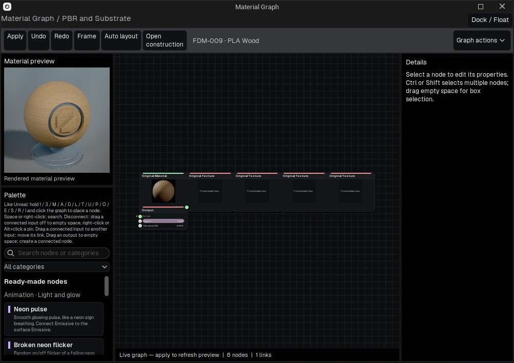

Figure 15. Material Graph with the rendered preset preview, palette, graph canvas and Details panel. This view inspects the native material wrapper; Open construction exposes supported underlying construction.

Use Group selection (Ctrl+G) to organize nodes and Ungroup (Ctrl+Shift+G) to expand them again. Save selection as preset stores a reusable construction. Insert Blend material provides the supported layered blend workflow. A graph built on a prepared family must stay within that family's runtime capabilities; it is not a general Unreal shader compiler.

To animate a material value, add or use an animatable Float node, expose the intended scalar/color control and create its material track. Invalid native parameter names are rejected. Scrub the timeline to inspect the same published value, and save the project to preserve both construction and animation. A static switch cannot be animated as though it were a scalar.

Surface painting offers a brush and face selection. Configure radius, strength, falloff, color, operation and channel. In Brush mode the left button paints; in Faces mode click or box-select, Ctrl adds and Shift removes. Navigation keeps its configured shortcuts. Fill object / selected faces applies the current operation to the selected scope. Slot-only limits work to the selected material slot where enabled.

Choose a paint material or add a painted material layer for a blend workflow. Preview helps inspect the painted channel. Vertex painting requires enough vertices to represent detail; it is not a new UV texture baked at an arbitrary resolution. Restore normal display after inspecting paint masks and keep the source model for reimport decisions.

### Make a graph edit you can verify

1. Duplicate a scene material for experimentation and assign the copy to one visible test object.

2. Open Material Graph from the graph icon in Materials. Confirm the material name before editing.

3. Identify the surface/output node and the inputs that currently reach it. A disconnected node does not contribute to the visible material.

4. Add a supported color or texture node from the palette and connect its output to the intended surface input. Connect compatible data types; color, scalar and normal data have different meanings.

5. Change one value and inspect the object. Keep the previous working construction until the new connection produces the expected result.

6. Use node groups and published controls for a reusable construction. Save the scene or export the material after checking dependencies.

| Graph component | Role | Practical check |
| --- | --- | --- |
| Constant / parameter | Supplies a value or an exposed control | Does the intended input receive it? |
| Texture | Samples an external or prepared image | Correct file, UVs, channel and color interpretation |
| Math / blend | Combines or remaps values | Check the range; multiplying by zero hides a contribution |
| UV / mapping | Determines texture coordinates | Compare scale and seams on the actual mesh |
| Time / panner | Drives a supported animated input | Compare different timeline frames and exported motion |
| Surface / output | Produces the final material | Confirm it is connected and supported by the construction |

BeautyShot's runtime graph is not the complete Unreal Editor material authoring environment. Available nodes and compiled material paths define what can run in the supplied build. If a construction is incomplete or unavailable, inspect the graph status instead of assuming that a node added to the canvas is already rendering.

### Surface paint and vertex data

Choose the intended object, painting mode and target before a stroke. Adjust brush radius and strength for the model scale, then make a short test stroke on a visible area. Inspect from another angle and Undo if it affected the wrong region. Vertex-based painting is limited by vertex density: a large polygon cannot hold the same localized detail as a dense mesh. Material masks and painted base color are different targets. Save the scene after a successful paint operation and verify portability when sharing resources.

## 11 · Groom and curve imports

Alembic groom import creates strand geometry from compatible curves. Set units and the up axis in Preferences before import if the source convention is known. Auto units is a starting point; inspect scale against the character. Z-up and Y-up describe different source coordinate systems.

Select the groom and open Groom geometry. Density interpolates additional strands between compatible nearby source curves. It does not recover a hairstyle that was not present in the source. Adaptive curve sampling uses more points where curvature requires them; a lower angle retains more curl detail while straight segments need fewer points.

Width multiplier scales original vertex widths, preserving taper from compatible sources such as XGen. Inspect roots and tips as well as the overall silhouette. Large widths and excessive density can make a groom appear solid and increase memory cost.

Rebuild rereads the source file with the current geometry settings. Restore original rereads it at 1× density and original curve sampling. Keep the Alembic file accessible; changing controls that rebuild geometry requires the source. Test a small crop before raising density across a full groom.

### Import and refine hair

1. In Preferences > Import, check Alembic units and Up Y / Up Z against the exporting application's settings. A unit mismatch can make strands appear enormous or almost invisible.

2. Import a supported Alembic groom and wait for preparation. Select the groom object rather than a nearby scalp mesh.

3. Inspect the silhouette, roots and tips before reducing data. Keep a saved copy of the original import.

4. Use retained density to reduce the number of curves. Use adaptive angle and minimum points to control simplification along each curve. These solve different costs.

5. Apply refinement and inspect curls, short hairs and the silhouette. Restore original if the reduction removes important shapes.

6. Adjust strand width, root/tip width and LOD bias for presentation. More width can make hair look fuller, but it does not recover removed strand geometry.

| Control | Main effect | Watch for |
| --- | --- | --- |
| Density | Retained curve count | Gaps or loss of volume |
| Adaptive angle | Simplification along a curve | Angular bends in curls |
| Minimum points | Lower limit for curve sampling | Excessively coarse short strands |
| Strand width | Rendered thickness | Clumping or a solid-looking hair mass |
| Root / tip width | Thickness distribution | Blunt tips or detached-looking roots |
| LOD bias | Detail selection | A different silhouette at viewing distance |

Curve grooms and alpha-masked hair cards require different import and material workflows. A static mesh import does not turn polygon strips into strand curves. Use the original exporting tool to prepare the intended representation.

## 12 · Lights and lighting rigs

Add rectangle, point, spot or sun lights from Add or the Outliner light control. Rectangle lights provide area-shaped highlights, point lights radiate from a position, spots have a cone and sun lights supply a directional source. Select each light to edit its transform, power and color. Temperature presets provide common color starting points; tint remains an artistic choice.

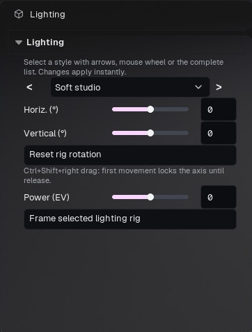

Figure 16. Lighting group controls operate on the rig. Select an individual light for its own intensity, shape and color.

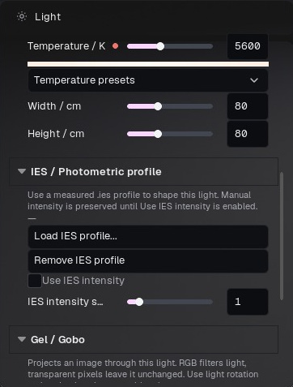

Figure 17. Individual-light settings include IES/gobo controls where supported by the selected light type.

Use source size and softness controls to shape highlights and shadows where supported. IES profiles shape photometric distribution; Gel/Gobo textures shape or color projected light. Load compatible resources and keep them with the project package. A gobo is not the same as changing the environment background.

Light Controller and rig controls move a group of lights coherently. Rig rotation can be reset and the rig framed. Rig Power (EV) changes the group's exposure-like intensity. Follow object keeps the configured light relationship to a target. Inspect the target and center before rotating a rig around a large or off-center scene.

Specular controls can hide a light's direct highlight while keeping its illumination. For point, spot and rectangle lights, floor-only specular controls reduce unwanted floor reflections without removing object highlights. Lighting groups on materials can further separate direct light and specular response.

Volumetric scattering and volumetric shadows affect participation in fog. They are useful only when an appropriate volumetric medium is present. Shadow maps, virtual shadow maps and ray-traced shadows are quality choices in Viewport quality, not interchangeable artistic light types. Use a small render to compare the chosen final backend after changing light or shadow settings.

### Establish a readable three-light setup

Start with one Key light. Set its direction before its intensity; its job is to reveal the main form. Add a weaker Fill from the other side to keep shadow detail without eliminating shape. Place a Rim behind or to the side to separate the silhouette. Toggle each light's eye to understand its contribution. Adjust one light at a time, then inspect reflective and dark materials together.

| Control / type | What it changes | Useful application |
| --- | --- | --- |
| Rectangle light | Broad emitter with editable dimensions | Softbox reflections and soft studio illumination |
| Point light | Local light emitting in all directions | Small practical sources |
| Spot light | Directed cone | Focused accents and projected patterns |
| Sun / directional | Distant directional illumination | Outdoor key or a consistent global direction |
| Intensity | Light contribution | Exposure balance between lights |
| Temperature / color | Hue of the light | Warm/cool separation; neutral material comparison |
| Width / height or source size | Apparent emitting area | Highlight shape and shadow softness where supported |
| Attenuation / cone | Spatial influence | Limit a local light to a useful region |
| IES | Photometric distribution | A prepared fixture profile |
| Gel / Gobo | Color or projected pattern | Patterned illumination with an appropriate light |

### Place a reflection deliberately

With the intended light selected, use Light Controller's reflection placement mode where available. Click the surface point that should receive the highlight, then adjust distance and emitter size. Verify from the render camera: a highlight placed from another viewing angle may move relative to the composition. Turn placement mode off when finished.

Lighting groups separate direct illumination and specular influence for supported targets. Environment reflections and indirect bounce remain shared. They are not a complete light-linking system for every transport path. The floor reserves a light channel, leaving two object groups; inspect the panel's explanation before assigning them.

Rotate the lighting rig with Ctrl + Shift + right drag when you want a different lighting angle without changing the camera. If an emitter should rotate with a turntable, enable its participation intentionally; studio lights usually remain fixed while the product rotates.

## 13 · Environment, floor and effects

Environment controls the HDRI, sky, ground and background. HDRI rotation changes the direction of environmental lighting. Intensity changes illumination; background visibility controls whether the environment appears behind the model. A hidden background does not necessarily disable its lighting. Sky Light enables the ambient contribution from the chosen environment.

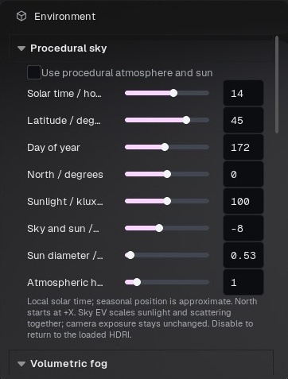

Figure 18. Environment procedural-sky controls. The remainder of this inspector scrolls to fog, HDRI and ground settings.

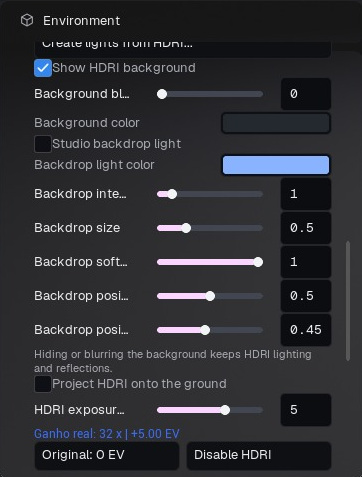

Figure 19. HDRI background, studio backdrop and exposure controls. Background visibility is distinct from environmental illumination.

Procedural sky provides an alternative sky source. Ground controls the floor's visibility and appearance. Adjust floor material/reflection rather than darkening the entire image to suppress a bright floor. Scene ambient occlusion adds indirect contact shading and is independent of material AO maps.

Camera backdrop can use a solid color or image. Cover fills the crop and may trim edges; Contain fits the whole image and may leave margins; Stretch fills by changing aspect. Match camera crop to image changes the output composition to the image ratio. Flat background and Backdrop at depth behave differently with camera movement and scene placement.

Volumetric fog is enabled in Environment. Local atmosphere effects are separate scene objects with their own artist controls. Use uniform object scale where requested by the effect. Radius controls a spherical volume; zero densities remove the fog contribution. Advanced controls expose the prepared effect parameters, which vary by asset.

Draw FX creates a stroke-based effect that can then be moved, rotated and scaled. Select a new stroke from Add > Particle Effects > Draw FX; Esc ends drawing. Natural/stylized flame options, color, direction, speed, gravity, linked light, custom mesh and material override appear only on compatible effects. Restore Default material to remove a custom override. Animated particles and effects need warmup when rendering a settled state.

### Set up an HDRI without changing the object

1. Select Environment in the Scene panel and locate the HDRI controls. Load a latitude/longitude HDR or EXR, ideally an equirectangular 2:1 image.

2. Rotate the environment while watching the object's reflections. Choose a useful light direction before raising exposure.

3. Adjust HDRI exposure. Each additional EV doubles its contribution; it does not change the camera exposure value.

4. Decide whether the same HDRI should be visible behind the object. Hiding the background does not require removing its illumination and reflections.

5. Use background blur or the studio background controls for presentation. Check reflective surfaces again after any lighting change.

6. Save the project and include the HDRI when packaging resources for another computer.

### Environment controls in detail

| Control | What it changes | Practical check |
| --- | --- | --- |
| Procedural sky | Replaces the loaded HDRI lighting with a sky/sun setup while enabled | Turn it off to return to the HDRI |
| Time, latitude, day of year | Sun position for the geographic setup | Check shadow direction on the ground |
| North orientation | Rotates the sky's geographic orientation; +X is the reference | Align a desired side of the model with the sun |
| Sun intensity / sky EV | Direct sun and the overall sky contribution | Keep camera exposure fixed while comparing |
| Sun diameter | Apparent light-source size | Larger values soften the sun shadow |
| Haze | Atmospheric scattering appearance | Avoid washing out a small product shot |
| Sky Light enable, EV, tint | Environment fill and its color | Neutral tint is useful when evaluating texture color |
| Background visibility / blur | Presentation behind the subject | The visible background and its lighting are separate choices |
| Studio backdrop light | A controllable spot/gradient on the backdrop | Adjust color, intensity, size, softness and X/Y placement |
| Ground projection | Projects the HDRI onto an environment ground | Set environment size and capture height together |

### Ground, shadows and scale

Show ground controls the floor surface. Its color, roughness, metalness and specular controls are the quick setup for a simple floor. Assigning a custom floor material transfers appearance control to that material; do not expect disabled simple controls to override it. Opacity maps can shape the visible floor. Compact floor, radius and edge softness help isolate a product presentation.

HDRI ground projection is a different operation from coloring the floor. Environment size is expressed in metres and HDRI camera height describes the height at which the panorama was captured. A smaller environment or lower capture height changes the apparent relationship between object and surroundings. Match a known object dimension before judging whether the projection looks plausible.

### Add atmosphere deliberately

Fog density sets the amount of fog; height falloff controls its vertical distribution. Scattering direction controls whether light is scattered preferentially forward or backward. Extinction changes how quickly light is attenuated, and view distance limits the evaluated extent. These values interact with scene scale and light direction. Start with low density, establish a back/side light, then raise density until the shaft is visible. Avoid compensating for weak lighting with dense fog that obscures the model.

Environment fog is global. Local fog/effect assets in Add are placed scene elements with their own controls. Use the Scene eye to isolate which element is causing haze. Transparent-background output omits atmosphere/backdrop elements that would fill the image; check the intended compositing result separately from the lit viewport.

## 14 · Cameras, lenses and multiple views

Free view is the navigation view and is not a saved render camera. Create a camera from the current view to preserve a composition. Look through camera activates it. A camera frame identifies the render crop; a locked camera uses the locked-frame indication. Unlock before editing its transform, then lock again to avoid accidental changes.

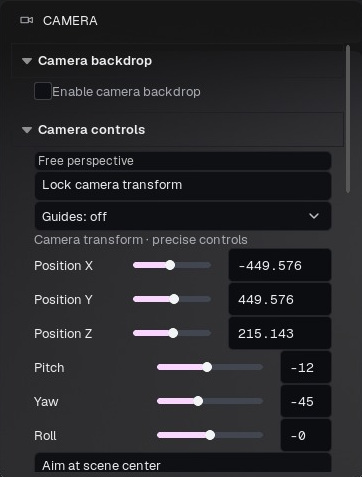

Figure 20. Camera controls for view locking, guides, precise position and orientation.

Camera controls include orbit/yaw, tilt, distance, precise transform and aim at scene center. Perspective uses a lens/FOV; orthographic projection removes perspective size change with depth. Choose a standard orthographic direction from View or the cube. Orthographic width controls framing; it is not a focal length.

Output / crop sets width, height and presets. Preview camera crop shows the intended image boundaries. Frame margin, guide color, opacity and outside shading help compose without changing final pixels. Duplicating a camera can also duplicate its keyframes; deleting the camera removes that viewpoint. Camera history provides a separate way to recover navigation/composition changes.

Depth of field depends on focus distance, aperture and the selected lens/projection. Use autofocus or a focus target when the subject moves. Bokeh/lens shape controls the appearance of out-of-focus highlights. Confirm focus at the final output resolution: a small preview can hide a missed focus plane. A focus target must remain correctly assigned and animated if the subject moves away.

Single view, picture-in-picture camera preview, two views and four views are workspace layouts. Preview size and updates per second trade fidelity for responsiveness; full lighting can increase preview cost. Each view has its own interaction context. Select the intended view before manipulating an object or light. A workspace with several previews does not itself create a multi-camera render queue.

Camera look / local override gives the camera its own post-process settings. Enter that camera before editing its local look. Scene post process remains the fallback for cameras without an override. The active camera selection in the Render panel determines which composition is exported.

### Create a repeatable shot

1. Navigate the free Perspective view until the framing is useful.

2. Open the camera controls and create a camera from the current view. Give it a descriptive name such as Front portrait or Detail clasp.

3. Choose Look through for that camera. Merely selecting a camera in Scene is not the same as making it the active view.

4. Set the lens, output aspect ratio and crop preview. Reframe after changing focal length.

5. Set focus and exposure, then lock the camera against accidental navigation. Unlock it before orbiting the saved shot.

6. In Render, explicitly choose that camera or include it in the camera queue. Save the project.

### Lens and focus reference

| Setting | Meaning | How to use it |
| --- | --- | --- |
| Perspective FOV | Angular field of view, 5-120 degrees | A wider value exaggerates perspective at close range |
| Lens presets | Full-frame focal-length/aperture combinations | Begin with 50 mm for a neutral view or 85 mm for a tighter portrait; reframe as needed |
| Orthographic width | Width of the view in scene centimetres | Useful for front/side comparisons without perspective convergence |
| Camera exposure EV | Exposure of this camera | Keep it fixed while comparing material or light changes |
| Depth of field | Enables lens defocus | Verify at final output resolution |
| Artist focus controls | Simple blur amount and a sharp depth band | Use when composing by appearance rather than physical lens values |
| Physical f-stop | Aperture, approximately f/0.7-f/64 | Lower values produce shallower focus |
| Focus distance | Distance to the sharp plane, in centimetres | Pick a surface or enter the intended measured distance |
| Focus target | A model/target that drives focus | Useful for a moving character or detail shot |
| Also aim camera | Rotates the view toward the focus target | Enable only if both framing and focus should follow it |
| Bokeh shape | Blade count, curvature and squeeze | Squeeze shapes the blur, not the geometry of the whole scene |

### Focus a detail reliably

Enable DOF, use a modest amount of blur and pick the intended surface with the focus interaction. Confirm the focus mode: a picked/manual distance is different from following the centre of the view. For animation, create or choose a focus target and verify that it follows the intended object. Increase blur only after the correct surface remains sharp. If everything is blurred, check scale and focus distance before changing material sharpness.

### Output, crop and camera looks

Width and height in Camera > Output / crop are shared with the output settings for that camera. Lock aspect ratio when resizing a shot without changing its composition. Crop preview, margin and darkening outside the frame are viewing aids; check the actual width and height before export.

A camera can use the scene post-processing look or its own override. Copy look / paste here applies the chosen look to one camera; applying to all cameras changes the wider set. Keep an overview camera and a detail camera named clearly so a queue does not mix unintended looks or resolutions.

### Multiple viewports

Use the view menu to choose Single, Preview, Two or Four views. Click inside the intended view before navigating or manipulating a gizmo. Each view can have a different camera, making front/side alignment easier. A locked camera prevents view navigation; an object selection lock prevents object manipulation. Diagnose those locks separately if an interaction appears unresponsive.

## 15 · Post processing and color management

Choose Scene post process for a common look or Camera look / local override for a particular camera. Check the target before changing exposure or color. Reset all post-process effects resets the selected scope; save a look preset first if you want to reuse it.

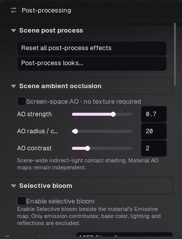

Figure 21. Scene post-processing entry points, ambient occlusion and selective bloom.

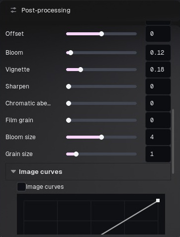

Figure 22. Additional post-processing controls and image curves in the scrolling inspector.

Exposure/EV sets image brightness. White balance temperature and tint correct or stylize color. Saturation, contrast, gamma, gain and offset change tonal response. Image curves provide channel/tonal shaping; neutral curves are a useful comparison point. Color grading can be disabled to diagnose whether a color shift comes from grading or the material.

Bloom creates glow around bright values. Selective bloom restricts an additional glow to marked emissive materials; choose whether to combine it with scene bloom. Vignette darkens the image perimeter. Sharpen, clarity and clarity radius affect detail contrast. Chromatic aberration/scene fringe separates color at edges. Grain size and amount control film-like texture.

Film texture effects include additional grain, chroma and animated grain where exposed. Zero intensity disables an effect. Animated grain is stable per output frame; it is different from path-tracing sampling noise. Clear legacy extra effects removes old effects retained by older scenes so the visible controls account for the look.

Color lookup loads a .cube LUT and offers an intensity blend. The display transform, including the available OCIO/tone-mapping choices, affects viewport and display image output. Linear EXR beauty and data passes have a different purpose: they are intended for a color-managed compositor, not direct comparison in an unmanaged image viewer. Apply the intended display transform when viewing them.

CMAA2 spatial antialiasing can run alone or after the selected GPU AA; combined mode retains that AA. It treats spatial edges, not illumination noise. Calibration and ROI tools help compare light/texture response. NPR's internal effect processing is separate from scene/camera post; changing a style should not require overwriting the scene's grading setup.

### Establish a neutral baseline

1. Select Post Process and check whether the panel edits the scene look or a camera override.

2. Choose the tone mapper before grading: ACES, Linear / sRGB display or AgX. Changing it later changes highlight and saturation behaviour.

3. Set exposure so bright surfaces retain useful detail. Temporarily reduce bloom if it obscures that judgment.

4. Adjust temperature and tint for white balance, then saturation and contrast. Use small changes while comparing a neutral and a saturated surface.

5. Add bloom, vignette, grain and sharpening only after the underlying image is balanced.

6. Save the look as a preset when it should be reused. Confirm the intended camera receives it.

### Grading controls

| Control | Effect | Typical misuse |
| --- | --- | --- |
| Exposure | Global brightness in EV | Using it to fix one incorrectly assigned texture |
| Highlights / midtones / shadows | Brightness of tonal regions | Crushing the shadow range until dark detail disappears |
| Temperature / tint | White balance and green-magenta bias | Leaving a strong cast while evaluating base colors |
| Saturation | Color intensity | Raising it to counteract clipped highlights |
| Contrast / gamma | Tonal separation and midtone response | Making black levels too dense |
| Gain / offset | Multiplicative and additive color adjustment | Offsetting all blacks into a milky grey |
| Bloom and size | Glow around bright contributions | Hiding emissive shapes with excessive spread |
| Vignette | Darkening near the frame edges | Confusing the effect with material shading |
| Sharpen / clarity | Local edge/detail contrast | Amplifying noise, seams and halos |
| Film grain / size / chroma | Intentional image texture | Mistaking added grain for renderer noise |
| Chromatic aberration | Channel separation toward the edges | Adding conspicuous color fringes to technical renders |

### Edit a curve

Enable image curves, choose RGB for overall tone or a single R/G/B channel for color adjustment, then click to add a point. Drag points gently to shape the curve. A mild S raises contrast; lifting the lower end raises the black level. Double-click a point or use the supported delete/drag-out interaction to remove it. Escape cancels the active edit. The curve supports a limited set of control points; use a simple curve rather than many almost coincident points.

### Ambient occlusion and selective bloom

Scene AO adds contact/detail shading and has strength, radius and contrast controls. Its radius uses scene scale; an oversized radius can darken broad areas. It is separate from an AO texture assigned to a material. Compare with AO disabled to identify over-darkening.

Selective bloom requires both the scene option and an appropriate emissive material selection. Its purpose is to glow designated emission without treating every bright reflection or pale surface as an emitter. Set the material's emission first, then tune bloom.

### NPR and exported color

NPR can add an internal style pass while the scene or camera post-processing remains active. Diagnose an unwanted cast by checking both the chosen style and the active scene/camera look. Unlit removes illumination from the material response; it does not bypass all display grading. PNG and video are display images. Linear EXR is intended for compositing and must be viewed with a suitable display transform, so a raw EXR viewer can look different from the viewport.

## 16 · Viewport renderers and performance

Real-time uses the interactive lighting path and is useful for scene assembly. Progressive path tracing keeps ray-traced preview active while navigating and refines after the view stops. Hybrid navigates in real time and blends in the completed path-traced result after a pause. NPR applies the selected stylized surface and/or internal post effect. Choose a renderer in Viewport quality or the viewport camera menu.

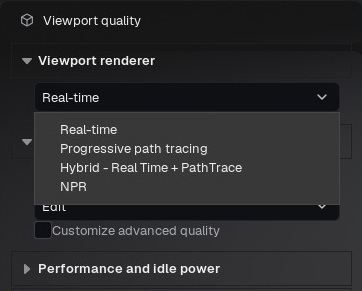

Figure 23. Viewport renderer choices. Offline render quality is configured in a different panel.

Progressive and Hybrid depend on hardware ray tracing and the shipped shaders. If unavailable, check the device/driver and a small scene first. A scene that renders offline can still exceed interactive memory or initialization constraints. Dense meshes, large textures and multiple previews all contribute to resource usage.

Progressive reconstruction offers Auto/neural preview or Native resolution/neural preview. The Auto label can mention DLSS on supported hardware. This is not a claim that NVIDIA Ray Reconstruction is implemented. During interaction the preview favors responsiveness; stationary refinement restores detail. Material edits invalidate affected accumulation, so allow the image to settle before evaluating fine differences.

Viewport quality presets include Reference, Presentation, Studio and Edit. Lighting/reflection quality, shadow method, geometry and depth of field are separate controls. Performance/idle power controls regulate background or idle work. Lower preview size or update frequency for additional camera views if they are consuming resources.

Viewport quality and offline render quality are separate. Increasing offline samples does not make navigation slower until rendering starts, and a fast viewport capture is not a substitute for offline sampling. Choose the final output backend deliberately. For an NPR-style final image use the NPR-compatible deferred output path; path tracing is a different renderer and should not be assumed to reproduce screen-space NPR effects.

### Choose a renderer for the current task

| Viewport mode | Best use | What to expect while editing |
| --- | --- | --- |
| Real-time | Importing, arranging, animation and rapid parameter work | Continuous feedback; transparency and indirect light can differ from path tracing |
| Progressive Path Trace | Evaluating physical materials and lighting | Samples accumulate while stationary; camera/material changes restart convergence |
| Hybrid | Fast navigation followed by a converged preview | Real-time feedback during motion, then a path-traced result after settling |
| NPR | Stylized presentation and hand-painted textures | Controls depend on the chosen style; use a compatible final output path |

### Balance navigation and convergence

Select Viewport quality, choose a mode, then adjust that mode's controls. In Progressive, raise the preview sample target only when the stationary result needs it. A larger target does not make a moving view instantly clean. Neural/noise-reduction controls change the preview reconstruction; inspect edges and fine texture after a camera move. Hybrid is useful when immediate navigation matters more than seeing the final material response during every mouse movement.

Preview reconstruction options are capability-dependent. The interface may expose Auto, native reconstruction or DLSS-related choices when available. An unavailable option cannot be enabled by choosing a higher quality preset. Do not assume the preview setting is the same as offline denoising or that every NVIDIA card exposes every reconstruction feature.

Real-time quality, internal screen percentage, available TSR/DLSS/FSR options, FPS limiting and idle reduction affect interactive workload. Start with the image size needed for editing. Evaluate fine texture at a known scale before judging an upscaled preview. Offline Render quality is configured separately; raising viewport settings alone is not a final-render quality setting.

### If Progressive does not initialize

Check the active graphics device, driver and hardware-ray-tracing availability. Test a simple object in a new scene, then the affected project. If only the large project fails, note geometry count, imported structure, texture sizes and VRAM use. Successful Movie Render Queue path tracing does not by itself prove the interactive path has initialized. Record the mode, scene and log information when reporting the issue. Avoid repeatedly starting expensive imports while the current one is still loading.

## 17 · NPR styles and hand-painted textures

Select Viewport quality > NPR, then a style. Preset names describe looks rather than artists. Existing projects keep their internal style identity when names change. Effect enabled toggles surface styles; NPR amount controls compatible post effects. Controls vary by style: do not expect a lighting slider to affect an unlit texture.

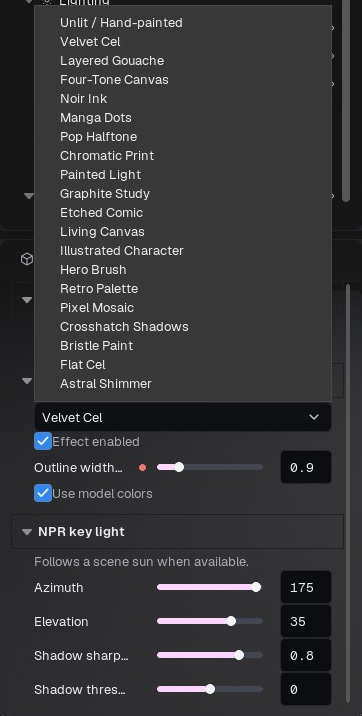

Figure 24. NPR style selector and style-specific controls. This menu uses the neutral style names in Beta 82.

### Style catalogue

These are the names displayed in Beta 82. A style is a starting construction with its own controls, not a promise that every imported model will resemble the same illustration. Authored textures, surface normals, lighting and framing remain important.

| Style | Visual purpose | Controls to inspect first |
| --- | --- | --- |
| Unlit / Hand-painted | Present painted texture colors without scene illumination | Base color, vertex color, opacity and active post look |
| Velvet Cel | Clean cel shading with readable shadow bands | Key-light direction, shadow threshold and sharpness |
| Layered Gouache | Layered painted shading | Brush density, strength, parallax and painted reflections |
| Four-Tone Canvas | A limited set of painted tonal regions | Model colors, light direction and outline |
| Noir Ink | Strong ink-like shadow treatment | Contrast, projection scale and background handling |
| Manga Dots | Monochrome print with tonal dots | Dot size at the intended output resolution |
| Pop Halftone | Graphic halftone over lit/mid/shadow regions | Tiling, softness and per-material pattern inputs |
| Chromatic Print | Color print and atmosphere treatment | Print mix, scale, dots and white highlights |
| Painted Light | Painted projection integrated with lighting | Projection size and paint-layer mix |
| Graphite Study | Pencil/graphite-like marks | Projection size, contrast and outline width |
| Etched Comic | Etched/hatch print treatment | Print exposure, saturation, contrast, brightness and dots |
| Living Canvas | Blended painted layers | Brush refraction, world size, blend size and original-scene mix |
| Illustrated Character | Character-oriented illustration | Lighting, model colors and contours |
| Hero Brush | Bold brush shading | Brush density and strength |
| Retro Palette | Reduced color palette | Grid divisions, color count and palette smoothing |
| Pixel Mosaic | Pixel-like blocks and tonal quantization | Pixel size, luminance levels and palette smoothing |
| Crosshatch Shadows | Line-based shadow texture | Contrast and projection size |
| Bristle Paint | Directional brush texture | Density, strength, parallax and reflections |
| Flat Cel | Simple graphic surface shading | Light direction, color and contour |
| Astral Shimmer | Animated stylized surface effect | Shimmer, dissolve and per-material masks/colors |

### A hand-painted game asset workflow

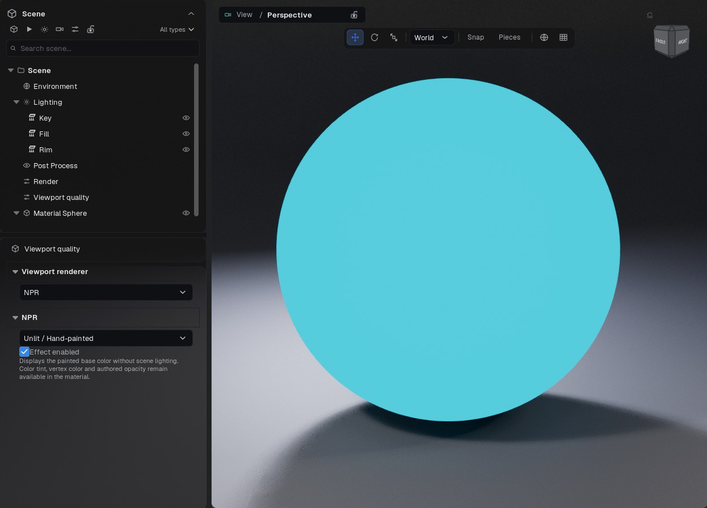

Figure 25. Unlit demonstration with a constant cyan base color: the sphere loses lighting gradients while the separate floor retains its scene appearance.

1. Import the model and assign its painted color map to Base color. Start with a white base tint.

2. Disable vertex color unless it is deliberately part of the authored asset. A vertex-color multiplier can hide the intended texture.

3. Choose NPR > Unlit / Hand-painted. Keep the material Opaque unless the asset actually needs cutouts or transparency.

4. Use a neutral scene/camera post look. Compare a recognizable color patch in the source image and viewport; a tone mapper or grade can still change its displayed appearance.

5. If the texture contains painted highlights and shadows, do not add physical lighting to recreate the same shading. Inspect the painted result from the intended game-like viewing distance.

6. Export with a compatible Deferred/Movie Render Queue or viewport workflow. A path-traced physical render is a different look.

### Calibrate the subject and background separately

Start with the subject at its intended size in the frame. Set the style's lighting before refining marks. Set outline width in pixels conservatively; an outline that is useful on a full character can be too heavy in a close-up. Adjust dot size/tiling and hatch projection while watching facial details and large flat areas. There is no universal dot size that fits every resolution and camera distance.

Where the style offers background/floor treatment, decide whether it should affect those regions. A monochrome subject does not require a fully black background. Compare the silhouette against the chosen backdrop and inspect both bright and dark texture areas. If the background becomes solid black, inspect style background settings, brightness and post contrast before changing the model's opacity.

### Surface and internal post-process controls

Some styles combine a surface shader with an internal style pass. Controls appear only for the relevant construction. The surface-effect toggle and the amount of the internal pass are different controls. NPR does not require overwriting the scene's existing Post Process settings. When diagnosing a result, compare the style with a neutral scene look, then reintroduce the desired grade.

Directional NPR lighting can follow the procedural sun; otherwise use the style's azimuth/elevation controls. World/projected patterns depend on model scale, while pixel-based marks depend on framing and output resolution. Check a stationary image and a short camera movement to distinguish a texture seam from temporal instability.

### Export the style you are viewing

Use a small test with the same camera, aspect and resolution relationship as the final job. For NPR output, choose the Deferred final path or a viewport capture as appropriate. Selecting a physical Path preview/final/reference preset switches away from NPR. Check the selected render camera and its local post override if the export differs from the view. Compare dark opaque regions over a contrasting background and inspect the alpha channel when RGBA is requested.

## 18 · Timeline and animation

Open Timeline from Window or the header icon. Set the frame range and FPS before authoring a timed shot. FPS defines how frames map to time. Scrub the playhead to inspect a frame; playback previews the animation but is not the same as exporting every frame offline.

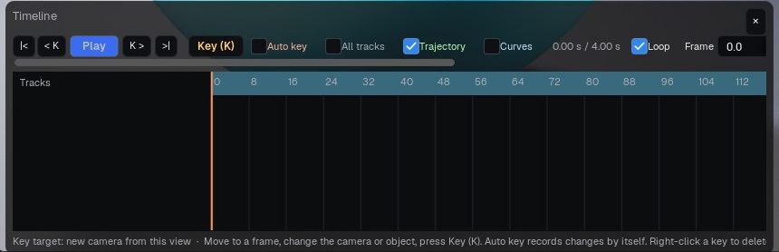

Figure 26. Timeline transport, keying options and track area. This demonstration has no authored keys yet.

Select the object, group, camera or animatable material control whose track you want to edit. Add keys for the intended values at the current frame. Move the playhead, change the value and add the next key. Use a group track to animate a multipart character as one unit instead of selecting every material-ID piece separately.

Interpolation determines the transition between keys. Whole track applies the interpolation choice across that track. Use held/step-like changes for abrupt switches and smooth interpolation for continuous movement where offered. Inspect intermediate frames: correct endpoints alone do not prove a good trajectory. Motion-path display helps inspect animated object movement.

Camera tracks can animate composition and supported lens/focus controls. A camera's local post-process override is edited while viewing that camera. Material tracks use published animatable values or compatible Float nodes. Arbitrary native static switches and unsupported graph operations are not timeline channels.

Imported animation depends on the supported importer and source data. A grouped static character does not become a skeletal rig merely because its group can be transformed. Use the source application's animation workflow for unsupported deformations, then import a supported representation.

For final output choose Timeline in the relevant render workflow. Direct capture records the timeline range at the chosen output rate while preserving duration. Offline rendering samples frames through the render pipeline. Turntable is a separate task using a selected object/group and pivot; it does not require manually adding a rotation key to every piece.

### Animate a complete imported character

1. In Scene, select the parent group that contains the character pieces. Keep the children inside the group.

2. Open Timeline from Window or the header button. Set FPS and the intended frame range.

3. Move to the first frame. Set the group's starting transform and press Key (K) while the viewport/timeline has the appropriate focus.

4. Move to a later frame, change the group's position/rotation/scale, and insert another key.

5. Scrub between the keys. The complete group should move together; if only one mesh moves, check the keyed target.

6. Play the range and inspect the motion. Save the project before rendering a Timeline task.

A selected object/group is the key target. When no object is targeted, camera animation is a separate workflow. Select deliberately before inserting keys. Auto Key is useful after a track is established, but can capture unintended edits if left enabled during general scene work.

### Timeline controls and editing

| Control | Purpose | Check before using |
| --- | --- | --- |
| First/last and previous/next key | Navigate the range or keys | Confirm the active track/selection |
| Play / pause | Preview animation | Preview FPS can be limited by scene workload |
| Frame / FPS / range | Time position and sampling rate | Set FPS before interpreting duration in seconds |
| Key / Auto Key | Record values at the current frame | Confirm the selected group, object or camera |
| All tracks | Show tracks beyond the current selection | Turn off when editing a large character hierarchy |
| Loop | Repeat playback of the range | It does not automatically make the endpoints match |
| Curves | Inspect interpolation | Smooth motion can overshoot between keys |
| Trajectory | Draw the motion path | Key points are distinct from intermediate frame points |

Right-click a key for actions such as going to its frame, deletion and interpolation. Shift-click selects additional keys. Drag keys to retime them; use the timeline zoom interaction, including Ctrl + wheel, when keys are crowded. Preview immediately after changing interpolation because the path between the same endpoints can change. A trajectory key point can be dragged to edit its spatial path; verify the resulting transform and timing.

### Turntable versus authored animation

A Turntable task automatically rotates the chosen scope around a pivot and does not require hand-keying every angle. Timeline output evaluates the authored animation range. For a model spinning in place, choose Turntable and set the group/scope, pivot, duration and FPS. For a camera move, character transform, imported animation clip or timed material effect, use the appropriate timeline/animation workflow and confirm the actual range before export.

Live viewport recording has its own Manual navigation, Turntable and Timeline choices. Recording the live view in Manual mode does not implicitly start a turntable. This distinction explains why a static recording can occur even when a different offline task was configured earlier.

## 19 · Render workflow and file formats

Open Render and choose the workflow before pressing the header Render button. Direct viewport output uses the active view's current pixel size and quality. Offline / Movie Render Queue uses the configured output resolution, camera and sampling. The camera selector, task and backend are separate decisions.

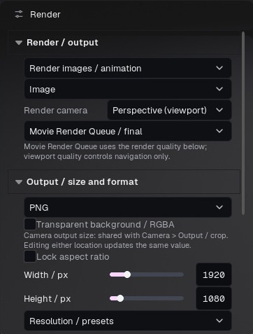

Figure 27. Offline Image task, camera, Movie Render Queue engine, format, alpha and output size.

### Direct viewport

Choose an image or recording task. Live recording captures navigation with the active camera's normal controls; Stop and save finishes it. Discard deletes that capture's temporary output, not existing files. Turntable records one complete rotation of the chosen objects/group around its pivot. Timeline records the current range. Selection outlines and gizmos are hidden from the capture.

### Offline output

Choose a camera, output width/height or resolution preset, format and destination. A still writes one image. Timeline writes the animated range. Turntable writes the orbit task. Choose Deferred/Lumen for compatible real-time/NPR presentation or Path Tracing for the physically traced beauty. Check warmup for temporal effects before increasing samples.

PNG is a lossless display image and can carry alpha when enabled. JPEG is compact but lossy and has no alpha. EXR stores linear HDR/compositing data; it requires appropriate viewing transforms. MP4 is practical for ordinary playback and does not provide transparent output. GIF is lightweight but palette-limited and can band or dither. The alpha-capable MOV option is intended for compatible compositing software; confirm the target application's codec support.

Use image sequences when you need individual frames or robust compositing. Do not rename an extension to convert a format. Large output resolution, multiple passes and long sequences increase disk requirements. Choose an empty named output folder for each version so that frames from separate renders are not confused.

After rendering, verify the actual files: size, dimensions, frame count, first/last frame, alpha and the chosen camera. View a transparent output over a checkerboard. A successful progress indicator does not tell you whether the selected task or framing was the one you intended.

### Render a still image, step by step

1. Select Render in Scene. Choose Render images / animation and the Image task.

2. Select the render camera explicitly. Perspective (viewport) uses the free view; a named camera uses its saved shot.

3. Choose Movie Render Queue / final for controlled offline quality, or the available quick viewport engine for a rapid preview.

4. Choose PNG for a display-ready image or EXR for a linear compositing workflow. Set width, height and aspect lock.

5. Enable Transparent background / RGBA only when required. This changes background handling; it does not repair an incorrectly transparent material.

6. Choose the offline quality preset and inspect the settings it applies. Keep a Deferred preset for NPR output.

7. Choose the destination, start the render and wait for completion. Inspect the actual saved file, not only the viewport.

### Choose the task before the file format

| Task | What is evaluated | Important setup |
| --- | --- | --- |
| Image | One frame from the selected camera | Camera, size, format and quality |
| Camera queue | The enabled cameras in the queue | Camera selection, each camera's resolution and look |
| Turntable | Automatic rotation of the selected scope | Pivot, scope, duration and FPS |
| Timeline | Authored time-dependent scene state | Frame range, FPS, tracks and camera |
| Capture live viewport | What the interactive view displays over time | Native view size, capture mode and ability to sustain FPS |

### File formats and alpha

| Format | Suitable delivery | Notes |
| --- | --- | --- |
| PNG | Still images and image sequences | Display color; supports alpha when requested |
| EXR | Linear HDR compositing and supported passes | Use a color-managed viewer; passes depend on render path |
| MP4 | Compact animation/video preview | Common delivery format without transparent alpha |
| GIF | Short lightweight preview | Limited palette; avoid using it to judge final color fidelity |
| MOV RGBA | Animation needing alpha | Available through the compatible animation path; larger files are normal |
| JPEG in camera queue | Compact opaque camera stills | No alpha; use PNG for transparent stills |

Transparent output keeps useful environmental illumination while omitting visible background/floor/atmospheric elements as required by that path. Test the exported alpha over a checkerboard or a colored layer. A black RGB background in a viewer is not proof that alpha is missing: inspect the alpha channel itself.

### Record the live viewport

Choose Capture live viewport, then the camera and capture mode. Manual navigation records your interaction; Turntable drives the rotation; Timeline advances the animation. Set the capture FPS and start Record MP4. Stop and save completes the recording. Cancel discards the current temporary recording, not an older completed file. Capture PNG now saves a single current view.

Live recording uses the native viewport pixel size and its interactive quality. Resize the view before recording if that is the intended output size. Offline width/height and sample settings do not turn a live recording into an offline render. If the scene cannot sustain the requested frame rate, inspect the reported capture/frame status and use offline animation output when consistent timing is required.

### Example: a five-second product turntable

Select the product group, choose Turntable, set selection/group scope and a central pivot. Use a five-second duration and 30 FPS for a nominal 150-frame sampling interval. Keep the camera fixed, check floor contact during rotation and ensure the lights are outside the rotating scope when they should remain stationary. Export a short low-cost preview before committing to final resolution. Inspect the start/end transition if the video must loop seamlessly.

## 20 · Offline quality, passes and camera queue

Render quality presets provide starting points for Studio, Final, Reference and Path Tracing. Spatial samples improve sampling of the output; warmup allows temporal history and effects to settle before writing frames. Increasing either costs time and can increase memory pressure. Do not increase both blindly to correct an incorrectly assigned texture or opacity mode.

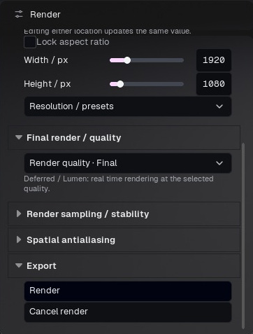

Figure 28. Offline quality and export controls below the output dimensions. These settings are independent of viewport navigation quality.

Path tracing samples per pixel govern convergence; light bounces govern how many interactions paths can make. Too few bounces can change glass and indirect light. Firefly maximum intensity clamps bright outliers, but an aggressive value can remove legitimate highlights. The path tracer denoiser reduces noise and may soften details. Compare a small crop with sufficient samples before committing a long sequence.

EXR beauty is linear. Deferred data passes include BaseColor/DiffuseAlbedo, WorldNormal, Roughness, Metallic, Specular and Depth, with additional channels shown when supported. These are not all beauty images: normals are directions, depth is distance and roughness is scalar data. Avoid applying a beauty display transform to a data pass used for computation.

Lighting-component AOVs are additional renders of the same frame, while data passes come from the G-buffer. They can add substantial render cost. Multilayer EXR stores multiple channels in one compatible container; separate outputs are useful when the compositor does not support that layout. Beauty only / preserve DOF avoids unnecessary diagnostic passes. Path tracing exports its linear beauty and hides deferred-only data passes.

Camera queue renders named scene cameras one at a time to PNG, EXR or JPEG. Use the queue command instead of assuming multi-view previews will be exported. Cancel queue ends the queue and restores the prior composition. Inspect the output names and camera count before sharing. Orthographic view export provides the selected standard views; check framing and scale for the intended presentation.

For NPR, compare a representative still and a short sequence at the intended dimensions. Screen-space dot/outline size can change its perceived scale with resolution. For hand-painted work, keep the Unlit style active and avoid adding lighting-based shading through an unrelated renderer.

### What the offline presets actually set

| Preset | Primary sampling | Additional setup | Intended use |
| --- | --- | --- | --- |
| Studio | 4 spatial samples | 16 warm-up frames | Quick Deferred proof |
| Final | 16 spatial samples | 32 warm-up frames | Deferred presentation output |
| Reference | 32 spatial samples | 64 warm-up frames | Higher-cost Deferred reference |
| Path preview | 64 samples per pixel | 4 bounces | Physical preview |
| Path final | 256 samples per pixel | 8 bounces | Balanced physical final |
| Path reference | 1024 samples per pixel | 12 bounces | More demanding physical reference |

These are preset settings, not guaranteed render times. Resolution, scene geometry, texture memory, glass, hair, emission and hardware all affect cost. Path presets select the physical path-tracing route and turn off NPR. Choose Deferred for an NPR look.

### Increase quality for the actual problem

| Symptom | First setting to inspect | Why |
| --- | --- | --- |
| Jagged or unstable Deferred detail | Spatial samples and output resolution | More spatial coverage can improve subpixel edges |
| Unsettled first frame or temporal effect | Warm-up frames | Gives time-dependent rendering state a chance to settle |
| Random noise in physical transport | Path samples and denoising | More samples reduce variance; denoising can soften fine detail |
| Missing multi-bounce light in glass/interiors | Bounce limit | Additional samples cannot replace a transport path cut off too early |
| Isolated very bright path-traced specks | Firefly/max-intensity control | Clamping can reduce outliers but can also suppress bright energy |
| Fine material detail looks soft | Texture resolution, focus, reconstruction and denoising | More samples do not fix a blurred input or defocused camera |

The controls allow finer adjustment beyond presets: spatial samples up to 64, path samples up to 4096, bounces up to 32 and warm-up up to 240 in this release. Use a representative crop/short output and change one parameter at a time. Compare at 100% pixel scale. Doubling both width and height creates four times as many output pixels before other costs are considered.

### EXR passes and their purpose

Choose EXR with the Deferred final path to expose supported data passes. Linear beauty is the rendered image. Base color/albedo describe surface color inputs, not the illuminated final appearance. Roughness, metallic/specular and material AO are material data; world normal encodes direction; depth is a distance quantity in centimetres; velocity describes motion. They are not intended to look like beauty when displayed as ordinary RGB photographs.

Additional lighting AOVs can require additional renders at the same frame. Multilayer EXR packages compatible layers together; otherwise inspect the generated companion files. Data-pass rendering disables effects such as depth of field and motion blur where needed for alignment. A beauty-only render can retain those effects. Path-traced beauty does not expose the same Deferred data-pass set.

### Camera queue checklist

Enable only the required cameras, verify each camera's output dimensions and local look, and confirm that each shot is focused and framed. Use All or Only active deliberately. Give cameras unique descriptive names before export. Render one representative camera first when changing format or quality, then run the complete queue. A correctly configured free viewport is not a substitute for checking the saved cameras.

## 21 · Preferences, shortcuts and customization

Preferences is available from Window and the settings icon. Language selects English, Português (Brasil) or Español. Some specialized asset/control labels may remain in their original language. Interface scale, opacity, interface color, outline, slider and text colors customize readability. Restore appearance returns the appearance defaults.

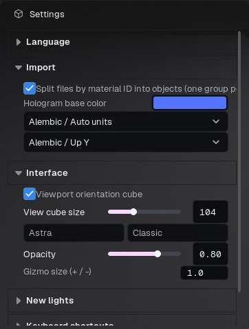

Figure 29. Settings for import and interface aids: cube visibility/size, visual theme, opacity and gizmo size.

Import preferences include splitting behavior and hologram base color. Alembic preferences include units and up axis. View cube size and gizmo size change interaction aids; + / − can adjust the gizmo where assigned. New-light settings define starting behavior for subsequently created lights. Existing lights should be checked independently.

Keyboard shortcuts can be edited, cleared and restored through the shortcut editor. Navigation profiles have their own bindings and focus/orbit behavior. If a shortcut does not work, check input focus and the assigned binding before assuming the action is unavailable. Typing inside a number field should not be confused with a viewport command.

Common defaults: Ctrl+N New; Ctrl+O Open; Ctrl+I Import mesh; Ctrl+S Save; Ctrl+Shift+S Save as; Ctrl+Z Undo; Ctrl+Shift+Z Redo; Ctrl+R Render current task. In the graph Ctrl+G groups and Ctrl+Shift+G ungroups. P selects perspective through the View command. Esc cancels active pick/draw operations. User bindings can override defaults; the shortcut editor is authoritative for your installation.

Favorites collect supported controls via right-click on their labels. Named panel layouts are useful for material editing, animation and multi-monitor work. Keep interface customization separate from scene presets: a lighting/material preset does not necessarily restore panel placement.

### Configure navigation to match your habits

Choose Classic, Maya, Blender or Custom in Navigation profile. Read the live hint in the panel/status bar instead of assuming one mouse binding applies to every profile. For example, the Maya profile uses Alt with left/middle/right mouse buttons for orbit/pan/dolly. Custom exposes mouse-button/modifier choices for the supported actions.

| Preference | What it changes | Suggested adjustment method |
| --- | --- | --- |
| Navigation speed | Overall navigation response | Begin near the default and change gradually |
| Orbit sensitivity | Rotation per pointer movement | Reduce for precise close-up work |
| Pan sensitivity | Lateral movement per gesture | Test with the object framed at working scale |
| Dolly sensitivity | Forward/back movement | Reduce if a small drag passes through the subject |
| Wheel sensitivity | Wheel zoom/dolly response | Match the wheel hardware to the working scale |
| Invert horizontal / vertical orbit | Direction of orbit | Test each axis independently |
| View cube size / visibility | Orientation widget | Keep it visible without covering the subject |
| Gizmo size | On-screen transform handle size | Increase for high-resolution displays, not to change object scale |
| New-light alignment | Initial orientation of newly added lights | Choose camera-horizontal, full camera alignment or none as appropriate |

### Customize a shortcut without losing control

Open Keyboard shortcuts, locate the action and assign the intended combination. Check whether it conflicts with another action or with a navigation modifier. Test it with focus in the correct panel. Clear or restore the binding if it is unsuitable. Avoid using an ordinary typing key for a frequent destructive action. The editor's current assignment takes precedence over examples in this manual.

### Import preferences are not retroactive repairs

Splitting by material ID changes how subsequent imports are organized. Hologram base color changes the loading/preview appearance, not the final base-color texture. Alembic unit and up-axis settings control interpretation of imported geometry/curves. Confirm scale and orientation immediately after import; changing a preference later does not necessarily rebuild an already imported object.

### Restore a readable workspace

If labels are cramped, first adjust panel width or interface scale. If colors have become difficult to distinguish, restore appearance or reset the relevant color. If a panel is missing, use Window show/hide controls and reset the layout if needed. Resetting navigation or layout is different from resetting materials, lighting or project content. Save a useful layout once the panels fit your monitor.

## 22 · Troubleshooting and reporting a problem

### The texture is darker or tinted

Check Base color versus another channel, source color space, white material tint, vertex color, exposure, camera-local grading and LUT. Use Unlit / Hand-painted to remove scene-light shading for a painted-texture comparison. Reset one category at a time so the cause remains identifiable.

### Black areas disappear

Inspect Opaque versus Masked/Translucent, the explicit opacity map and base-color alpha. Black RGB is not automatically transparent. Compare an exported RGBA image over a checkerboard. If the issue persists, provide the original texture including alpha and the affected material settings.

### UV seams or inverted details

Inspect texture padding, mip/filtering behavior, UDIM assignment, source channels and normal convention. Disable vertex color for a texture-only comparison. State which NPR style or renderer shows the seam and whether it is also present in an exported image.

### Slow navigation or incomplete path-tracing initialization

Wait for imports, then try a small known scene in the same renderer. Reduce additional preview size/update rate and inspect texture/geometry size. Compare Realtime with Progressive; include GPU model, driver, VRAM and scene size in a report. Do not infer that another user's GPU behaves like the reference RTX 4060.

### Render differs from viewport

Confirm camera, crop, renderer/backend, viewport versus offline workflow, scene/camera post override and output format. EXR linear appearance differs from display PNG. Warmup and samples affect temporal effects; backdrop inclusion and alpha affect the background. Check actual output files rather than only a screenshot of the viewport.

### Missing controls or unexpected selection

Select the relevant object/material slot and renderer. Filters may hide Outliner entries without hiding objects. A locked camera cannot be transformed until unlocked. Specialized presets expose only their supported controls. Restore the layout if a panel is off-screen; this need not reset scene data.

### Useful bug report

Include the build number, Windows/GPU/driver, exact steps from a fresh or supplied project, expected versus observed behavior, selected renderer/output route and a small screenshot or exported frame. Attach a minimal project and the required source texture if you are permitted to share them. Include the latest relevant log from the application's Saved/Logs directory. Remove personal paths or unrelated private data before posting publicly.

This manual documents functionality, not a promise that every third-party shader, model or codec behaves identically in every renderer. Preserve the distribution's third-party notices. The purchase/license terms on the product page govern seats and commercial use; the manual does not replace those terms. Use the support links accompanying your download for build-specific assistance.

### Presets or the viewport appear uniformly white

First wait for loading to finish and confirm that a material was actually applied to the object. Selecting a library card edits/inspects a material; it does not necessarily assign it to the mesh. Compare a visibly colored preset in the library and its result after dragging it onto the object. Check exposure, material tint, texture paths and whether the intended renderer is active.

Launch the supplied BeautyShot.exe from the complete extracted installation. Keep its content folders together. A copied internal executable or incomplete update is not equivalent to the full installation. Confirm the build identifier when collecting screenshots or comparing machines. If the issue persists, keep the log and report the exact launch path and affected preset. Do not use a screenshot with incomplete materials as a reference for the preset's intended appearance.

### A practical diagnostic sequence

| Problem | First comparison | Information that narrows the report |
| --- | --- | --- |
| Whole model white | Known colored preset on the same mesh | Assignment, exposure, renderer and installation path |
| Only one map missing | Open the original texture and check its assigned slot | File path, channel and source format |
| Black RGB becomes transparent | Opaque material versus explicit opacity setup | Texture alpha, opacity mode, exported alpha |
| NPR seam but Realtime clean | Same camera, material and neutral post look | Style, normal map, UV boundary and output frame |
| Preview differs from final | Same named camera and renderer route | Camera override, tone mapping, format and alpha |
| Turntable does not move | Offline task versus live capture mode | Scope, pivot, mode, duration and frame range |
| Gizmo does not affect the intended view | Click the target viewport and check locks | Layout, active view, selected object and camera |
| Missing panels after monitor change | Reset layout | Previous monitor arrangement and interface scale |

### Share a small reproducible case

Save a copy, remove unrelated objects and keep the smallest material/texture set that still demonstrates the issue. Write numbered reproduction steps and identify the expected result. Include one whole-window screenshot to show the mode/settings and one close crop for the defect. If an export is involved, attach the exported file as well as the screenshot. A precise minimal case is more useful than repeatedly changing many settings in the original project.