# BeautyShot 82 - Manual ilustrado do usuário

Edition 2 / Edição 2 · 30 October 2026

## 1 · Comece aqui

BeautyShot é um aplicativo Windows para apresentação de assets 3D: materiais, iluminação, câmeras, animação e saída em imagem ou vídeo. Este manual descreve a interface da Beta 82. Os controles dependem do objeto, da família do material e do renderizador selecionados; opções que não se aplicam podem ficar ocultas.

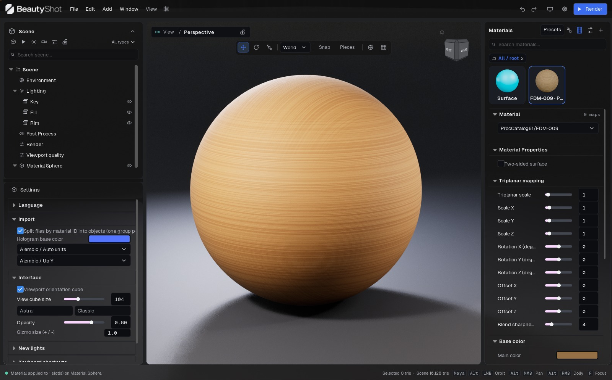

Figura 01. Beta 82 com material da biblioteca aplicado à esfera de demonstração. Viewport e miniatura mostram a superfície procedural em tom de madeira.

### Instalar e abrir

Extraia todo o download para uma pasta com permissão de escrita. Mantenha as pastas Engine e SculptStudio junto do executável de entrada; copiar apenas o executável não instala o aplicativo. Abra o BeautyShot pela pasta extraída, nunca de dentro do ZIP. Guarde projetos e renders em outra pasta para que a atualização do aplicativo não substitua seu trabalho.

A build distribuída destina-se a Windows de 64 bits e DirectX 12. Path tracing progressivo e offline exigem GPU e driver compatíveis com ray tracing por hardware. As opções DLSS exigem hardware NVIDIA compatível. Um recurso funcionar em um renderizador não comprova suporte em outro. A máquina de referência desta versão tem RTX 4060 de 8 GB e 32 GB de RAM; é uma configuração testada, não um requisito mínimo universal nem garantia de desempenho.

### Sua primeira imagem

1. Escolha Arquivo > Importar malha. Aguarde a conclusão da geometria e das texturas.

2. Selecione uma peça em Cena e seu slot de material. Atribua base color, normal e roughness em Materiais.

3. Em Ambiente, escolha um HDRI ou céu procedural. Ajuste as luzes em Lighting.

4. Navegue até um enquadramento útil. Enquadre tudo ou a seleção se o modelo estiver fora da vista.

5. Crie uma câmera a partir da vista, defina a resolução e trave-a depois de compor a imagem.

6. Salve o projeto. Em Render, escolha tarefa de imagem, câmera, formato e destino. Use PNG para uma imagem pronta para exibição; EXR para composição linear.

Para texturas que já contêm iluminação pintada, use Qualidade da viewport > NPR > Unlit / Hand-painted. Comece com a cor do material branca e vertex color desligado. O procedimento específico está no capítulo NPR.

### Como ler os nomes da interface

As capturas mostram a interface em inglês da build Windows Beta 82. A edição em português explica os mesmos controles e mantém o rótulo em inglês quando isso facilita encontrar o campo. “Cena > Render” significa clicar em Render na hierarquia à esquerda; não significa apertar o botão azul Render. Uma seção pode estar mais abaixo no inspetor: role dentro do painel, não sobre a viewport.

### Exercício guiado: uma imagem de estúdio a partir de um objeto

1. Extraia o download e abra BeautyShot.exe. Crie uma pasta de trabalho para modelo, texturas, projeto e renders.

2. Importe a malha e espere a barra de status concluir o carregamento. Expanda o grupo importado, selecione uma malha e depois seu slot de material. O material correspondente deve ficar selecionado à direita.

3. Comece com Surface e Opaque. Para um objeto não metálico sem textura, use Metalness em 0 e Roughness próxima de 0,4. São valores para o exercício, não um preset universal. Deixe vertex color desligado, salvo se o modelo utilizar polypaint intencionalmente.

4. Com o foco na viewport, pressione F para enquadrar a seleção. Orbite até ler bem a silhueta. Não use a rotação do objeto apenas para olhar ao redor dele.

5. Selecione a luz Key em Cena. Posicione-a de um lado e ajuste a intensidade até a forma ficar clara. Use Fill para recuperar informação nas sombras e Rim para separar a silhueta. Evite que o brilho mais forte vire uma mancha branca sem detalhe.

6. Crie uma câmera a partir da vista. Escolha a proporção de entrega e trave a câmera após compor. Salve o projeto com Ctrl+S.

7. Clique em Cena > Render. Escolha Render images / animation, Image, a câmera desejada e PNG. Faça a primeira saída pequena, por exemplo 1280 × 720. Escolha o método de exportação antes de ajustar sua qualidade.

8. Renderize para a pasta de saída. Abra o arquivo salvo, confira enquadramento, materiais e fundo, depois aumente a resolução para a imagem final.

### O que deve permanecer junto

| Item | Finalidade | Ao atualizar |
| --- | --- | --- |
| Pasta do aplicativo | Executável, engine e conteúdo de execução | Substitua como versão completa; não misture binários arbitrariamente |
| Projeto .sculptstudio | Composição e configurações da cena | Preserve seu projeto salvo e os backups |
| Modelos e texturas | Recursos externos usados pelo projeto | Preserve caminhos estáveis ou empacote o projeto |
| PNG, EXR ou vídeo exportado | Entrega final | Guarde fora da pasta do aplicativo |

Se o executável informar que falta VCRUNTIME ou MSVCP, instale o runtime Microsoft Visual C++ x64 indicado no guia rápido do download. Copiar DLLs avulsas para a pasta do aplicativo não é um procedimento de instalação.

## 2 · Área de trabalho e navegação

A barra de menus fica no topo. Cena e o inspetor contextual Objeto ficam à esquerda; Materiais fica à direita. A viewport ocupa o centro, com seletor de câmera, ferramentas de transformação e cubo de navegação. A barra inferior informa importação, carregamento de texturas e contagem de triângulos. A Timeline abre abaixo da viewport.

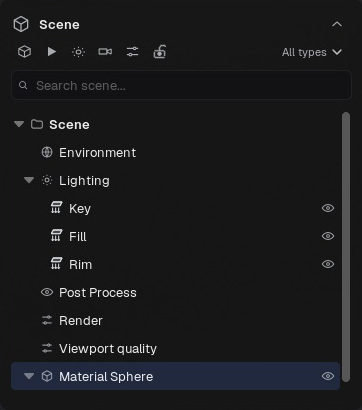

Figura 02. Árvore Scene: selecione objetos, expanda grupos, filtre itens e altere visibilidade.

Clique em um objeto para selecioná-lo. Use o Outliner quando superfícies sobrepostas dificultarem a seleção. Enquadre a seleção antes de orbitar um detalhe pequeno. A barra de ferramentas alterna mover, girar e escalar, espaço de coordenadas, encaixe e seleção de peças. Alterar o espaço de transformação muda os eixos do gizmo; isso não gira o objeto por conta própria.

A navegação é configurável. Em Preferências > Navegação, escolha perfil, centro de órbita e comportamento do foco. O rodapé mostra dicas do perfil ativo. O centro de órbita pode usar pivô da vista, seleção ou ponto sob o cursor. O foco pode enquadrar a seleção ou manter a posição da câmera. Eixo e direção do arrasto de dolly são ajustáveis. Copie vínculos ou parta de um preset antes de personalizar.

Shift + arrasto com botão direito gira o HDRI. Ctrl + Shift + arrasto com botão direito gira o rig de luzes; o primeiro movimento trava o eixo até soltar. O cubo de navegação escolhe vistas padronizadas e Home retorna à vista inicial. Oculte-o pelo menu ou ajuste seu tamanho em Preferências.

Arraste divisórias para redimensionar os painéis. Janela permite destacar Cena/propriedades ou Materiais, mover o aplicativo ao próximo monitor e restaurar o layout. Layouts nomeados guardam arranjos úteis. Restaurar layout altera a interface, não as transformações dos objetos.

Controles numéricos aceitam valores digitados; Shift torna o arrasto mais preciso. O indicador de valor modificado permite voltar ao padrão. Clique com o botão direito em rótulos compatíveis para adicionar ou remover Favoritos. O conta-gotas do seletor de cor captura uma cor visível; Esc cancela.

### Navegar sem modificar o asset

| Ação | Onde operar | O que muda |
| --- | --- | --- |
| Selecionar malha ou slot | Hierarquia de Cena | Alvo de edição; não o enquadramento |
| Orbitar, pan e dolly | Viewport, com o gesto do perfil ativo | Posição e orientação da vista |
| Mover, girar, escalar | Gizmo ou números de Objeto | Transformação do objeto ou grupo selecionado |
| World / local | Barra de transformação | Base dos eixos do gizmo |
| F / enquadrar seleção | Viewport com objeto selecionado | Enquadramento da câmera nessa seleção |
| Shift + arrasto direito | Viewport | Orientação do HDRI |
| Ctrl + Shift + arrasto direito | Viewport | Rotação do rig de iluminação |

As capturas usam o perfil Maya: Alt + arrasto esquerdo orbita, Alt + arrasto central faz pan e Alt + arrasto direito faz dolly. Outros perfis usam gestos diferentes. Confira as dicas do rodapé depois de trocar de perfil; não suponha que os comandos de Blender ou Toolbag continuem ativos.

### Organizar a interface para uma tarefa

1. Abra Janela > Panel layouts e salve o arranjo atual antes de reorganizar.

2. Para trabalhar com materiais, aumente Materiais arrastando sua borda interna. Role dentro dele para alcançar canais abaixo de Base color.

3. Ajuste a divisória entre Cena e Objeto para dar mais espaço à hierarquia ou ao inspetor.

4. Use Janela > Float / dock Materials quando houver um segundo monitor. A viewport principal continua na janela principal.

5. Use Janela > Reset layout se algum painel ficar difícil de localizar. Ocultar painéis e restaurar layout não apaga itens da cena.

### Editar um número com precisão

Clique no campo numérico e digite o valor exato quando o slider for grosseiro. Segure Shift durante o arrasto para refinar. O percurso visual do slider é uma faixa conveniente; alguns campos aceitam uma faixa maior por digitação. As unidades dependem do campo: pixels para saída e efeitos de tela, centímetros para foco, graus para ângulos e valores sem unidade para muitos multiplicadores de material. Confira o rótulo antes de copiar números entre controles.

Se um controle estiver desabilitado, confira primeiro seleção, família do material e renderizador. Path tracing indisponível pode indicar falta de suporte do hardware; uma seção de opacidade ausente pode apenas significar que o material é opaco. Abrir um painel não seleciona automaticamente um objeto adequado.

## 3 · Referência dos menus

### Arquivo

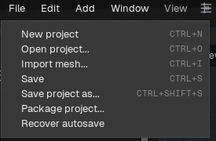

Figura 03. Menu Arquivo na interface em inglês.

Novo inicia um projeto. Abrir carrega um projeto salvo. Importar malha adiciona geometria à cena atual. Salvar atualiza o projeto; Salvar como cria outro arquivo. Empacotar projeto reúne recursos externos compatíveis para transferência. Recuperar autosave abre uma cópia de recuperação: confira-a e salve com outro nome antes de substituir o projeto principal.

### Editar

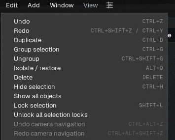

Figura 04. Menu Editar na interface em inglês.

Desfazer e Refazer percorrem o histórico de edições. Duplicar cria cópias dos itens selecionados. Agrupar reúne peças; Desagrupar desfaz o agrupamento sem excluir seus membros. Excluir remove o item selecionado; excluir um grupo também remove os objetos contidos nele. Isolar e Restaurar permitem trabalhar temporariamente só com a seleção. Ocultar, Mostrar tudo, Travar e Destravar tudo controlam visibilidade e edição. O histórico da câmera é separado do histórico geral.

### Adicionar

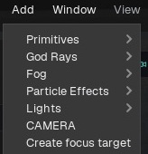

Figura 05. Menu Adicionar na interface em inglês.

Primitivas incluem esfera, plano, cubo e cilindro. Luzes incluem retangular, pontual, spot e sol. Câmera cria uma câmera a partir da vista; alvo de foco fornece um ponto móvel para a profundidade de campo. Submenus de efeitos são preenchidos pela biblioteca instalada: atmosfera/fog local, partículas, god rays e Draw FX. O fog volumétrico global fica em Ambiente. Draw FX inicia o desenho; Parar desenho ou Esc encerra. Fire scatter usa a superfície selecionada quando disponível.

### Janela

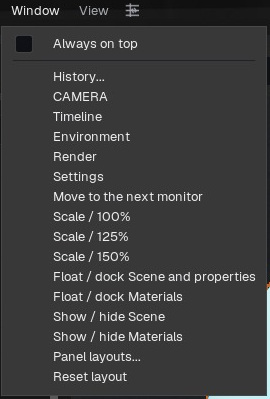

Figura 06. Menu Janela na interface em inglês.

Histórico abre ferramentas de histórico/câmera. Câmera, Timeline, Ambiente, Render e Preferências abrem seus painéis. Mover para o próximo monitor troca a tela da janela principal. Escala oferece 100%, 125% e 150%. Destacar/reencaixar Cena e propriedades e Destacar/reencaixar Materiais alternam painéis flutuantes e encaixados. Mostrar/ocultar Cena e Materiais controlam sua visibilidade. Layouts de painéis gerencia arranjos salvos. Restaurar layout volta ao encaixe padrão.

### View

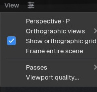

Figura 07. Menu View na interface em inglês.

Perspectiva retorna à projeção em perspectiva. Vistas ortográficas oferece Frente, Trás, Esquerda, Direita, Topo e Base. Mostrar grid ortográfico alterna a grade. Enquadrar tudo ajusta a vista à cena visível. Passes abre canais de diagnóstico. Qualidade da viewport abre os controles de renderizador e desempenho.

### Menu de câmera da viewport

Ver através de escolhe Vista livre, uma câmera da cena ou Nova câmera a partir da vista. Renderizador da viewport escolhe Realtime, Progressive path tracing, Hybrid ou NPR. Layout escolhe Vista única, Prévia de câmera, Duas vistas ou Quatro vistas. Opções das vistas abre tamanho, frequência de atualização e iluminação das prévias. O pequeno cadeado ao lado trava ou destrava a câmera de render ativa.

### Botões do cabeçalho

Desfazer, Refazer, Mostrar/ocultar painéis, Preferências e Render dão acesso direto. Render executa a tarefa configurada, que pode não ser uma imagem estática. O ícone da timeline alterna sua exibição. Minimizar, maximizar e fechar podem estar na barra de título do Windows, conforme o modo de janela.

### Comandos de arquivo e edição: efeito e atalhos

| Comando | Atalho padrão | Resultado / cuidado |
| --- | --- | --- |
| New | Ctrl + N | Inicia projeto novo; salve o trabalho atual |
| Open | Ctrl + O | Abre projeto, sem importá-lo como geometria |
| Import mesh | Ctrl + I | Adiciona geometria/recursos compatíveis ao projeto atual |
| Save | Ctrl + S | Atualiza o arquivo do projeto |
| Save as | Ctrl + Shift + S | Grava outra versão do projeto |
| Package project | Pelo menu | Reúne recursos para transferência; confira o pacote |
| Recover autosave | Pelo menu | Abre recuperação; salve uma cópia revisada separadamente |
| Undo | Ctrl + Z | Reverte edições de cena compatíveis |
| Redo | Ctrl + Shift + Z / Ctrl + Y | Reaplica uma edição desfeita quando disponível |
| Duplicate | Ctrl + D | Copia os itens selecionados |
| Group / Ungroup | Ctrl + G / Ctrl + Shift + G | Altera a hierarquia selecionada |
| Isolate | Alt + Q | Concentra temporariamente nos objetos escolhidos |
| Hide | Ctrl + H | Esconde a seleção; Show all restaura a visibilidade |
| Lock | Shift + L | Protege seleção/manipulação; Unlock all remove bloqueios |
| Delete | Delete | Remove a seleção; grupos incluem seu conteúdo |
| Camera undo / redo | Ctrl + Alt + Z / Ctrl + Alt + Shift + Z | Percorre o histórico da vista separadamente |

Atalhos dependem do contexto e podem ser personalizados. Grafo, campo de texto ou diálogo nativo podem estar com foco no lugar da viewport. Consulte Preferences > Keyboard shortcuts para os valores da instalação.

### Decisões de layout e visualização

Use Window > Always on top quando BeautyShot precisar ficar acima de outras janelas. Move to next monitor move o aplicativo; painéis soltos podem exigir reposicionamento próprio. Salve um layout após organizar Scene, Materials, Graph e Timeline. Se um painel ficar inacessível após desconectar monitor, use Restore/Reset layout.

View > Passes seleciona uma exibição de diagnóstico. Não equivale aos passes EXR de Render. Viewport quality controla a renderização interativa. Câmera/saída definem enquadramento salvo e exportação. O botão Render segue a tarefa atual: confira-a ao alternar entre imagem, animação e captura.

## 4 · Projetos, importação e portabilidade

Salve cedo, principalmente antes de importar um asset pesado. O projeto registra composição, atribuições e ajustes; ele não substitui as malhas e texturas de origem. Mantenha esses recursos em uma pasta estável. Use Empacotar projeto para transferir o trabalho e abra a cópia empacotada para conferir os caminhos.

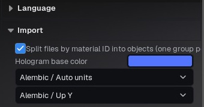

Figura 08. Preferências de importação: separação por material ID, cor do holograma e interpretação de Alembic.

Importe por Arquivo > Importar malha ou pelo arrasto compatível. O filtro do diálogo de arquivos indica os formatos aceitos nesta build. Importar malha e importar groom Alembic são operações distintas; dados de animação ou cabelo não são equivalentes a uma malha estática. Preferências de importação controlam a separação por peças/IDs de material. Assim, um personagem pode aparecer como grupo com peças e slots editáveis separadamente.

O holograma é uma prévia de carregamento. A geometria aparecer não significa que todas as texturas estejam prontas. Confira a barra inferior e aguarde antes de avaliar o material ou iniciar um render final. Fontes muito grandes podem exigir bastante RAM, VRAM e tempo, mesmo que o asset visível pareça simples.

Reimportar selecionado atualiza um objeto pela origem preservando posicionamento e materiais atribuídos. Reimportar somente esta peça atualiza uma parte de uma origem com múltiplas peças. O seletor de peça e o mapeamento de materiais definem o que será substituído. Confira essas escolhas após renomear partes no programa de modelagem.

Se faltar um arquivo, restaure-o no caminho salvo ou aponte o canal/origem para a localização nova. Salve uma cópia corrigida e empacote novamente. Autosave auxilia a recuperação, mas não substitui controle de versões. Faça backups datados antes de mudanças destrutivas e de abrir trabalhos antigos em uma beta nova.

### Importar um personagem com várias peças

1. Abra Preferências > Import. Mantenha Split files by material ID into objects ativo se quiser selecionar separadamente cada região de material.

2. Use Arquivo > Importar malha e escolha a origem. A cena já aberta recebe a importação.

3. Espere o holograma e o progresso das texturas terminarem. Expanda o novo grupo em Cena e confira peças e slots esperados.

4. Selecione o grupo para mover o personagem inteiro. Selecione uma peça quando precisar modificar apenas seu posicionamento ou material.

5. Salve o projeto .sculptstudio perto da pasta de fontes. Não renomeie nem mova mapas originais antes de empacotar ou corrigir seus caminhos.

### Salvar, Salvar como e Empacotar são operações distintas

| Comando | Quando usar | Conferência posterior |
| --- | --- | --- |
| Salvar | Continuar o mesmo projeto | Nome e destino corretos |
| Salvar projeto como | Criar versão ou cena alternativa | Novo arquivo abre com os mesmos recursos |
| Empacotar projeto | Transferir para outra máquina ou arquivar | Recursos coletados acompanham a cena |
| Recuperar autosave | Recuperar trabalho após interrupção | Inspecionar a recuperação e usar Salvar como |

Ao empacotar, transfira a cena resultante junto da pasta de recursos que a acompanha. Um pacote é uma entrega de projeto, não substitui o BeautyShot instalado. Abra a cópia empacotada no novo local antes de apagar pastas de origem.

### Reimportar preservando uma atribuição intencional

Salve uma versão antes. Selecione a peça afetada e use Reimport only this piece quando a alteração pertencer a um componente. Use Reimport objects from this file para o conjunto relacionado à mesma origem. Se nomes ou IDs de material mudaram no programa de modelagem, confira a correspondência de peças e materiais apresentada; o índice antigo pode não identificar mais a região desejada. Depois, compare silhueta, posição, slots e texturas antes de sobrescrever a cena anterior.

Quando uma origem está ausente, o diálogo de localização pede o modelo original ou seu substituto, não outro projeto BeautyShot. Para um mapa ausente, use o canal de material correspondente. Arquivos com nomes semelhantes em várias pastas podem ser ambíguos: escolha o asset correto explicitamente.

## 5 · Cena, grupos e transformações

O Outliner de Cena reúne ambiente, iluminação, pós-processamento, render, qualidade da viewport, câmeras, grupos e peças. A busca filtra a lista exibida. Filtros por tipo não alteram a visibilidade da cena. Expanda grupos e objetos para acessar peças e slots de material.

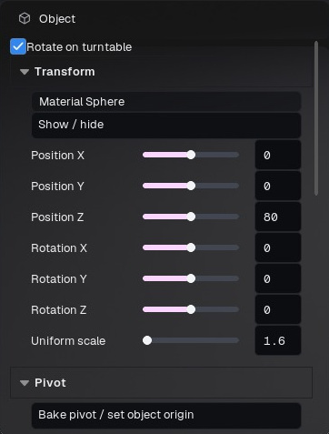

Figura 09. Inspector Object: participação no turntable, transformações e pivô. Selecione objeto ou grupo antes de editar.

Clique no olho para mostrar ou ocultar. Arraste sobre vários olhos para alterar itens em um gesto; um Desfazer restaura esse gesto. A trava impede a edição do item correspondente. O pequeno cadeado de câmera controla sua transformação. Selecione o slot de material para editar a atribuição correta, especialmente em superfícies sobrepostas.

Agrupe peças que precisam mover ou animar juntas. Selecione o próprio grupo para animar a transformação do personagem inteiro. Excluir um grupo exclui os objetos contidos nele; use Desagrupar para mantê-los. Isole a seleção em cenas densas e restaure a visibilidade antes da saída final.

O inspetor Objeto apresenta posição, rotação e escala. Gizmos de mover/girar/escalar usam o espaço de coordenadas escolhido. Snapping facilita deslocamentos regulares. Escalas negativas ou muito desiguais podem afetar normais, espessura e padrões procedurais; confira os materiais depois. Vista explodida separa peças para apresentação sem exigir posicionar cada parte manualmente.

Editar pivô altera o centro das transformações. Escolha uma das 27 posições da caixa envolvente, digite coordenadas, copie um pivô, procure o vértice mais próximo ou escolha um vértice na viewport. Saia da edição do pivô antes de mover o objeto. Aplicar pivô/definir origem torna esse ponto a origem mantendo a malha no lugar. Confira o pivô antes do turntable: um pivô deslocado faz o personagem orbitar em vez de girar sobre si.

Mesh / Subdivision reúne controles disponíveis de refinamento da geometria. Mais geometria nem sempre ajuda: avalie silhueta e sombreamento, preservando a origem para reimportação. Visibilidade no render e seleção no editor são coisas diferentes; confirme os objetos que aparecerão na saída.

### Organizar um personagem para animação

1. Em Cena, selecione as peças do personagem usando Ctrl para adicionar itens. Exclua cenário e luzes independentes, salvo se também precisarem acompanhar o personagem.

2. Escolha Editar > Agrupar seleção e dê um nome claro ao grupo.

3. Selecione a linha do grupo e confira transformação e pivô. O grupo é um alvo de transformação, não apenas uma pasta visual.

4. Mova-o um pouco e confirme que todas as peças desejadas acompanham. Desfaça esse movimento de teste.

5. Abra a Timeline com o grupo selecionado e crie chaves de Objeto para ele. Não é necessário criar uma trilha de transformação para cada peça de UV/material.

### Seleção, visibilidade e exclusão

| Controle | Resultado | Engano comum |
| --- | --- | --- |
| Filtro por tipo ou busca | Reduz a lista do Outliner | Achar que os itens filtrados não serão renderizados |
| Olho / Mostrar-ocultar | Altera a visibilidade da cena | Esquecer uma peça oculta na imagem final |
| Travar seleção | Evita seleção/edição acidental | Tentar mover um alvo travado |
| Isolar / restaurar | Concentra temporariamente na seleção | Esquecer de restaurar a cena |
| Desagrupar | Mantém membros e desfaz o agrupamento | Usar Excluir quando queria reorganizar |
| Excluir grupo | Apaga grupo e objetos contidos | Tratar o grupo como pasta vazia |

### Definir um pivô útil

Para turntable, escolha um pivô central da caixa envolvente ou digite a posição do eixo desejado. Para uma dobradiça, escolha um vértice próximo da articulação. Experimente uma rotação pequena antes de animar. Restaure a rotação se foi apenas diagnóstico. Editar pivô e mover objeto são operações separadas: saia do modo de pivô antes de reposicionar a peça.

Separate material ID, Separate loose parts e Separate by polypaint colour aparecem nos menus de contexto compatíveis da cena. Eles alteram a estrutura de edição; salve uma versão antes. Explode view ajuda a apresentar conjuntos: use sua intensidade e Reset explode para retornar as peças. Confira se selecionou o grupo ou conjunto pretendido antes de aplicar.

## 6 · Biblioteca de materiais e presets

A biblioteca reúne materiais da cena e categorias de presets. Busca, categorias e Favoritos facilitam encontrar um preset. Ajuste o tamanho das miniaturas. A miniatura ilustra o material nas condições de sua prévia; a aparência muda em outro modelo, iluminação ou renderizador.

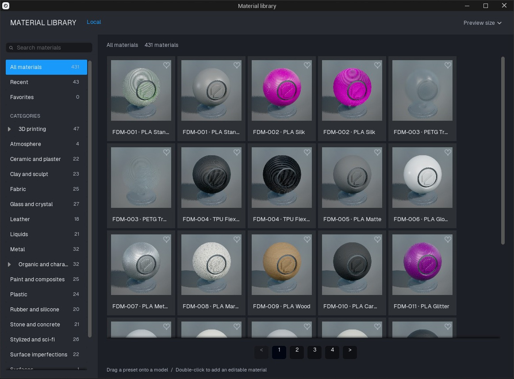

Figura 10. Biblioteca com prévias carregadas, busca, categorias, favoritos e páginas. O rodapé explica arrastar para atribuir e duplo clique para adicionar.

Arraste um preset para uma superfície ou slot no Outliner. Alt + arrasto abre opções de abrangência. Duplo clique adiciona um material editável à biblioteca da cena. Confirme o slot antes de editar: vários objetos podem compartilhar o mesmo material, e a alteração afetará todos eles. Duplique o material quando uma peça precisar de ajustes independentes.

Use categorias e Mover para para organizar entradas selecionadas. Favorito marca materiais frequentes. Salve/exporte um preset para reutilizar o look e importe presets compatíveis à biblioteca local. Mantenha as texturas dependentes junto dele ao compartilhar. Um preset de material não contém toda a iluminação e composição da câmera.

Abrir Material Graph ou Open construction apresenta a construção editável. Controles de artista oferecem ajustes comuns; Avançado lista parâmetros reais do material pai preparado. Essas vistas editam dados relacionados, não cópias independentes. Alguns presets usam texturas especiais ou switches compilados que exigem uma variante preparada, em vez de simples substituição de arquivo.

Prismatic Crystal é um material para superfícies escolhidas, não um estilo NPR global. Aplique-o somente onde quiser aparência de cristal; use o seletor NPR para o estilo artístico da viewport.

### Aplicar um preset na superfície certa

1. Selecione o objeto e expanda seus slots em Cena. Identifique o slot que deve receber o material.

2. Clique em Presets no topo de Materiais. Escolha uma categoria e refine em Search materials. All materials remove a restrição de categoria; Favorites mostra favoritos e Recent ajuda a retornar a escolhas anteriores.

3. Aguarde as miniaturas terminarem. Arraste um cartão para a superfície visível desejada. Para uma região oculta ou sobreposta, use seu slot de material.

4. Segure Alt durante o arrasto se precisar escolher a abrangência. Leia a opção antes de aplicar: substituir um material compartilhado pode afetar várias peças.

5. Feche a biblioteca e confira nome, família e canais. Compare o modelo na iluminação da sua cena; a biblioteca usa uma cena própria de prévia.

Dar duplo clique em um cartão adiciona um material editável à cena. Isso não garante que o slot desejado o esteja usando. Confira a atribuição antes de editar parâmetros.

### Materiais compartilhados e variações independentes

Compartilhe um material entre peças que devem continuar iguais. Duplique-o antes de criar uma variação exclusiva e atribua a cópia ao slot. Renomear facilita identificar, mas não cria outra cópia. Um objeto duplicado ainda pode compartilhar o material original.

| Local | Conteúdo | Ação típica |
| --- | --- | --- |
| Biblioteca de presets | Materiais reutilizáveis de partida | Buscar, filtrar, favoritar, adicionar ou aplicar |
| Lista de materiais da cena | Materiais disponíveis neste projeto | Selecionar, renomear, duplicar, organizar e atribuir |
| Inspetor de material | Parâmetros do material selecionado | Alterar mapas, valores e controles da família |
| Graph / construction | Construção editável compatível | Conectar nodes ou consultar parâmetros publicados |

Exporte um preset reutilizável depois de conferir suas texturas dependentes. Um arquivo de imagem no seu disco não passa a existir em outro computador só porque o material tem um nome. Importe o preset exportado em outra cena e confira antes de compartilhar. Câmeras, luzes e render da cena não pertencem a um preset comum de material.

## 7 · Canais de textura e interpretação de cor

Selecione o material e coloque cada mapa no canal correspondente. Base color descreve a cor; normal descreve detalhes de direção; roughness controla a abertura do brilho; metallic identifica metal; AO controla oclusão ambiente; emissive adiciona cor emitida. Mapas empacotados exigem escolher o canal de origem correto em cada destino. Nem toda textura em tons de cinza é opacidade.

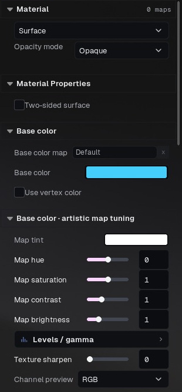

Figura 11. Família, modo de opacidade, mapa Base color, tint e vertex color. Os ajustes artísticos do mapa aparecem abaixo.

Cada mapa pode ser ligado/desligado sem perder arquivo, tiles ou ajustes. Abrir pasta da origem localiza o arquivo. Restaurar mapa retorna ao padrão/herdado quando disponível. Texturas de presets podem ser herdadas até serem substituídas. Canais de origem escolhem R, G, B ou A. Alterações de espaço de cor geram uma textura convertida compatível, em vez de forçar um sampler incompatível.

Base color costuma conter dados de cor; roughness, metallic, AO e normal são dados lineares. Siga a convenção do programa de origem, em vez de compensar uma interpretação errada com exposição. Normais podem ser DirectX ou OpenGL; use o controle de interpretação quando relevos parecerem invertidos. Intensidade regula a força do detalhe.

Roughness ou Glossiness define a interpretação. Glossiness é invertido para roughness em dados lineares. Níveis/gamma e inversão são ajustes do canal, independentes da exposição da cena. O threshold de metallic pode separar metal/dielétrico de forma binária; deixe-o desligado para valores contínuos intencionais. AO tem seus próprios níveis. A prévia de canal isola dados para diagnóstico.

Escala UV, repetição de detalhe, detail normal, height/parallax e sharpen modificam amostragem ou relevo aparente. A amostragem UV/UDIM da cor deve acompanhar a origem. Antes de atribuir uma costura ao shader, confira padding, convenção de normal, canal e textura original. Pintura de superfície e vertex color podem multiplicar a cor; desligue Use vertex color ao comparar só a textura. O fluxo de carregar base map privilegia a textura, mas confira ajustes já salvos no projeto/preset.

Tint e níveis de base color são alterações artísticas intencionais. Para comparar com a origem, comece com tint branco, níveis neutros, espaço de cor correto e sem modulação de vértices. Transformação de exibição e pós-processamento ainda podem mudar a imagem da tela.

### Conectar um conjunto PBR convencional

1. Selecione o slot, escolha Surface e comece com material opaco.

2. Carregue o albedo em Base color map. Deixe o multiplicador de cor branco e desligue Use vertex color para a comparação inicial com a textura.

3. Carregue Roughness no canal correspondente. Se o arquivo for Glossiness, escolha essa interpretação em vez de compensar mudando a luz.

4. Carregue Metallic em Metalness ou mantenha 0 constante para um dielétrico. Metal usa a cor de forma diferente de plástico; não aumente Metalness só para deixar plástico mais brilhante.

5. Carregue o normal map. Se cavidades virarem relevos ou a luz inverter nos detalhes, confira Flip green / OpenGL normal. Comece com intensidade 1.

6. Coloque AO apenas no canal correto. Adicione Emission separadamente se houver áreas luminosas.

7. Confira de vários ângulos. Salve depois de confirmar o material de destino de todos os mapas, principalmente quando os slots têm nomes parecidos.

| Entrada | Informação armazenada | Interpretação a conferir |
| --- | --- | --- |
| Base color / albedo | Cor pintada da superfície | Fonte de cor/sRGB; tint neutro |
| Roughness | Reflexos amplos ou definidos | Dados lineares; branco geralmente mais áspero |
| Glossiness | Convenção inversa à rugosidade | Selecionar interpretação Glossiness |
| Metalness | Regiões metálicas ou dielétricas | Máscara linear; evitar ligar alpha por engano |
| Normal | Detalhe de direção em espaço tangente | Dados normais lineares e convenção do canal verde |
| AO | Informação de oclusão | Dado escalar linear; não é opacidade |
| ORM | Três mapas escalares na mesma imagem | R = AO, G = Roughness, B = Metal |
| Opacity | Cobertura da superfície | Alpha ou máscara autoral; independente do preto RGB |
| Emission | Cor e padrão emitidos | Cor mais intensidade; bloom é outro efeito |

### Inspecionar o canal em vez de adivinhar

Use o seletor de origem quando o mapa empacotado guardar a máscara apenas em R, G, B ou A. Desligue temporariamente o mapa para comparar sua contribuição sem perder o caminho. Channel preview ajuda a examinar a origem; retorne a RGB após o diagnóstico. Levels/gamma altera o canal; exposição da cena modifica a imagem renderizada inteira.

Para costuras em normal/roughness, inspecione na resolução de entrega com sharpen próximo do neutro. Confira padding UV e a convenção de normal do exportador. Detail normal e sua repetição são camadas extras; desligue durante a comparação da textura original. Height/parallax cria profundidade aparente nas famílias compatíveis; não equivale a subdivisão que altera a silhueta da malha.

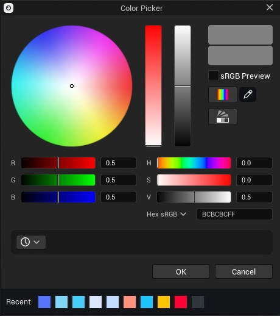

Figura 12. Seletor com valores numéricos e amostras salvas/recentes. Confira a interpretação da cor ao comparar texturas.

## 8 · Opacidade, pixels pretos e vidro

Cor preta e transparência são independentes. Um pixel preto opaco deve continuar sendo uma superfície preta visível. A máscara de cobertura define se a superfície existe. O alpha do base color pode fornecer cobertura quando configurado; a luminosidade RGB não substitui esse alpha.

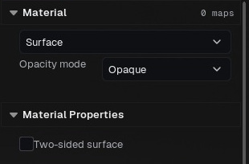

Figura 13. Opacity mode é uma escolha explícita. Um material opaco não deriva cobertura de valores RGB pretos.

### Escolher o modo de cobertura

Opaque mantém a superfície sólida. Mapas de opacidade guardados são ignorados por materiais opacos, inclusive no NPR. Cutout / Masked remove pixels conforme a cobertura e serve para folhas, renda ou recortes de hair cards. Translucent permite cobertura parcial, com comportamento de ordenação e render distinto. Para vidro ou plástico transparente, escolha Glass em vez de apenas reduzir a opacidade de uma superfície com espalhamento.

### Diagnosticar regiões pretas desaparecendo

1. Selecione o slot afetado e confira Opacity mode.

2. Para objeto sólido, escolha Opaque. Confira o canal Opacity e o indicador de alpha do Base color.

3. Veja o alpha da textura separado do RGB. Um PNG pode ter alpha zero indesejado mesmo que a imagem RGB pareça correta.

4. Para recortes intencionais, mantenha Masked e forneça a máscara correta. Não elimine alpha legítimo para esconder outro problema.

5. Exporte um PNG RGBA pequeno e veja sobre um xadrez. Fundo preto do visualizador pode esconder a diferença entre preto e transparência.

Subsurface e thickness não são cobertura. Branco na máscara SSS habilita espalhamento; preto o reduz. Thickness muda a distância percorrida pela luz. Para uma garrafa, comece com cobertura 1 e ajuste distância de absorção, cor de transmissão, IOR e roughness. Vidro precisa de geometria, espessura e ambiente adequados para refletir. Realtime e path tracing podem diferir; um plano fino não é um volume fechado físico.

Para saída transparente, escolha formato com alpha e habilite a opção de alpha da saída. JPEG e MP4 comum não preservam fundo transparente. Cobertura do material e alpha do fundo da imagem são configurações separadas.

### Três significados diferentes de “transparente”

| Ajuste | Controla | Não significa |
| --- | --- | --- |
| Opacity mode / máscara | Se o material cobre um pixel | Que toda cor escura deve desaparecer |
| Transmissão e absorção do vidro | Luz atravessando o volume do material | Fundo transparente no arquivo de imagem |
| Render > Transparent background / RGBA | Alpha da composição exportada | Que todos os materiais viram vidro |

Para tinta preta continuar sólida, use superfície opaca. Para recortar uma folha, use máscara de cobertura. Para uma garrafa colorida, use Glass com transmissão/absorção e espessura adequada. Para remover o fundo do estúdio na entrega, habilite RGBA. Essas operações podem coexistir, mas uma não substitui a outra.

### Examinar o alpha exportado

Renderize um PNG pequeno com Transparent background / RGBA ativo. Abra sobre xadrez claro e sobre fundo escuro em um editor de imagens. Examine uma área preta dentro do modelo: se o material é opaco, ela deve cobrir o fundo. Examine um recorte intencional: ele deve revelar o fundo. Confira a silhueta externa em busca de franjas. A comparação distingue cobertura do material de um visualizador que apenas mostra transparência como preto.

Para vidro, confira primeiro escala, normais e se a geometria representa uma casca sólida. Aumente roughness para suavizar transmissão e reflexos; ajuste tint de transmissão e distância de absorção para controlar a cor da espessura. Compare uma borda fina com o centro espesso. Use uma fonte de reflexão clara e um fundo contrastante para tornar o vidro legível. Um ambiente uniforme pode dificultar enxergar até um vidro corretamente transparente.

## 9 · Famílias de materiais e controles avançados

Escolha uma família adequada: PBR geral, pele/subsurface, metal, clear coat, tecido/fuzz, vidro, hair cards ou olhos. Os parâmetros variam por família. Comece pelos controles básicos; Artista e Avançado expõem outras capacidades do material pai preparado. Pesquise parâmetros e confira o tipo antes de alterar.

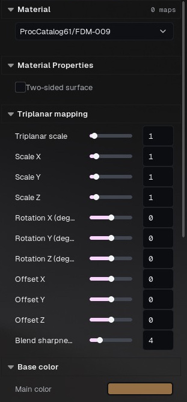

Figura 14. Um preset procedural expõe controles próprios de projeção triplanar e cor principal. Sua construção difere de um material simples com mapas.

Perfis de pele, força de transmissão, espessura e cor de espalhamento regulam subsurface. Clear coat adiciona uma camada refletiva com roughness próprio. Tecido/fuzz controla resposta de fibras. A opacidade de hair cards recorta cartões; não cria fios de groom. Olhos incluem máscara e profundidade da íris. Receitas de vidro são pontos de partida, não substitutos da geometria correta.

Grupos de iluminação separam luz direta e resposta especular. Superfície de um/dois lados muda a resposta de faces traseiras. Cor, mapa e intensidade emissivos controlam emissão. Para brilho só em materiais escolhidos, marque Bloom seletivo neles e ajuste raio/intensidade em Pós-processamento. Pode ser combinado com bloom da cena; material emissivo brilhante não equivale automaticamente a uma luz de área em todo renderizador.

Materiais procedurais/argila podem oferecer escala automática, repetição e relevo. A escala automática ajusta o detalhe ao modelo; revise-a quando as unidades da origem produzirem detalhes inadequados. Entradas escalares, vetores, cores e texturas em Avançado editam parâmetros reais preparados. Switches marcados como compilados não geram variantes ausentes da build. Texturas cube, volume e virtual podem exigir variante preparada.

O inspetor de capacidades descreve a família real de render. Ele não promete compilar qualquer grafo Unreal dentro do aplicativo distribuído. Duplique o material antes de mudar sua família e compare os canais depois.

### Escolher a família antes de refinar o look

| Família / fluxo | Uso previsto | Primeiros controles a conferir |
| --- | --- | --- |
| Surface | Objetos PBR opacos gerais | Base color, roughness, metalness e normal |
| Clear coat | Substrato com revestimento, como pintura envernizada | Material base, quantidade e rugosidade da camada |
| Cloth | Tecido com resposta suave em ângulos rasantes | Cor, roughness, fuzz e espalhamento |
| Skin | Pele com espalhamento controlado | Escala, perfil, máscaras, specular e normal |
| Subsurface | Cera, resina e sólidos com espalhamento | Distância, cor, espessura e transmissão |
| Glass | Vidro ou plástico transparente | Espessura, tint, roughness, IOR e absorção |
| Hair cards | Geometria em fitas texturizadas | Máscara de opacidade, normal e direção dos fios |
| Groom | Cabelo importado em curvas | Geometria, largura dos fios e aparência |
| Eye | Superfícies específicas de olhos | Íris, reflexos e geometria apropriada |
| Preset nativo preparado | Material com construção própria | Controles de artista e parâmetros Advanced |

### Criar um objeto pintado e envernizado

Comece com base não metálica se a camada visível for tinta. Defina cor e rugosidade moderada. Selecione Clear coat, aumente sua quantidade e deixe a rugosidade da camada menor que a da base. Posicione uma luz retangular ampla para revelar o segundo brilho. Compare em ângulo rasante. Se tudo ficar branco, reduza luz/exposição antes de tentar resolver com mais saturação.

### Ajustar espalhamento em uma ordem controlada

Confira a escala real antes da distância de espalhamento. Use luz neutra de estúdio e compare uma borda fina com uma região espessa. Ajuste cor, depois distância ou intensidade e, por último, máscaras. A máscara define onde o efeito atua; thickness descreve quanto material a luz atravessa. Não compense textura base errada aumentando SSS. Compare no renderizador final, pois o transporte de luz difere entre realtime e path tracing.

Advanced expõe parâmetros do material pai selecionado. Busque pelo nome e abra o grupo relevante. Escalares são números; vetores podem ser cores ou valores empacotados; campos de textura apontam para imagens. Assets preparados somente para leitura, como texturas de cubo ou volume, não são slots comuns de imagem 2D. Um parâmetro existir não garante que toda variante compilada o utilize visivelmente.

## 10 · Grafo de materiais e pintura de superfície

Abra Material Graph pela biblioteca para inspecionar a construção. Selecione nodes, edite entradas e conecte saídas compatíveis. Mantenha a saída final conectada. Controles publicados de artista usam os mesmos valores dos nodes no grafo e, quando animáveis, da timeline.

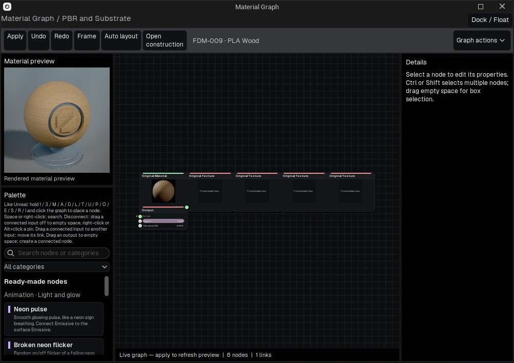

Figura 15. Material Graph com prévia renderizada, paleta, canvas e Details. A vista inspeciona o material nativo encapsulado; Open construction abre sua construção quando compatível.

Agrupar seleção (Ctrl+G) organiza nodes; Desagrupar (Ctrl+Shift+G) expande-os. Salvar seleção como preset guarda uma construção reutilizável. Inserir material Blend oferece o fluxo de mistura em camadas compatível. Um grafo baseado em família preparada precisa respeitar suas capacidades em runtime; não é um compilador geral de shaders Unreal.

Para animar um material, adicione/use um node Float animável, exponha o controle escalar/cor e crie a faixa do material. Nomes inválidos de parâmetros nativos são rejeitados. Percorra a timeline para conferir o mesmo valor publicado e salve o projeto para preservar construção e animação. Switch estático não pode ser animado como valor escalar.

Pintura de superfície oferece pincel e seleção de faces. Configure raio, força, falloff, cor, operação e canal. No modo Brush, o botão esquerdo pinta; em Faces, clique ou selecione por caixa, Ctrl adiciona e Shift remove. A navegação mantém seus atalhos. Preencher objeto/faces selecionadas aplica a operação ao escopo escolhido. Slot-only limita ao slot selecionado quando ativado.

Escolha um material de pintura ou adicione camada pintada para misturar materiais. A prévia ajuda a conferir o canal. Pintura de vértices depende de vértices suficientes para representar detalhes; ela não cria uma textura UV com resolução arbitrária. Restaure a exibição normal após examinar máscaras e preserve a origem para decidir sobre reimportação.

### Fazer uma edição de graph que possa ser conferida

1. Duplique um material da cena para experimentar e atribua a cópia a um objeto visível.

2. Abra Material Graph pelo ícone de grafo em Materiais. Confira o nome do material antes de editar.

3. Identifique o node de superfície/saída e as conexões que chegam a ele. Um node desconectado não participa do material visível.

4. Adicione um node compatível de cor ou textura pela paleta e conecte ao input desejado. Ligue tipos compatíveis; cor, escalar e normal têm significados diferentes.

5. Mude um valor e observe o objeto. Preserve a construção anterior até a nova conexão produzir o resultado esperado.

6. Use grupos e controles publicados para uma construção reutilizável. Salve a cena ou exporte o material depois de conferir dependências.

| Componente | Papel | Conferência prática |
| --- | --- | --- |
| Constante / parâmetro | Fornece valor ou controle exposto | O input correto está recebendo esse valor? |
| Textura | Amostra uma imagem externa ou preparada | Arquivo, UVs, canal e interpretação de cor |
| Matemática / blend | Combina ou remapeia valores | Confira a faixa; multiplicar por zero elimina a contribuição |
| UV / mapping | Determina coordenadas da textura | Compare escala e costuras na malha real |
| Time / panner | Anima uma entrada compatível | Compare quadros da timeline e a animação exportada |
| Superfície / saída | Produz o material final | Confira conexão e suporte da construção |

O graph em runtime do BeautyShot não é todo o ambiente de materiais do Unreal Editor. Nodes disponíveis e caminhos compilados definem o que a build executa. Se uma construção estiver incompleta ou indisponível, leia o status do graph; adicionar um node à tela não significa que ele já esteja renderizando.

### Pintura de superfície e dados de vértices

Escolha objeto, modo e alvo de pintura antes de aplicar um traço. Ajuste raio e força à escala do modelo e faça um teste curto em uma área visível. Veja de outro ângulo e desfaça se atingiu a região errada. Pintura por vértice depende da densidade: um polígono grande não guarda o mesmo detalhe localizado de uma malha densa. Máscaras de material e base color pintado são alvos diferentes. Salve após uma operação correta e confira a portabilidade ao compartilhar recursos.

## 11 · Groom e importação de curvas

A importação de groom Alembic cria geometria de fios a partir de curvas compatíveis. Defina unidades e eixo vertical em Preferências quando souber a convenção da origem. Unidades automáticas são um ponto de partida; confira a escala em relação ao personagem. Z-up e Y-up representam sistemas diferentes.

Selecione o groom e abra Geometria do Groom. Densidade interpola fios adicionais entre curvas próximas compatíveis; não recupera um penteado ausente da origem. Amostragem adaptativa usa mais pontos onde a curvatura exige: ângulo menor preserva cachos, enquanto trechos retos precisam de menos pontos.

O multiplicador de largura escala as larguras originais dos vértices, preservando o afunilamento de fontes compatíveis, como XGen. Confira raízes e pontas, além da silhueta. Largura e densidade excessivas podem deixar o cabelo sólido e aumentar o uso de memória.

Reconstruir relê a origem com os ajustes atuais. Restaurar original relê com densidade 1× e amostragem original. Mantenha o Alembic acessível; reconstrução depende desse arquivo. Teste um recorte pequeno antes de elevar a densidade do groom inteiro.

### Importar e refinar cabelo

1. Em Preferências > Import, confira unidades Alembic e Up Y / Up Z conforme o exportador. Unidade errada pode deixar fios enormes ou quase invisíveis.

2. Importe um groom Alembic compatível e aguarde a preparação. Selecione o groom, não a malha do couro cabeludo próxima.

3. Confira silhueta, raízes e pontas antes de reduzir dados. Preserve uma cópia salva da importação original.

4. Use densidade retida para reduzir a quantidade de curvas. Ângulo adaptativo e mínimo de pontos controlam a simplificação ao longo de cada curva. São custos diferentes.

5. Aplique o refinamento e confira cachos, fios curtos e silhueta. Restaure o original se perder formas importantes.

6. Ajuste largura do fio, raiz/ponta e LOD bias para apresentação. Engrossar pode dar mais volume visual, mas não recupera geometria removida.

| Controle | Efeito principal | Observe |
| --- | --- | --- |
| Density | Quantidade de curvas preservadas | Falhas ou perda de volume |
| Adaptive angle | Simplificação ao longo da curva | Dobras angulares em cachos |
| Minimum points | Limite inferior de amostras da curva | Fios curtos muito grosseiros |
| Strand width | Espessura renderizada | Aglomeração ou aparência de massa sólida |
| Root / tip width | Distribuição de espessura | Pontas sem afilamento ou raízes destacadas |
| LOD bias | Seleção de detalhe | Mudança de silhueta à distância |

Grooms em curvas e hair cards recortados por alpha têm fluxos de importação e material distintos. Importar malha estática não transforma fitas poligonais em curvas de fios. Prepare a representação desejada no programa de origem.

## 12 · Luzes e rigs de iluminação

Adicione luz retangular, pontual, spot ou sol pelo menu Adicionar ou controle de luz no Outliner. Retangulares criam reflexos de área; pontuais irradiam de uma posição; spots têm cone; sol fornece direção. Selecione a luz para editar transformação, potência e cor. Presets de temperatura são pontos de partida; tint continua sendo uma escolha artística.

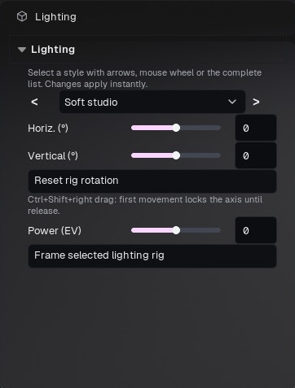

Figura 16. Controles do grupo Lighting atuam no rig. Selecione uma luz para intensidade, formato e cor individuais.

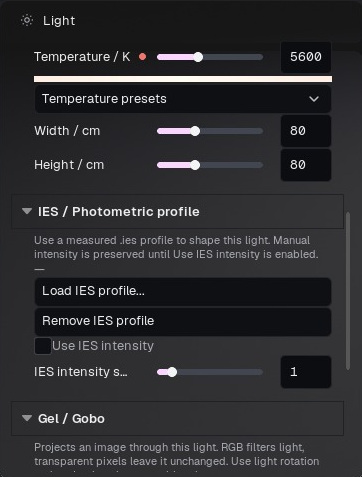

Figura 17. Configurações individuais incluem IES/gobo quando compatíveis com o tipo de luz.

Tamanho da fonte e suavidade moldam brilhos e sombras quando disponíveis. Perfis IES definem distribuição fotométrica; Gel/Gobo molda ou colore a projeção. Carregue recursos compatíveis e mantenha-os no pacote do projeto. Gobo não equivale a trocar a imagem de fundo do ambiente.

Light Controller e controles do rig movem um conjunto de luzes de forma coerente. É possível restaurar rotação e enquadrar o rig. Potência em EV muda a intensidade do conjunto. Seguir objeto mantém a relação configurada com o alvo. Confira alvo e centro antes de girar um rig ao redor de uma cena grande ou deslocada.

Controles especulares podem ocultar o brilho direto de uma luz preservando sua iluminação. Para pontual, spot e retangular, controles exclusivos do piso reduzem reflexos indesejados no chão sem retirar os brilhos do objeto. Grupos de iluminação nos materiais separam ainda mais luz direta e resposta especular.

Espalhamento volumétrico e sombras volumétricas regulam a participação no fog. Só são úteis com um meio volumétrico adequado. Shadow maps, virtual shadow maps e sombras ray traced são opções de qualidade da viewport, não tipos artísticos de luz. Compare um render pequeno no backend final depois de mudar iluminação ou sombras.

### Montar uma iluminação legível de três luzes

Comece com uma Key. Defina a direção antes da intensidade: sua função é revelar a forma principal. Adicione Fill mais fraca do outro lado para preservar detalhes sem eliminar o volume. Posicione Rim atrás ou de lado para separar a silhueta. Alterne o olho de cada luz para entender sua contribuição. Ajuste uma de cada vez e confira materiais reflexivos e escuros juntos.

| Controle / tipo | O que altera | Aplicação útil |
| --- | --- | --- |
| Luz retangular | Emissor amplo com dimensões editáveis | Reflexos de softbox e iluminação suave |
| Pontual | Luz local emitindo em todas as direções | Fontes pequenas |
| Spot | Cone direcionado | Destaques e padrões projetados |
| Sun / direcional | Iluminação direcional distante | Luz externa ou direção global consistente |
| Intensity | Contribuição luminosa | Equilibrar luzes |
| Temperatura / cor | Matiz da luz | Separação quente/fria ou comparação neutra |
| Largura / altura ou tamanho da fonte | Área aparente do emissor | Forma do reflexo e suavidade compatível das sombras |
| Atenuação / cone | Influência espacial | Limitar luz local a uma região |
| IES | Distribuição fotométrica | Perfil preparado de luminária |
| Gel / Gobo | Cor ou padrão projetado | Iluminação com padrão em luz adequada |

### Posicionar um reflexo intencionalmente

Com a luz selecionada, use o modo de posicionamento por reflexão do Light Controller quando disponível. Clique no ponto que deve receber o brilho e ajuste distância e tamanho da fonte. Confira pela câmera de render: um brilho posicionado de outro ângulo pode mudar em relação à composição. Desligue o modo de posicionamento ao concluir.

Lighting groups separam iluminação direta e influência especular nos alvos compatíveis. Reflexos do ambiente e iluminação indireta continuam compartilhados. Não representam vinculação completa de luz para todos os caminhos de transporte. O piso reserva um canal, restando dois grupos de objetos; leia a explicação do painel antes de atribuir.

Gire o rig com Ctrl + Shift + arrasto direito para mudar o ângulo de luz mantendo a câmera. Se uma luz precisar acompanhar o turntable, habilite sua participação conscientemente; luzes de estúdio normalmente ficam fixas enquanto o produto gira.

## 13 · Ambiente, piso e efeitos

Ambiente controla HDRI, céu, chão e fundo. A rotação do HDRI muda a direção da iluminação ambiental. Intensidade altera iluminação; visibilidade do fundo define se o ambiente aparece atrás do modelo. Ocultar o fundo não necessariamente desliga sua luz. Sky Light ativa a contribuição ambiente da fonte escolhida.

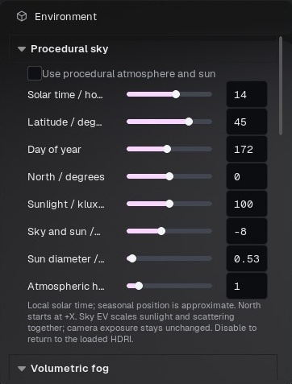

Figura 18. Controles de céu procedural em Environment. Role o inspector para fog, HDRI e chão.

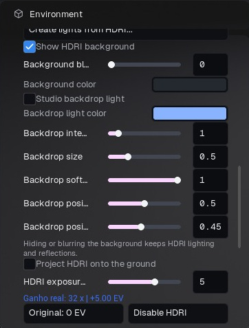

Figura 19. Fundo HDRI, luz de fundo de estúdio e exposição. Visibilidade do fundo é diferente de iluminação do ambiente.

Céu procedural oferece outra fonte de céu. Ground controla presença e aparência do piso. Ajuste material/reflexo do chão em vez de escurecer a imagem inteira para reduzir seu brilho. Oclusão ambiente da cena adiciona contato na luz indireta e é independente dos mapas AO dos materiais.

O fundo da câmera pode ser cor sólida ou imagem. Preencher/Cover ocupa o recorte e pode cortar bordas; Conter/Contain mostra a imagem inteira e pode deixar margens; Esticar/Stretch preenche alterando proporção. Ajustar recorte à imagem muda a proporção de saída. Fundo chapado e fundo com profundidade respondem de formas diferentes ao movimento e posicionamento.

Fog volumétrico global é ativado em Ambiente. Efeitos locais de atmosfera são objetos separados com controles próprios. Use escala uniforme quando solicitado. Raio controla o volume esférico; densidades zero removem o fog. Avançado apresenta parâmetros do efeito preparado, que variam conforme o asset.

Draw FX cria um efeito por traço, depois editável por transformação. Escolha outro traço em Adicionar > Particle Effects > Draw FX; Esc encerra o desenho. Chama natural/estilizada, cor, direção, velocidade, gravidade, luz vinculada, malha e material personalizados só aparecem em efeitos compatíveis. Material padrão remove o override. Partículas e efeitos animados precisam de warmup para renderizar um estado estabilizado.

### Preparar um HDRI sem alterar o objeto

1. Selecione Environment em Scene e localize os controles de HDRI. Carregue um HDR ou EXR latitude/longitude, preferencialmente equiretangular 2:1.

2. Gire o ambiente observando os reflexos do objeto. Escolha a direção da luz antes de aumentar a exposição.

3. Ajuste a exposição do HDRI. Cada EV adicional dobra sua contribuição; isso não altera o valor de exposição da câmera.

4. Decida se o mesmo HDRI deve aparecer atrás do objeto. Esconder o fundo não exige remover sua iluminação e seus reflexos.

5. Use desfoque do fundo ou os controles de fundo de estúdio para a apresentação. Confira superfícies reflexivas após mudanças de iluminação.

6. Salve o projeto e inclua o HDRI ao empacotar recursos para outro computador.

### Controles do ambiente em detalhe

| Controle | O que modifica | Conferência prática |
| --- | --- | --- |
| Procedural sky | Substitui a iluminação do HDRI por céu/sol enquanto ativo | Desative para voltar ao HDRI |
| Hora, latitude, dia do ano | Posição solar para a configuração geográfica | Confira a direção da sombra no chão |
| North orientation | Gira a orientação geográfica do céu; +X é a referência | Alinhe o lado desejado do modelo ao sol |
| Intensidade do sol / sky EV | Sol direto e contribuição geral do céu | Mantenha a exposição da câmera ao comparar |
| Diâmetro do sol | Tamanho aparente da fonte | Valores maiores suavizam a sombra solar |
| Haze | Aparência da dispersão atmosférica | Evite lavar o contraste de um produto pequeno |
| Sky Light, EV e tint | Preenchimento do ambiente e sua cor | Cor neutra ajuda a avaliar a textura |
| Visibilidade / desfoque do fundo | Apresentação atrás do modelo | Fundo visível e iluminação são escolhas separadas |
| Luz do fundo de estúdio | Mancha/gradiente controlável no fundo | Ajuste cor, intensidade, tamanho, suavidade e posição X/Y |
| Ground projection | Projeta o HDRI no chão do ambiente | Ajuste tamanho do ambiente e altura de captura juntos |

### Chão, sombras e escala

Show ground controla a superfície do piso. Cor, rugosidade, metalness e specular permitem montar um piso simples rapidamente. Ao atribuir um material personalizado ao chão, esse material passa a controlar a aparência; os controles simples desabilitados não o substituem. Mapas de opacidade podem recortar o piso. Compact floor, raio e suavidade da borda ajudam a isolar a apresentação de um produto.

A projeção do HDRI no chão é diferente de colorir o piso. O tamanho do ambiente usa metros, e HDRI camera height descreve a altura de captura do panorama. Um ambiente menor ou uma altura menor altera a relação aparente entre objeto e cenário. Confira uma dimensão conhecida do objeto antes de julgar a projeção.

### Adicionar atmosfera com controle

Fog density define a quantidade de névoa; height falloff controla sua distribuição vertical. Scattering direction determina a preferência de dispersão para frente ou para trás. Extinction muda a atenuação da luz, e view distance limita a extensão calculada. Esses valores interagem com escala e direção da luz. Comece com densidade baixa, estabeleça uma luz lateral/traseira e aumente até enxergar o feixe. Evite compensar uma iluminação fraca com névoa densa que esconde o modelo.

O fog de Environment é global. Assets locais de fog/efeitos em Add são elementos posicionados na cena, com controles próprios. Use o olho no Scene para descobrir qual elemento gera a névoa. A saída com fundo transparente omite elementos de atmosfera/fundo que preencheriam a imagem; confira o resultado de composição separadamente da viewport iluminada.

## 14 · Câmeras, lentes e múltiplas vistas

Vista livre é a câmera de navegação, não uma câmera de render salva. Crie uma câmera da vista para guardar a composição. Ver através da câmera a ativa. Uma moldura identifica o recorte; a indicação muda quando a câmera está travada. Destrave antes de alterar sua transformação e trave novamente para evitar movimentos acidentais.

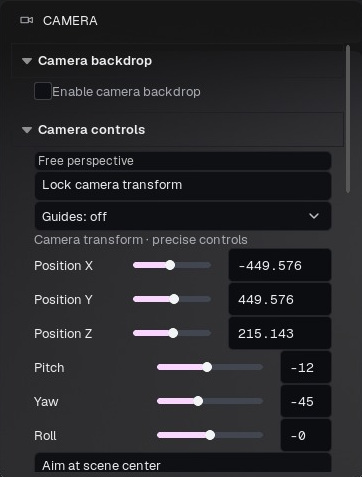

Figura 20. Controles de câmera para trava da vista, guias, posição e orientação precisas.

Controles incluem órbita/yaw, inclinação, distância, transformação precisa e apontar para o centro. Perspectiva usa lente/FOV; projeção ortográfica elimina a mudança de tamanho com a profundidade. Escolha uma direção ortográfica pelo menu View ou cubo. Largura ortográfica controla enquadramento, não distância focal.

Saída/recorte define largura, altura e presets. Prévia do recorte mostra os limites da imagem. Margem, cor/opacidade das guias e sombreamento externo auxiliam composição sem mudar pixels finais. Duplicar câmera pode duplicar seus keyframes; excluir remove a vista. Histórico da câmera oferece recuperação separada de navegação/composição.

Profundidade de campo depende de distância de foco, abertura e lente/projeção. Use autofocus ou alvo de foco para assunto em movimento. Bokeh/forma da lente controla brilhos desfocados. Confira foco na resolução final: uma prévia pequena pode esconder um plano de foco errado. O alvo precisa continuar corretamente atribuído e animado quando o assunto se desloca.

Vista única, prévia de câmera, duas vistas e quatro vistas são layouts de trabalho. Tamanho e atualizações por segundo equilibram fidelidade e fluidez; iluminação completa pode custar mais. Cada vista tem seu contexto de interação. Ative a vista pretendida antes de manipular objetos ou luzes. Ter várias prévias não cria automaticamente uma fila de render de câmeras.

Look da câmera/override local permite pós-processamento próprio. Entre na câmera antes de editar seu look. O pós da cena continua sendo o padrão para câmeras sem override. A câmera escolhida em Render define a composição exportada.

### Criar um enquadramento repetível

1. Navegue na Perspective livre até obter o enquadramento desejado.

2. Abra os controles de câmera e crie uma câmera a partir da vista atual. Use um nome descritivo, como Retrato frontal ou Detalhe do fecho.

3. Escolha Look through nessa câmera. Apenas selecioná-la em Scene não é o mesmo que ativar sua vista.

4. Defina lente, proporção de saída e prévia de recorte. Reenquadre após mudar a distância focal.

5. Ajuste foco e exposição; trave a câmera para evitar navegação acidental. Destrave antes de orbitar o enquadramento salvo.

6. Em Render, escolha explicitamente essa câmera ou inclua-a na fila. Salve o projeto.

### Referência de lente e foco

| Configuração | Significado | Como usar |
| --- | --- | --- |
| FOV em perspectiva | Campo angular, de 5 a 120 graus | Um valor amplo exagera a perspectiva a curta distância |
| Presets de lente | Combinações de focal/abertura em referência full-frame | Comece com 50 mm para vista neutra ou 85 mm para retrato fechado; reenquadre |
| Largura ortográfica | Largura da vista em centímetros da cena | Útil para comparar frente/lado sem convergência de perspectiva |
| Exposição EV da câmera | Exposição desta câmera | Mantenha fixa ao comparar materiais ou luzes |
| Depth of field | Ativa o desfoque de lente | Confira na resolução final de saída |
| Foco Artist | Intensidade simples de blur e faixa de profundidade nítida | Use para compor pela aparência, sem valores físicos da lente |
| F-stop Physical | Abertura, aproximadamente f/0,7 a f/64 | Valores menores deixam menor profundidade em foco |
| Distância de foco | Distância do plano nítido, em centímetros | Escolha uma superfície ou digite uma distância conhecida |
| Focus target | Modelo/alvo que conduz o foco | Útil para personagem em movimento ou detalhe |
| Also aim camera | Orienta a câmera para o alvo de foco | Ative somente se enquadramento e foco devem acompanhá-lo |
| Formato do bokeh | Lâminas, curvatura e compressão | A compressão altera o desfoque, não a geometria da cena inteira |

### Focar um detalhe com segurança

Ative DOF, use desfoque moderado e escolha a superfície desejada pela interação de foco. Confira o modo: distância escolhida/manual difere de acompanhar o centro da vista. Na animação, crie ou escolha um alvo de foco e verifique se ele acompanha o objeto correto. Aumente o desfoque somente depois que a superfície certa permanecer nítida. Se tudo estiver desfocado, confira escala e distância antes de modificar a nitidez do material.

### Saída, recorte e looks de câmera

Largura e altura em Camera > Output / crop são compartilhadas com a saída daquela câmera. Trave a proporção para redimensionar sem alterar a composição. Prévia de recorte, margem e escurecimento externo são auxiliares de visualização; confira largura e altura reais antes de exportar.

Uma câmera pode usar o pós-processamento da cena ou uma substituição própria. Copy look / paste here aplica o look à câmera escolhida; aplicar a todas modifica o conjunto. Nomeie claramente uma câmera geral e uma de detalhe para a fila não misturar looks ou resoluções sem intenção.

### Múltiplas viewports

Use o menu de vista para escolher Single, Preview, Two ou Four. Clique dentro da vista desejada antes de navegar ou manipular o gizmo. Cada vista pode ter outra câmera, facilitando alinhamentos frontal/lateral. Uma câmera travada impede navegação; o bloqueio de seleção impede manipular o objeto. Verifique esses dois bloqueios separadamente se uma interação não responder.

## 15 · Pós-processamento e gerenciamento de cor

Escolha Pós-processamento da cena para um look comum ou Look da câmera/override local para uma câmera específica. Confira o destino antes de alterar exposição ou cor. Restaurar todos os efeitos atua no escopo selecionado; salve um preset de look se quiser reutilizá-lo.

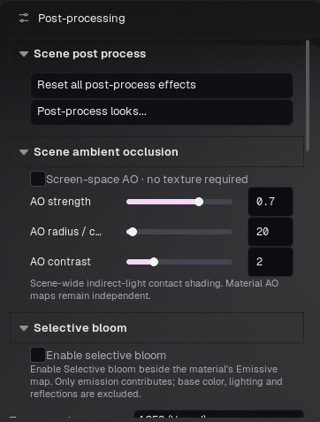

Figura 21. Acesso ao pós-processamento da cena, oclusão ambiente e bloom seletivo.

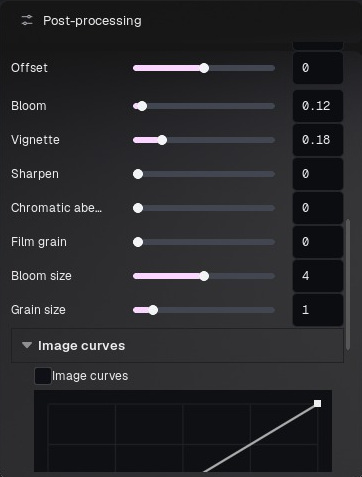

Figura 22. Controles adicionais e curvas de imagem no inspector com rolagem.

Exposição/EV controla brilho. Temperatura e tint corrigem ou estilizam a cor. Saturação, contraste, gamma, ganho e offset mudam a resposta tonal. Curvas de imagem ajustam canais/tons; curvas neutras são uma boa base de comparação. Desative color grading para diagnosticar se uma mudança vem da correção de cor ou do material.

Bloom cria halo em valores brilhantes. Bloom seletivo restringe um brilho adicional aos materiais emissivos marcados; escolha se deseja combinar com bloom da cena. Vinheta escurece o perímetro. Sharpen, clareza e raio da clareza alteram contraste de detalhes. Aberração cromática/scene fringe separa cores nas bordas. Tamanho e intensidade do grão controlam textura de filme.

Efeitos de filme incluem grão adicional, croma e animação do grão quando disponíveis. Intensidade zero desliga o efeito. Grão animado é estável por quadro de saída; não é o mesmo que ruído de amostragem do path tracing. Limpar efeitos extras antigos remove efeitos guardados por cenas antigas para que os controles visíveis correspondam ao look.

Color lookup carrega LUT .cube com intensidade ajustável. A transformação de exibição, incluindo opções OCIO/tone mapping disponíveis, afeta viewport e imagens de exibição. Beauty linear EXR e passes de dados destinam-se a composição com gerenciamento de cor, não comparação direta em visualizador sem transform. Aplique a transformação de exibição adequada ao visualizá-los.

CMAA2 pode funcionar sozinho ou depois do AA da GPU; combinado preserva esse AA. Ele trata bordas espaciais, não ruído de iluminação. Ferramentas de calibração/ROI ajudam a comparar resposta de luz e textura. O processamento interno NPR é separado do pós da cena/câmera; trocar estilo não exige substituir o grading da cena.

### Estabelecer uma base neutra

1. Selecione Post Process e confira se o painel edita o look da cena ou uma substituição da câmera.

2. Escolha o tone mapper antes da correção: ACES, Linear / sRGB display ou AgX. Mudá-lo depois altera altas luzes e saturação.

3. Ajuste a exposição para preservar detalhes nas superfícies claras. Reduza bloom temporariamente se ele atrapalhar essa avaliação.

4. Ajuste temperatura e tint para balanço de branco, depois saturação e contraste. Faça alterações pequenas comparando superfícies neutras e saturadas.

5. Acrescente bloom, vinheta, granulação e nitidez após equilibrar a imagem base.

6. Salve o look como preset para reutilizá-lo. Confirme que ele foi aplicado à câmera desejada.

### Controles de correção

| Controle | Efeito | Uso inadequado comum |
| --- | --- | --- |
| Exposição | Brilho geral em EV | Tentar corrigir uma textura atribuída incorretamente |
| Highlights / midtones / shadows | Brilho por região tonal | Escurecer sombras até perder seus detalhes |
| Temperature / tint | Balanço de branco e eixo verde-magenta | Deixar uma dominante forte ao avaliar cores base |
| Saturation | Intensidade das cores | Aumentar para compensar altas luzes estouradas |
| Contrast / gamma | Separação tonal e resposta dos meios-tons | Deixar pretos densos demais |
| Gain / offset | Ajuste multiplicativo e aditivo de cor | Levantar todos os pretos para um cinza lavado |
| Bloom e tamanho | Brilho espalhado em contribuições intensas | Esconder a forma emissiva com espalhamento excessivo |
| Vignette | Escurecimento nas bordas do quadro | Confundir o efeito com sombreamento do material |
| Sharpen / clarity | Contraste local de borda/detalhe | Amplificar ruído, costuras e halos |
| Film grain / tamanho / chroma | Textura intencional na imagem | Confundir o grão adicionado com ruído do render |
| Chromatic aberration | Separação de canais nas bordas | Criar franjas coloridas fortes em renders técnicos |

### Editar uma curva

Ative image curves, escolha RGB para o tom geral ou R/G/B para ajustar uma cor e clique para adicionar um ponto. Arraste suavemente para moldar a curva. Um S discreto aumenta contraste; levantar a extremidade inferior eleva o preto. Dê duplo clique em um ponto ou use a exclusão/arraste para fora disponível para removê-lo. Escape cancela a edição ativa. Há um limite de pontos: prefira uma curva simples a muitos pontos quase coincidentes.

### Oclusão ambiente e bloom seletivo

O AO da cena acrescenta sombra de contato/detalhe, com intensidade, raio e contraste. O raio depende da escala; um raio exagerado pode escurecer grandes regiões. Ele é independente da textura AO do material. Compare com AO desligado para identificar escurecimento excessivo.

Selective bloom exige a opção da cena e a seleção apropriada no material emissivo. Sua finalidade é dar glow à emissão escolhida, sem tratar qualquer reflexo intenso ou superfície clara como emissor. Ajuste primeiro a emissão do material e depois o bloom.

### NPR e cor exportada

O NPR pode adicionar um passe interno de estilo enquanto o pós-processamento da cena/câmera continua ativo. Para investigar uma dominante indesejada, confira tanto o estilo quanto o look ativo. Unlit remove a iluminação da resposta do material; não ignora toda a correção de exibição. PNG e vídeo são imagens de exibição. EXR linear é destinado à composição e precisa de uma transformação de visualização adequada; por isso, um visualizador de EXR bruto pode diferir da viewport.

## 16 · Renderizadores da viewport e desempenho

Realtime usa o caminho de iluminação interativo e ajuda na montagem. Progressive path tracing mantém a prévia por raios durante a navegação e refina ao parar. Hybrid navega em realtime e apresenta o resultado path traced após uma pausa. NPR aplica superfícies estilizadas e/ou pós interno do estilo. Escolha em Qualidade da viewport ou no menu de câmera da viewport.

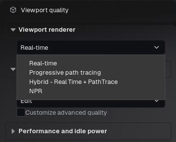

Figura 23. Escolhas de renderizador da viewport. A qualidade offline é configurada em outro painel.

Progressive e Hybrid dependem de ray tracing por hardware e shaders incluídos. Se indisponíveis, confira GPU/driver e uma cena pequena primeiro. Uma cena renderizar offline não significa que caiba nos limites de memória/inicialização interativos. Malhas densas, texturas grandes e múltiplas prévias contribuem para o consumo.

A reconstrução progressiva oferece Auto/prévia neural ou resolução nativa/prévia neural. Auto pode mostrar DLSS em hardware compatível. Isso não significa implementação de NVIDIA Ray Reconstruction. Durante interação a prévia prioriza fluidez; parada, refina detalhes. Editar materiais invalida a acumulação afetada; aguarde estabilizar para comparar diferenças finas.

Presets de qualidade incluem Reference, Presentation, Studio e Edit. Qualidade de luz/reflexos, método de sombra, geometria e profundidade de campo são controles distintos. Desempenho/consumo em repouso regula trabalho em segundo plano ou parado. Reduza tamanho/frequência das câmeras adicionais se suas prévias consumirem recursos.

Qualidade da viewport e qualidade offline são separadas. Aumentar amostras offline não pesa na navegação antes do render, e captura rápida não substitui amostragem offline. Escolha deliberadamente o backend de saída. Para preservar NPR no render final, use a saída deferred compatível com NPR; path tracing é outro renderizador e não deve ser presumido equivalente para efeitos de tela.

### Escolher o renderizador para a tarefa

| Modo da viewport | Uso principal | Comportamento durante a edição |
| --- | --- | --- |
| Real-time | Importação, organização, animação e ajustes rápidos | Resposta contínua; transparência e luz indireta podem diferir do path trace |
| Progressive Path Trace | Avaliar materiais físicos e iluminação | Acumula amostras parado; mudanças de câmera/material reiniciam a convergência |
| Hybrid | Navegação rápida seguida de prévia convergida | Resposta realtime durante movimento, depois path trace ao estabilizar |
| NPR | Apresentação estilizada e texturas hand-painted | Controles dependem do estilo; use uma saída final compatível |

### Equilibrar navegação e convergência

Selecione Viewport quality, escolha o modo e ajuste seus controles. No Progressive, aumente a meta de amostras da prévia somente quando o resultado parado precisar. Uma meta maior não deixa a vista em movimento limpa instantaneamente. Controles neurais/de redução de ruído modificam a reconstrução da prévia; observe bordas e textura fina após mover a câmera. Hybrid é útil quando a navegação imediata importa mais que a resposta final do material em cada movimento do mouse.

As opções de reconstrução dependem dos recursos disponíveis. A interface pode mostrar Auto, reconstrução nativa ou opções relacionadas a DLSS quando compatíveis. Escolher um preset superior não habilita um recurso indisponível. Não presuma que o ajuste da prévia equivale ao denoise offline ou que toda placa NVIDIA oferece todos os recursos de reconstrução.

Qualidade realtime, porcentagem interna de resolução, opções TSR/DLSS/FSR disponíveis, limite de FPS e redução em repouso afetam o trabalho interativo. Comece pelo tamanho necessário para editar. Avalie textura fina em escala conhecida antes de julgar uma prévia ampliada. A qualidade de Render offline é independente; aumentar apenas a viewport não configura a qualidade final.

### Se o Progressive não inicializar

Confira dispositivo gráfico ativo, driver e disponibilidade de ray tracing por hardware. Teste um objeto simples em uma cena nova e depois o projeto afetado. Se falhar apenas no projeto pesado, anote contagem de geometria, estrutura importada, tamanhos de textura e uso de VRAM. O Movie Render Queue renderizar em path trace não comprova, sozinho, que o caminho interativo inicializou. Registre modo, cena e logs ao relatar. Evite iniciar importações pesadas repetidamente enquanto uma ainda carrega.

## 17 · Estilos NPR e texturas hand-painted

Escolha Qualidade da viewport > NPR e selecione o estilo. Os nomes descrevem looks, sem nomes de artistas. Projetos existentes mantêm a identidade interna do estilo após renomear. Effect enabled alterna estilos de superfície; NPR amount regula pós compatíveis. Controles variam por estilo: iluminação não deve alterar uma textura unlit.

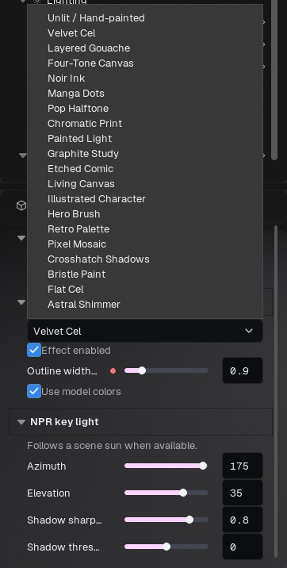

Figura 24. Seletor NPR e controles específicos. O menu usa os nomes neutros da Beta 82.

### Catálogo de estilos

Estes são os nomes exibidos na Beta 82. Um estilo é uma construção inicial com controles próprios, não uma promessa de que qualquer modelo importado terá a mesma aparência de uma ilustração. Texturas autorais, normais, iluminação e enquadramento continuam importantes.

| Estilo | Finalidade visual | Primeiros controles a conferir |
| --- | --- | --- |
| Unlit / Hand-painted | Exibir cores pintadas sem iluminação da cena | Base color, vertex color, opacidade e pós-processamento |
| Velvet Cel | Cel shading limpo com faixas de sombra legíveis | Direção da luz, limiar e nitidez da sombra |
| Layered Gouache | Sombreamento com camadas pintadas | Densidade, força, paralaxe e reflexos pintados |
| Four-Tone Canvas | Conjunto limitado de regiões tonais pintadas | Cores do modelo, luz e contorno |
| Noir Ink | Tratamento forte de sombra em tinta | Contraste, escala de projeção e fundo |
| Manga Dots | Impressão monocromática com pontos tonais | Tamanho do ponto na resolução de saída |
| Pop Halftone | Retícula gráfica sobre regiões claras/médias/escuras | Repetição, suavidade e mapas por material |
| Chromatic Print | Impressão colorida e atmosfera | Mistura, escala, pontos e realces brancos |
| Painted Light | Projeção pintada integrada à luz | Tamanho da projeção e mistura da pintura |
| Graphite Study | Marcas semelhantes a lápis/grafite | Projeção, contraste e contorno |
| Etched Comic | Gravura/hachura com tratamento de impressão | Exposição, saturação, contraste, brilho e pontos |
| Living Canvas | Camadas de pintura misturadas | Refração da pincelada, escala, mistura e cena original |
| Illustrated Character | Ilustração voltada a personagens | Iluminação, cores e contornos |
| Hero Brush | Sombreamento com pinceladas fortes | Densidade e intensidade |
| Retro Palette | Paleta reduzida | Divisões da grade, número de cores e suavização |
| Pixel Mosaic | Blocos de pixels e quantização tonal | Tamanho do pixel, níveis de luminância e suavização |
| Crosshatch Shadows | Textura de linhas nas sombras | Contraste e tamanho da projeção |
| Bristle Paint | Textura direcional de pincel | Densidade, força, paralaxe e reflexos |
| Flat Cel | Sombreamento gráfico simples | Direção da luz, cor e contorno |
| Astral Shimmer | Efeito estilizado animado de superfície | Shimmer, dissolve e máscaras/cores por material |

### Fluxo para um asset hand-painted de games

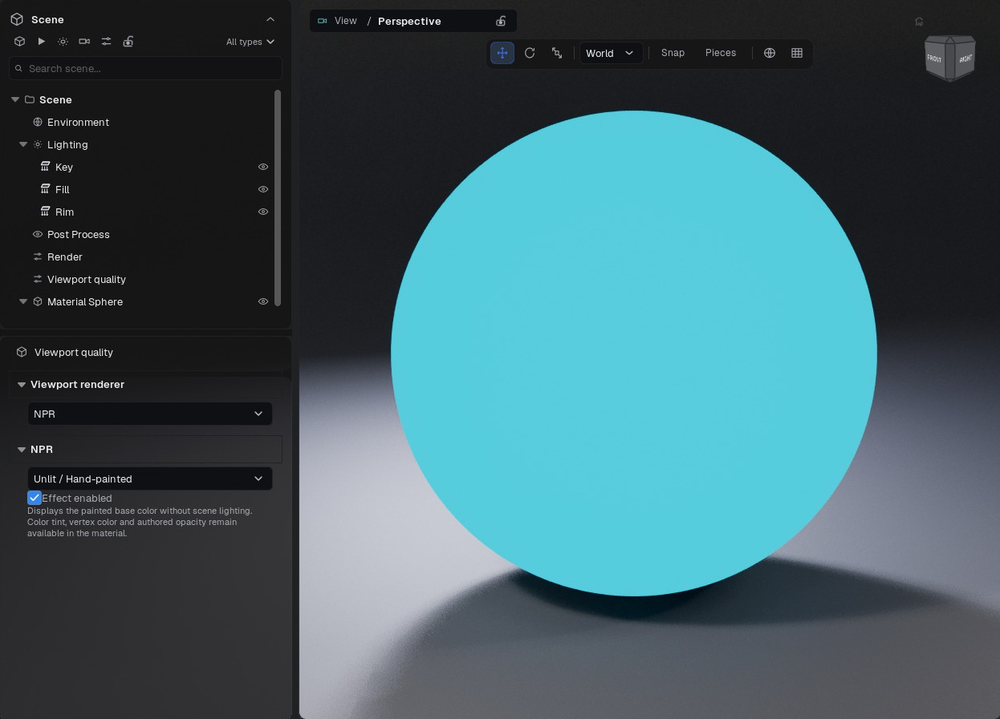

Figura 25. Demonstração Unlit com cor ciano constante: a esfera perde os gradientes de iluminação, enquanto o piso separado mantém sua aparência na cena.

1. Importe o modelo e atribua a textura pintada a Base color. Comece com tint branco.

2. Desative vertex color, exceto quando ele fizer parte intencional do asset. Essa multiplicação pode esconder a textura desejada.

3. Escolha NPR > Unlit / Hand-painted. Mantenha Opaque se o asset não precisar de recortes ou transparência.

4. Use um look neutro na cena/câmera. Compare uma região de cor reconhecível na imagem original e na viewport; tone mapper e correção ainda podem alterar sua exibição.

5. Se a textura já tem luzes e sombras pintadas, não adicione iluminação física para recriar o mesmo sombreamento. Observe na distância de visualização pretendida para o jogo.

6. Exporte por um fluxo compatível de Deferred/Movie Render Queue ou viewport. Um render físico em path trace representa outra aparência.

### Calibrar personagem e fundo separadamente

Comece com o modelo no tamanho desejado no quadro. Ajuste a luz do estilo antes das marcas. Use contorno em pixels com moderação; uma linha útil no personagem inteiro pode ficar grossa demais em close. Ajuste tamanho/repetição dos pontos e projeção da hachura observando rosto e áreas planas. Não existe tamanho universal de retícula para todas as resoluções e distâncias.

Quando houver tratamento de fundo/chão, decida se ele deve afetar essas regiões. Um personagem monocromático não exige fundo totalmente preto. Compare a silhueta com o fundo e examine regiões claras e escuras da textura. Se o fundo ficar preto sólido, confira configurações do estilo, brilho e contraste do pós antes de alterar a opacidade do modelo.

### Superfície e pós-processamento interno

Alguns estilos combinam shader de superfície e passe interno. Os controles aparecem conforme a construção. Ativar o efeito de superfície e ajustar a intensidade do passe interno são operações diferentes. NPR não exige sobrescrever o Post Process existente da cena. Ao investigar um resultado, compare o estilo com look neutro e depois reintroduza a correção desejada.

A luz direcional NPR pode acompanhar o sol procedural; caso contrário, use azimute/elevação do estilo. Padrões em projeção/mundo dependem da escala do modelo; marcas em pixels dependem do enquadramento e resolução. Confira uma imagem parada e um movimento curto para distinguir costura da textura de instabilidade temporal.

### Exportar o estilo que está vendo

Faça uma saída pequena com a mesma câmera, proporção e relação de resolução do trabalho final. Para NPR, use Deferred final ou captura de viewport conforme a finalidade. Selecionar Path preview/final/reference físico muda o modo para fora do NPR. Confira câmera de render e seu pós local se a saída diferir da vista. Compare regiões pretas opacas sobre fundo contrastante e examine o canal alpha quando solicitar RGBA.

## 18 · Timeline e animação

Abra Timeline por Janela ou pelo ícone do cabeçalho. Defina intervalo e FPS antes de criar um plano com duração específica. FPS relaciona quadros e tempo. Arraste o playhead para conferir um quadro; playback é prévia, não exportação offline de todos os quadros.

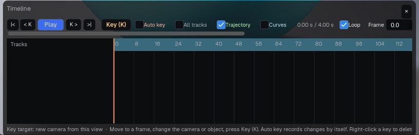

Figura 26. Transporte, opções de chave e trilhas da timeline. A demonstração ainda não possui chaves autorais.

Selecione objeto, grupo, câmera ou controle de material animável. Adicione chaves dos valores desejados no quadro atual. Mova o playhead, altere o valor e crie a próxima chave. Use a faixa do grupo para animar um personagem com várias peças sem selecionar cada ID de material separadamente.

Interpolação define a transição entre chaves. Faixa inteira aplica a escolha à faixa completa. Use transições constantes/degrau para mudanças abruptas e suaves para movimento contínuo, conforme as opções. Confira os quadros intermediários: extremos corretos não garantem trajetória boa. A visualização do caminho ajuda a inspecionar o movimento.

Faixas de câmera animam composição e controles de lente/foco compatíveis. O override de pós da câmera é editado olhando por ela. Faixas de material usam valores publicados ou nodes Float compatíveis. Switches estáticos nativos e operações de grafo não suportadas não viram canais de timeline.

Animação importada depende do importador e dos dados. Agrupar um personagem estático não cria um rig esquelético só porque o grupo pode ser transformado. Use o programa de origem para deformações não suportadas e importe uma representação compatível.

Na saída, escolha Timeline no fluxo de render. Captura direta grava o intervalo na taxa escolhida preservando a duração. Render offline amostra quadros pelo pipeline de render. Turntable é outra tarefa, baseada no objeto/grupo e pivô selecionados; não exige criar uma chave em cada peça.

### Animar um personagem importado completo

1. Em Scene, selecione o grupo pai que contém as peças. Mantenha os filhos dentro dele.

2. Abra Timeline em Window ou pelo botão do cabeçalho. Defina FPS e intervalo.

3. Vá ao primeiro frame. Ajuste a transformação inicial do grupo e pressione Key (K) com foco apropriado na viewport/timeline.

4. Vá a um frame posterior, altere posição/rotação/escala do grupo e insira outra chave.

5. Arraste o tempo entre as chaves. O grupo inteiro deve se mover; se apenas uma malha se mover, confira o alvo animado.

6. Reproduza o intervalo e observe o movimento. Salve o projeto antes de renderizar uma tarefa Timeline.

Um objeto/grupo selecionado é o alvo das chaves. Sem alvo de objeto, animar a câmera é um fluxo separado. Selecione conscientemente antes de inserir chaves. Auto Key ajuda após estabelecer a trilha, mas pode gravar ajustes indesejados se permanecer ativo durante a edição geral.

### Controles e edição da timeline

| Controle | Finalidade | Conferência |
| --- | --- | --- |
| Primeiro/último e chave anterior/seguinte | Navegar pelo intervalo ou pelas chaves | Confira trilha/seleção ativa |
| Play / pause | Prévia da animação | A cena pode limitar o FPS de prévia |
| Frame / FPS / intervalo | Posição temporal e taxa de amostragem | Defina FPS antes de interpretar duração em segundos |
| Key / Auto Key | Gravar valores no frame atual | Confira grupo, objeto ou câmera selecionado |
| All tracks | Exibir trilhas além da seleção | Desative ao editar hierarquias extensas |
| Loop | Repetir a reprodução | Não faz as extremidades coincidirem automaticamente |
| Curves | Inspecionar interpolação | Movimentos suaves podem ultrapassar valores entre chaves |
| Trajectory | Desenhar o caminho | Pontos-chave se distinguem dos frames intermediários |

Clique com o botão direito em uma chave para ir ao frame, excluir ou alterar interpolação. Shift + clique adiciona chaves à seleção. Arraste para mudar o tempo; use o zoom, incluindo Ctrl + roda, quando estiverem próximas. Reproduza após alterar interpolação, pois o caminho entre os mesmos extremos pode mudar. Um ponto-chave da trajetória pode ser arrastado para editar o caminho espacial; confira transformação e tempo resultantes.

### Turntable e animação autoral

Uma tarefa Turntable gira automaticamente o escopo escolhido em torno de um pivô, sem exigir chave para cada ângulo. A saída Timeline avalia o intervalo animado. Para girar o modelo no lugar, escolha Turntable e defina grupo/escopo, pivô, duração e FPS. Para movimento de câmera, transformação de personagem, clip importado ou efeito temporizado, use o fluxo de timeline/animação apropriado e confira o intervalo real antes de exportar.

A gravação ao vivo da viewport tem escolhas próprias: Manual navigation, Turntable e Timeline. Gravar em Manual não inicia um turntable automaticamente. Essa diferença explica uma gravação estática mesmo quando outra tarefa offline havia sido configurada.

## 19 · Fluxos de render e formatos de arquivo

Abra Render e escolha o fluxo antes de pressionar o botão do cabeçalho. Saída direta usa tamanho em pixels e qualidade da vista ativa. Offline/Movie Render Queue usa resolução, câmera e amostragem configuradas. Câmera, tarefa e backend são escolhas separadas.

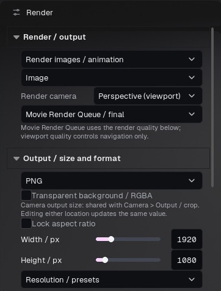

Figura 27. Tarefa offline Image, câmera, motor Movie Render Queue, formato, alpha e tamanho.

### Viewport direta

Escolha imagem ou gravação. Gravação ao vivo captura a navegação com os controles normais da câmera; Parar e salvar conclui. Descartar remove o temporário dessa captura, não arquivos existentes. Turntable grava uma volta dos objetos/grupo escolhidos em torno do pivô. Timeline grava o intervalo atual. Contornos de seleção e gizmos ficam ocultos na captura.

### Saída offline

Escolha câmera, largura/altura ou preset, formato e destino. Imagem estática grava uma imagem. Timeline grava o intervalo animado. Turntable executa a rotação. Use Deferred/Lumen para apresentação realtime/NPR compatível ou Path Tracing para beauty calculada fisicamente. Confira warmup de efeitos temporais antes de aumentar amostras.

PNG é imagem sem perdas e pode ter alpha quando habilitado. JPEG é compacto, com perdas e sem alpha. EXR contém dados lineares HDR/composição e exige transformação de visualização adequada. MP4 é prático para reprodução comum e não oferece transparência. GIF é leve, mas limitado em paleta, podendo apresentar banding/dither. A opção MOV com alpha se destina a composição compatível; confira o codec no programa de destino.

Use sequência de imagens quando precisar de quadros individuais ou composição robusta. Trocar a extensão não converte formato. Resolução alta, múltiplos passes e sequências longas exigem mais disco. Use uma pasta vazia e nomeada para cada versão para não misturar quadros de renders diferentes.

Depois, confira os arquivos reais: tamanho, dimensões, quantidade de quadros, primeiro/último quadro, alpha e câmera. Veja saída transparente sobre xadrez. A barra terminar não comprova que tarefa e enquadramento escolhidos eram os pretendidos.

### Renderizar uma imagem passo a passo

1. Selecione Render em Scene. Escolha Render images / animation e a tarefa Image.

2. Escolha explicitamente a câmera. Perspective (viewport) usa a vista livre; uma câmera nomeada usa seu enquadramento salvo.

3. Escolha Movie Render Queue / final para qualidade offline controlada ou o motor rápido de viewport disponível para prévia.

4. Escolha PNG para imagem pronta para exibição ou EXR para composição linear. Defina largura, altura e trava de proporção.

5. Ative Transparent background / RGBA apenas quando necessário. Isso altera o fundo; não corrige um material transparente incorretamente.

6. Escolha a qualidade offline e confira os ajustes aplicados. Mantenha um preset Deferred para saída NPR.

7. Escolha o destino, inicie e aguarde a conclusão. Examine o arquivo salvo, não apenas a viewport.

### Escolher a tarefa antes do formato

| Tarefa | O que é avaliado | Configuração importante |
| --- | --- | --- |
| Image | Um frame da câmera escolhida | Câmera, tamanho, formato e qualidade |
| Camera queue | Câmeras habilitadas na fila | Seleção, resolução e look de cada câmera |
| Turntable | Rotação automática do escopo | Pivô, escopo, duração e FPS |
| Timeline | Estado animado da cena | Intervalo, FPS, trilhas e câmera |
| Capture live viewport | Exibição interativa ao longo do tempo | Tamanho nativo, modo e capacidade de manter FPS |

### Formatos e alpha

| Formato | Entrega apropriada | Observações |
| --- | --- | --- |
| PNG | Imagens e sequências | Cor de exibição; suporta alpha quando solicitado |
| EXR | Composição HDR linear e passes compatíveis | Use visualização com gestão de cor; passes dependem do motor |
| MP4 | Prévia compacta de animação/vídeo | Formato comum sem alpha transparente |
| GIF | Prévia curta e leve | Paleta limitada; não serve para avaliar fidelidade final de cor |
| MOV RGBA | Animação com alpha | Disponível no fluxo compatível; arquivos maiores são normais |
| JPEG na fila de câmeras | Imagens opacas compactas | Sem alpha; use PNG para transparência |

A saída transparente preserva a iluminação útil do ambiente enquanto omite fundo/chão/atmosfera visíveis conforme o fluxo. Teste o alpha exportado sobre quadriculado ou camada colorida. Um fundo RGB preto no visualizador não comprova ausência de transparência: examine o canal alpha.

### Gravar a viewport ao vivo

Escolha Capture live viewport, câmera e modo. Manual navigation grava a interação; Turntable conduz a rotação; Timeline avança a animação. Defina FPS e inicie Record MP4. Stop and save conclui. Cancel descarta a gravação temporária atual, não um arquivo anterior concluído. Capture PNG now salva uma imagem da vista atual.

A gravação usa os pixels nativos e a qualidade interativa da viewport. Redimensione a vista antes de gravar se esse for o tamanho pretendido. Resolução e amostras offline não transformam gravação ao vivo em render offline. Se a cena não sustentar a taxa pedida, observe o status de captura/frames e prefira animação offline quando a regularidade temporal for essencial.

### Exemplo: turntable de produto de cinco segundos

Selecione o grupo do produto, escolha Turntable, defina escopo de seleção/grupo e pivô central. Use cinco segundos e 30 FPS para um intervalo nominal de 150 amostras de frame. Mantenha a câmera fixa, confira o contato com o piso e deixe as luzes fora do escopo giratório quando precisarem permanecer paradas. Exporte uma prévia curta e econômica antes da resolução final. Confira a transição entre início/fim se precisar de loop contínuo.

## 20 · Qualidade offline, passes e fila de câmeras

Presets de qualidade oferecem pontos de partida Studio, Final, Reference e Path Tracing. Amostras espaciais refinam a amostragem; warmup estabiliza histórico temporal e efeitos antes de gravar. Aumentar ambos custa tempo e pode aumentar memória. Não eleve amostras para corrigir textura ou modo de opacidade atribuídos incorretamente.

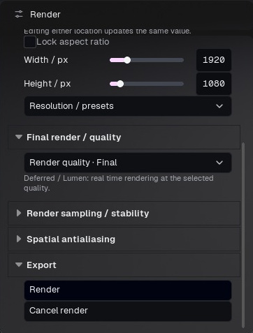

Figura 28. Qualidade offline e exportação abaixo das dimensões. Esses ajustes são independentes da qualidade de navegação.

Amostras por pixel do path tracing controlam convergência; bounces controlam a quantidade de interações dos raios. Poucos bounces podem mudar vidro e iluminação indireta. Intensidade máxima de firefly limita valores extremos, mas exagerar remove brilhos legítimos. O denoiser reduz ruído e pode suavizar detalhes. Compare um recorte com amostras suficientes antes de uma sequência longa.

Beauty EXR é linear. Passes deferred incluem BaseColor/DiffuseAlbedo, WorldNormal, Roughness, Metallic, Specular e Depth, além dos canais exibidos quando disponíveis. Nem todos são imagens beauty: normais são direções, depth é distância e roughness é dado escalar. Evite aplicar transformação de beauty a um passe usado para cálculo.

AOVs de componentes de luz são renders adicionais do mesmo quadro; passes de dados vêm do G-buffer. Podem elevar bastante o tempo. EXR multicamada reúne canais num contêiner compatível; arquivos separados ajudam quando o compositor não aceita esse layout. Somente beauty/preservar DOF evita passes desnecessários. Path tracing exporta beauty linear e oculta passes exclusivos do deferred.

Fila de câmeras renderiza câmeras nomeadas uma por vez em PNG, EXR ou JPEG. Use esse comando em vez de esperar que as prévias de múltiplas vistas sejam exportadas. Cancelar fila encerra e restaura a composição anterior. Confira nomes e quantidade de câmeras. Exportar vistas ortográficas gera as direções selecionadas; revise enquadramento e escala.

Para NPR, compare uma imagem e uma sequência curta na resolução desejada. Tamanho de retícula/contorno em tela pode mudar de percepção conforme a resolução. Para hand-painted, mantenha Unlit ativo e evite acrescentar sombreamento por outro renderizador.

### O que os presets offline configuram

| Preset | Amostragem principal | Ajuste adicional | Finalidade |
| --- | --- | --- | --- |
| Studio | 4 amostras espaciais | 16 frames de aquecimento | Prova Deferred rápida |
| Final | 16 amostras espaciais | 32 frames de aquecimento | Apresentação Deferred |
| Reference | 32 amostras espaciais | 64 frames de aquecimento | Referência Deferred de maior custo |
| Path preview | 64 amostras por pixel | 4 rebatimentos | Prévia física |
| Path final | 256 amostras por pixel | 8 rebatimentos | Final físico equilibrado |
| Path reference | 1024 amostras por pixel | 12 rebatimentos | Referência física mais exigente |

São configurações, não tempos garantidos. Resolução, geometria, memória de textura, vidro, cabelo, emissão e hardware afetam o custo. Presets Path selecionam path tracing físico e desligam NPR. Escolha Deferred para preservar um look NPR.

### Aumentar qualidade para o problema certo

| Sintoma | Primeiro ajuste a conferir | Motivo |
| --- | --- | --- |
| Serrilhado ou detalhe Deferred instável | Amostras espaciais e resolução | Maior cobertura espacial pode melhorar bordas subpixel |
| Primeiro frame/efeito temporal não estabilizado | Frames de aquecimento | Dá tempo para estabilizar estados temporais |
| Ruído aleatório no transporte físico | Amostras Path e denoise | Mais amostras reduzem variância; denoise pode suavizar detalhe |
| Falta de luz após reflexos/refrações | Limite de rebatimentos | Amostras extras não substituem um caminho interrompido cedo |
| Pontos isolados muito brilhantes no path trace | Controle de firefly/intensidade máxima | Limitar reduz picos, mas também pode suprimir energia intensa |
| Detalhe fino excessivamente suave | Textura, foco, reconstrução e denoise | Mais amostras não corrigem entrada borrada ou câmera desfocada |

Os controles permitem ir além dos presets: até 64 amostras espaciais, 4096 amostras Path, 32 rebatimentos e 240 frames de aquecimento nesta versão. Use uma região/saída curta representativa e altere um parâmetro por vez. Compare a 100% dos pixels. Dobrar largura e altura produz quatro vezes mais pixels antes dos demais custos.

### Passes EXR e suas finalidades

Escolha EXR no caminho Deferred final para acessar os passes de dados compatíveis. Linear beauty é a imagem renderizada. Base color/albedo descrevem entradas de cor da superfície, não o resultado iluminado. Roughness, metallic/specular e material AO são dados do material; world normal codifica direção; depth é distância em centímetros; velocity descreve movimento. Não foram feitos para parecer beauty em um visualizador RGB comum.

AOVs adicionais de iluminação podem exigir renders adicionais no mesmo frame. Multilayer EXR reúne camadas compatíveis; caso contrário, confira os arquivos acompanhantes. Passes de dados desativam efeitos como DOF e motion blur quando necessário para alinhamento. Um render apenas beauty pode manter esses efeitos. Beauty em path trace não oferece o mesmo conjunto de passes Deferred.

### Conferir a fila de câmeras

Habilite só as câmeras necessárias, confira dimensões e look local de cada uma e confirme foco/enquadramento. Use All ou Only active conscientemente. Dê nomes únicos e descritivos antes da exportação. Renderize uma câmera representativa ao mudar formato ou qualidade e depois execute a fila completa. Uma viewport livre correta não substitui a conferência das câmeras salvas.

## 21 · Preferências, atalhos e personalização

Preferências fica em Janela e no ícone de configurações. Idioma escolhe English, Português (Brasil) ou Español. Rótulos especializados de assets/controles podem permanecer na língua original. Escala, opacidade, cor da interface, contorno, sliders e texto ajustam legibilidade. Restaurar aparência volta aos padrões visuais.

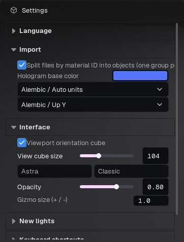

Figura 29. Configurações de importação e interface: visibilidade/tamanho do cubo, tema, opacidade e tamanho do gizmo.

Importação inclui separação de peças e cor do holograma. Alembic inclui unidades e eixo vertical. Tamanho do cubo e do gizmo ajusta auxiliares; + / − pode ajustar o gizmo quando vinculado. Ajustes de novas luzes definem valores iniciais das próximas luzes, não dispensando conferir as existentes.

Atalhos de teclado podem ser editados, limpos e restaurados. Perfis de navegação têm vínculos e comportamentos próprios. Se um atalho falhar, confira foco de entrada e vínculo antes de presumir que o comando não existe. Digitação num campo numérico não é comando de viewport.

Padrões comuns: Ctrl+N Novo; Ctrl+O Abrir; Ctrl+I Importar malha; Ctrl+S Salvar; Ctrl+Shift+S Salvar como; Ctrl+Z Desfazer; Ctrl+Shift+Z Refazer; Ctrl+R Render da tarefa atual. No grafo, Ctrl+G agrupa e Ctrl+Shift+G desagrupa. P seleciona perspectiva pelo comando View. Esc cancela escolha/desenho ativos. Vínculos personalizados podem substituir padrões; o editor de atalhos é a referência da instalação.

Favoritos reúne controles compatíveis pelo botão direito em seus rótulos. Layouts nomeados ajudam em materiais, animação e múltiplos monitores. Separe personalização da interface de presets da cena: um preset de luz/material não necessariamente restaura os painéis.

### Configurar a navegação conforme seu hábito

Escolha Classic, Maya, Blender ou Custom em Navigation profile. Leia a dica do painel/barra de status, sem presumir que um comando vale para todos os perfis. Por exemplo, Maya usa Alt com botões esquerdo/meio/direito para orbitar/pan/dolly. Custom permite escolher botão e modificadores das ações compatíveis.

| Preferência | O que altera | Método de ajuste |
| --- | --- | --- |
| Navigation speed | Resposta geral da navegação | Comece perto do padrão e altere aos poucos |
| Orbit sensitivity | Rotação por movimento do ponteiro | Reduza para detalhes em close |
| Pan sensitivity | Movimento lateral por gesto | Teste com objeto enquadrado na escala de trabalho |
| Dolly sensitivity | Movimento para frente/trás | Reduza se um gesto pequeno atravessar o objeto |
| Wheel sensitivity | Resposta do zoom/dolly na roda | Adapte à roda e à escala de trabalho |
| Inverter órbita horizontal / vertical | Direção da órbita | Teste cada eixo separadamente |
| Tamanho / visibilidade do cubo | Indicador de orientação | Deixe visível sem cobrir o modelo |
| Gizmo size | Tamanho das alças na tela | Aumente para tela de alta resolução, não para escalar o objeto |
| Alinhamento de luzes novas | Orientação inicial ao adicionar luz | Escolha horizontal da câmera, alinhamento completo ou nenhum |

### Personalizar atalho sem perder o controle

Abra Keyboard shortcuts, localize a ação e atribua a combinação. Confira conflito com outra ação ou modificador de navegação. Teste com foco no painel correto. Limpe ou restaure se não servir. Evite associar uma tecla comum de digitação a uma ação destrutiva frequente. A atribuição atual do editor prevalece sobre exemplos deste manual.

### Preferências de importação não são reparos retroativos

Separar por material ID altera a organização das próximas importações. Hologram base color modifica a aparência de carregamento/prévia, não a textura final. Unidade e eixo vertical de Alembic controlam a interpretação de geometria/curvas. Confira escala e orientação logo após importar; alterar uma preferência depois não necessariamente reconstrói o objeto já importado.

### Recuperar uma interface legível

Se os rótulos estiverem apertados, ajuste largura do painel ou escala da interface. Se as cores ficarem difíceis de distinguir, restaure a aparência ou a cor correspondente. Se faltar painel, use mostrar/ocultar em Window e redefina o layout se necessário. Redefinir navegação/layout é diferente de redefinir materiais, iluminação ou conteúdo do projeto. Salve um layout útil quando tudo couber no monitor.

## 22 · Solução de problemas e relato de bugs

### Textura escura ou tingida

Confira Base color versus outro canal, espaço de cor, tint branco, vertex color, exposição, grading local da câmera e LUT. Use Unlit / Hand-painted para remover sombreamento da cena na comparação de textura pintada. Restaure uma categoria por vez para identificar a causa.

### Partes pretas desaparecem

Confira Opaque versus Masked/Translucent, mapa de opacidade e alpha do base color. RGB preto não é automaticamente transparente. Compare PNG RGBA sobre xadrez. Se persistir, forneça a textura original com alpha e os ajustes do material.

### Costuras UV ou relevos invertidos

Confira padding, mip/filtering, UDIM, canais e convenção de normal. Desligue vertex color para comparar só a textura. Informe estilo NPR/renderizador afetado e se a costura também aparece no arquivo renderizado.

### Navegação lenta ou path tracing não inicia

Aguarde importação e teste uma cena pequena conhecida no mesmo renderizador. Reduza tamanho/frequência das prévias extras e confira tamanho de texturas/geometria. Compare Realtime e Progressive; informe GPU, driver, VRAM e tamanho da cena. Não presuma que a GPU de outro usuário se comporte como a RTX 4060 de referência.

### Render diferente da viewport

Confirme câmera, recorte, backend, captura versus offline, pós da cena/câmera e formato. EXR linear difere de PNG de exibição. Warmup e amostras afetam efeitos temporais; inclusão do backdrop e alpha mudam o fundo. Confira arquivos reais, não apenas print da viewport.

### Controles ausentes ou seleção inesperada

Selecione o objeto/slot e renderizador corretos. Filtros podem ocultar entradas do Outliner sem esconder objetos. Câmera travada precisa ser destravada para transformar. Presets especializados expõem seus controles compatíveis. Restaure o layout se um painel estiver fora da tela; isso não exige zerar a cena.

### Relato útil

Informe versão, Windows/GPU/driver, passos exatos a partir de projeto novo ou fornecido, resultado esperado e observado, renderizador/rota de saída e uma imagem ou quadro exportado. Anexe projeto mínimo e textura necessária se tiver permissão. Inclua log relevante recente em Saved/Logs do aplicativo. Remova caminhos pessoais e dados privados sem relação antes de publicar.

Este manual documenta funções, não promete que todo shader, modelo ou codec de terceiros se comporte igualmente em todos os renders. Preserve avisos de terceiros da distribuição. Termos de compra/licença da página do produto definem assentos e uso comercial; o manual não os substitui. Use os links de suporte do download para ajuda específica da build.

### Presets ou viewport ficam uniformemente brancos

Primeiro aguarde o carregamento e confirme que o material foi aplicado ao objeto. Selecionar uma miniatura inspeciona/edita o material; não necessariamente o atribui à malha. Compare um preset claramente colorido na biblioteca com o resultado após arrastá-lo ao objeto. Confira exposição, tint, caminhos das texturas e renderizador ativo.

Abra o BeautyShot.exe fornecido na instalação completa extraída. Mantenha suas pastas de conteúdo juntas. Um executável interno copiado ou uma atualização incompleta não equivale à instalação inteira. Confira a identificação da build ao capturar telas ou comparar máquinas. Se persistir, preserve o log e informe caminho de abertura e preset afetado. Não use uma captura com materiais incompletos como referência da aparência pretendida.

### Sequência prática de diagnóstico

| Problema | Primeira comparação | Informação que ajuda no relato |
| --- | --- | --- |
| Modelo inteiro branco | Preset colorido conhecido na mesma malha | Atribuição, exposição, renderizador e instalação |
| Apenas um mapa ausente | Abrir textura original e conferir slot | Caminho, canal e formato |
| RGB preto transparente | Material Opaque versus opacidade explícita | Alpha da textura, modo e alpha exportado |
| Costura NPR, Realtime limpo | Mesma câmera/material e pós neutro | Estilo, normal map, limite UV e frame de saída |
| Prévia difere do final | Mesma câmera nomeada e motor | Pós local, tone mapping, formato e alpha |
| Turntable não gira | Tarefa offline versus modo de captura | Escopo, pivô, modo, duração e intervalo |
| Gizmo não afeta a vista certa | Ativar a viewport e conferir travas | Layout, vista ativa, objeto e câmera |
| Painéis somem após trocar monitor | Redefinir layout | Organização anterior e escala da interface |

### Compartilhar um caso pequeno e reproduzível

Salve uma cópia, retire objetos alheios e mantenha o menor conjunto de materiais/texturas que ainda demonstra o problema. Escreva passos numerados e o resultado esperado. Inclua uma captura da janela inteira para mostrar modo/configurações e um recorte aproximado do defeito. Se envolver exportação, anexe o arquivo exportado além do print. Um caso mínimo preciso ajuda mais que alterar muitas configurações repetidamente no projeto original.